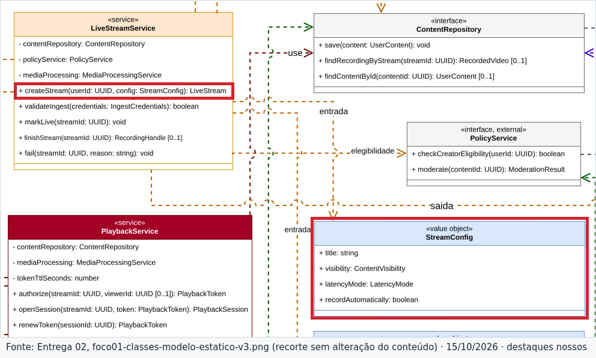
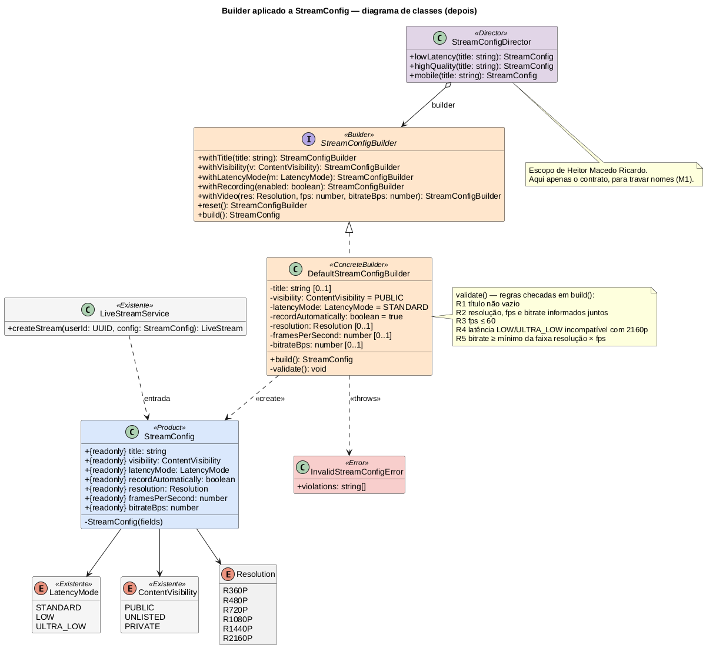

# 1.1.1.1. Modelagem — Builder para `StreamConfig`

**Autor:** Lucas Andrade Zanetti · **Data:** 15/10/2026 · **Escopo:** diagrama de classes do Builder (antes/depois), regras de validação e evidências. Sequência e Director são de Heitor Macedo Ricardo; código e testes ficam no [repositório de código](https://github.com/Bappoz/g6-streaming-entrega03-subgrupo01-codigo).

Decisão e raciocínio completos: [ADR-001](/Base/Relatórios/1.1.1.SubEquipe_01/ADR/ADR-001-builder-stream-config.md).

## Fontes do planejamento

Planejamento da SubEquipe_01 v1.0 (08/10/2026): Builder principal para `StreamConfig` (seção 3); entregável de Lucas — "Diagrama de classes do Builder (antes/depois)", `StreamConfig` + ConcreteBuilder com validações, ADR-001 (seção 4).

## Antes — recorte da Entrega 02

`LiveStreamService.createStream(userId, config: StreamConfig)` recebe um `«value object»` com quatro atributos (`title`, `visibility`, `latencyMode`, `recordAutomatically`).

*Figura 1 — Recorte do diagrama de classes v3 (Entrega 02). Autoria original: SubEquipe_01, Entrega 02.*

## Depois — Builder aplicado

*Figura 2 — Diagrama de classes do Builder, v1. Autoria: Lucas Andrade Zanetti, 2026. Fonte editável: <a href="Base/Relatórios/1.1.1.SubEquipe_01/assets/builder/builder-classes-depois-v1.puml" target="_blank" rel="noopener">builder-classes-depois-v1.puml</a> (PlantUML) · <a href="Base/Relatórios/1.1.1.SubEquipe_01/assets/builder/builder-classes-depois-v1.svg" target="_blank" rel="noopener">SVG</a>.*

### Participantes GoF → classes

| Participante | Classe | Responsável |
| --- | --- | --- |
| Product | `StreamConfig` | Lucas |
| Builder | `StreamConfigBuilder` | Lucas |
| ConcreteBuilder | `DefaultStreamConfigBuilder` | Lucas |
| Director | `StreamConfigDirector` | Heitor (sequência e presets implementados) |
| Client | `LiveStreamService` / `demo.ts` | Heitor (`demo.ts`) |

### O que muda no modelo da Entrega 02

| Item | v3 (Entrega 02) | Proposto | Situação |
| --- | --- | --- | --- |
| `StreamConfig` | 4 atributos | + `video: VideoSettings | undefined`; resolução, fps e bitrate são opcionais em conjunto | **Revisão do v3 — precisa de aceite do grupo** |
| `Resolution` | `QualityVariant.resolution: string` | enumeração `R360P`…`R2160P` | Apenas em `StreamConfig`; `QualityVariant` não alterado |
| `recordAutomatically` | sem padrão | padrão `true` | Decisão D3 do ADR |

### Regras de validação (`build()`)

| Id | Regra | Evidência |
| --- | --- | --- |
| R1 | título não vazio | decisão de projeto |
| R2 | `video` ausente ou `VideoSettings` com resolução, fps e bitrate juntos (garantia estrutural) | E10 |
| R3 | fps ≤ 60 | E11 |
| R4 | latência LOW/ULTRA_LOW incompatível com 2160p | E08, E09 |
| R5 | bitrate ≥ mínimo da faixa resolução × fps | E10, E12 |

## Evidências

Capturas feitas em 15/10/2026; cada uma traz fonte e data no rodapé.

| Id | Arquivo | O que comprova |
| --- | --- | --- |
| E01 | `b-e01-planejamento-premissa-streamconfig.png` | Premissa do planejamento sobre `StreamConfig` e `QualityVariant` |
| E02 | `b-e02-v3-streamconfig-quatro-atributos.png` | `StreamConfig` v3 tem 4 atributos |
| E03 | `b-e03-v3-enumeracoes-e-qualityvariant.png` | Enumerações existentes; `QualityVariant` guarda resolução, bitrate e fps |
| E04 | `b-e04-e02-livestreamservice-recebe-streamconfig.png` | `LiveStreamService` recebe `StreamConfig` |
| E05 | `b-e05-e02-decisoes-de01-de03-de08.png` | Decisões DE01, DE03 e DE08 da Entrega 02 |
| E06 | `b-e06-e02-encoder-parametros-do-cliente.png` | Parâmetros de vídeo são do encoder do cliente |
| E07 | `b-e07-e02-sequencia-createstream.png` | Onde `StreamConfig` entra na sequência de início |
| E08 | `b-e08-latencia-baixa-incompativel-com-4k.png` | Latência baixa não suporta 4K |
| E09 | `b-e09-4k-forca-latencia-normal.png` | 4K força latência normal |
| E10 | `b-e10-bitrate-depende-de-codec-resolucao-fps.png` | Bitrate depende de codec, resolução e fps |
| E11 | `b-e11-taxa-de-quadros-ate-60-e-codecs.png` | fps até 60 |
| E12 | `b-e12-plataforma-a-bitrate-por-resolucao.png` | Resolução maior exige bitrate maior |

Arquivos em <a href="Base/Relatórios/1.1.1.SubEquipe_01/assets/builder/evidencias/" target="_blank" rel="noopener">assets/builder/evidencias/</a>. E08–E11 vêm de documentação pública de outra plataforma que não a de referência; E12 vem da de referência.

## Senso crítico

- A premissa do planejamento (7 parâmetros em `StreamConfig`) **não** estava no v3; o Builder só se justifica depois da revisão D1. Se o grupo recusar a revisão, a alternativa honesta é construtor simples.
- Valores numéricos de R5 são de referência, não normativos.
- Custo do padrão em tempo/memória: não medido; depende do benchmark.
- Referência GoF: páginas ainda a confirmar no exemplar consultado.

## Histórico de versões

| Versão | Data | Autor | Descrição | Revisor |
| --- | --- | --- | --- | --- |
| 1.0 | 15/10/2026 | [@Bappoz](https://github.com/Bappoz) | Modelagem do Builder, ADR-001 e evidências | A preencher |
| 1.1 | 15/10/2026 | [@Bappoz](https://github.com/Bappoz) | Link do repositório de código atualizado após renomeação | A preencher |
| 1.2 | 16/10/2026 | [@Bappoz](https://github.com/Bappoz) | Diagrama de classes alinhado ao código integrado (`VideoSettings`, `fromBuilder`, `validate(): string[]`, R2 estrutural) | @1emes ([PR #2](https://github.com/UnBArqDsw2026-2-Turma01/2026.2-T01-_G6_ProjetoStreamingVideo_Entrega_03/pull/2)) |
| 1.3 | 17/10/2026 | [@Bappoz](https://github.com/Bappoz) | Links de evidências e âncoras do ADR-001 corrigidos para o roteador do Docsify; Client do Builder atribuído a Heitor (`demo.ts`) | A preencher |
