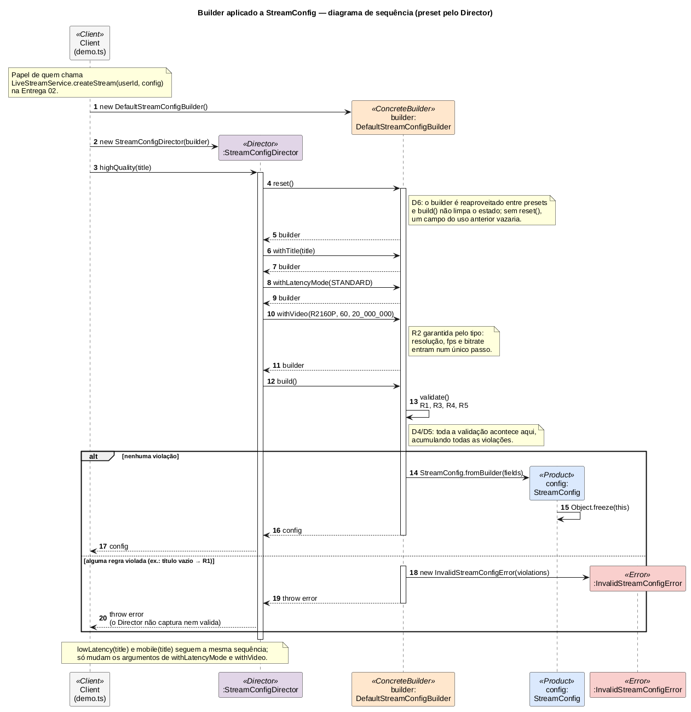

# 1.1.1.2. Sequência — Builder (Director em execução)

**Autor:** Heitor Macedo Ricardo · **Data:** 15/10/2026 · **Escopo:** diagrama de sequência do Builder e `StreamConfigDirector` (presets). O diagrama de classes, as regras de validação e o ADR-001 são de Lucas Andrade Zanetti: [1.1.1.1. Modelagem — Builder](/Base/Relatórios/1.1.1.SubEquipe_01/1.1.1.1.ModelagemBuilder.md).

## Fontes do planejamento

Planejamento da SubEquipe_01 v1.0 (08/10/2026), seção 4: entregável de Heitor — "Diagrama de sequência do Builder (Client → Director → Builder → `build()`)" e "`StreamConfigDirector`, presets, `demo.ts` e testes".

## Diagrama

*Figura 1 — Diagrama de sequência do Builder, v1: preset `highQuality` montado pelo Director. Autoria: Heitor Macedo Ricardo, 2026. Fonte editável: <a href="Base/Relatórios/1.1.1.SubEquipe_01/assets/builder/builder-sequencia-v1.puml" target="_blank" rel="noopener"><code>builder-sequencia-v1.puml</code></a> (PlantUML) · <a href="Base/Relatórios/1.1.1.SubEquipe_01/assets/builder/builder-sequencia-v1.svg" target="_blank" rel="noopener">SVG</a>.*

## Como ler

| Mensagens | O que acontece | Elo |
| --- | --- | --- |
| 1–2 | O Client cria um único `DefaultStreamConfigBuilder` e o entrega ao Director. O Director conhece só a interface `StreamConfigBuilder`. | Diagrama de classes: `StreamConfigDirector o--> StreamConfigBuilder` |
| 3–4 | O Client pede um preset; a primeira coisa que o Director faz é `reset()`. | D6 — `build()` não limpa o estado; o builder é reaproveitado entre presets |
| 6–11 | Passos de montagem. Os três campos de vídeo entram juntos em `withVideo`. | R2 garantida pelo tipo (divergência registrada no README do padrão, no repositório de código) |
| 12–13 | `build()` chama `validate()`, que verifica R1, R3, R4 e R5 e acumula todas as violações. | D4, D5 |
| 14–17 | Sem violação: nasce o `StreamConfig`, congelado, e volta até o Client. | Product imutável |
| 18–20 | Com violação: `InvalidStreamConfigError` atravessa o Director sem ser capturado. | O Director não duplica validação |

`lowLatency(title)` e `mobile(title)` seguem a mesma sequência; só mudam os argumentos de `withLatencyMode` e `withVideo`.

## Presets do Director

| Preset | Resolução · fps · bitrate | Latência | Por quê |
| --- | --- | --- | --- |
| `lowLatency` | 720p · 30 · 4,5 Mbps | `LOW` | 2160p está fora por R4; 720p tem mínimo de 3 Mbps, que cabe numa rede doméstica comum |
| `highQuality` | 2160p · 60 · 20 Mbps | `STANDARD` | Única latência que R4 aceita em 4K; acima do mínimo de 14 Mbps da faixa 31–60 fps |
| `mobile` | 480p · 30 · 1 Mbps | `STANDARD` | Em rede móvel, estabilidade vale mais que latência |

Todos os bitrates ficam com folga acima do mínimo de R5, para que uma revisão da tabela de referência não derrube um preset por poucos kbps. Visibilidade e gravação não fazem parte do preset: são escolhas do criador e ficam nos padrões do builder (`PUBLIC`, gravação ligada — D3). Os valores são decisão de projeto, não norma de plataforma.

## Correspondência com o código

O diagrama foi desenhado a partir do código já implementado, e não o contrário: cada mensagem corresponde a uma chamada real.

| Elemento | Arquivo no [repositório de código](https://github.com/UnBArqDsw2026-2-Turma01/g6-streaming-entrega03-subgrupo01-codigo) |
| --- | --- |
| Client | `src/criacionais/builder/demo.ts` |
| Director e presets | `src/criacionais/builder/stream-config-director.ts` |
| Ordem das mensagens 4–12 | teste "chama reset() primeiro e build() por último" em `stream-config-director.test.ts` |
| Mensagens 18–20 | teste "repassa a violação R1 quando o título é vazio" no mesmo arquivo |

A ordem das chamadas não é só desenho: um teste com um builder dublê registra as chamadas e confere `reset → withTitle → withLatencyMode → withVideo → build`. Se o código mudar a sequência, o teste falha e o diagrama precisa ser revisto.

## Senso crítico

- **O diagrama mostra um preset, não todos.** Desenhar os três repetiria a mesma sequência; a nota final do diagrama registra a diferença.
- **O caminho sem Director não aparece.** O Client também pode montar a configuração direto no builder (a demo faz isso na parte 2). É a mesma sequência a partir da mensagem 4, sem o Director.
- **D6 ainda sem confirmação.** O reaproveitamento do builder é o que obriga o `reset()`. O resultado preliminar do benchmark sugeria o builder reaproveitado mais lento que um novo; a medição pareada não confirmou diferença nenhuma ([análise do benchmark](https://github.com/UnBArqDsw2026-2-Turma01/g6-streaming-entrega03-subgrupo01-codigo/blob/main/benchmark/relatorio/analise-builder.md)). D6 se sustenta pelo design — o Director reaproveita o builder que recebe —, não por desempenho, e o `reset()` é exigido por correção.

## Histórico de versões

| Versão | Data | Autor | Descrição | Revisor |
| --- | --- | --- | --- | --- |
| 1.0 | 15/10/2026 | [@HeitorM50](https://github.com/HeitorM50) | Diagrama de sequência do Builder e presets do Director | @1emes ([revisão do PR #2](https://github.com/UnBArqDsw2026-2-Turma01/2026.2-T01-_G6_ProjetoStreamingVideo_Entrega_03/pull/2#pullrequestreview-5554232012)) |
| 1.1 | 16/10/2026 | [@HeitorM50](https://github.com/HeitorM50) | Imagem e links de arquivo compatíveis com o roteador do Docsify; senso crítico de D6 atualizado com o resultado do benchmark (revisão de @1emes no PR #2) | A preencher |
| 1.2 | 17/10/2026 | [@Bappoz](https://github.com/Bappoz) | Client do Builder (`demo.ts`) atribuído a Heitor nas tabelas de participantes | A preencher |
