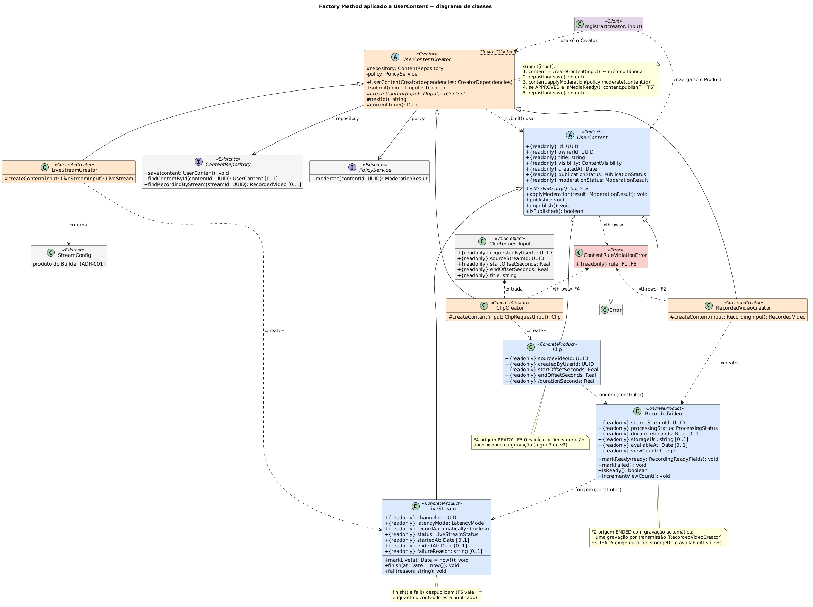

# 1.1.1.3. Modelagem — Factory Method para `UserContent`

**Autor:** Matheus Lemes Amaral · **Data:** 16/10/2026 · **Escopo:** diagrama de classes do Factory Method, correspondência com o diagrama v3 da Entrega 02, regras e evidências. A sequência está em [1.1.1.4. Sequência — Factory Method](/Base/Relatórios/1.1.1.SubEquipe_01/1.1.1.4.SequenciaFactoryMethod.md); código e testes ficam no [repositório de código](https://github.com/Bappoz/g6-streaming-entrega03-subgrupo01-codigo), pasta `src/criacionais/factory-method/`.

Decisão e raciocínio completos: [ADR-002](/Base/Relatórios/1.1.1.SubEquipe_01/ADR/ADR-002-factory-method-user-content.md).

## Fontes do planejamento

Planejamento da SubEquipe_01 v1.0 (08/10/2026), seção 2: Factory Method como segundo padrão, para a hierarquia `UserContent` (decisão DE03), com o problema "o código que publica conteúdo não deveria conhecer a classe concreta que está criando" (<a href="Base/Relatórios/1.1.1.SubEquipe_01/assets/builder/evidencias/b-e01-planejamento-premissa-streamconfig.png" target="_blank" rel="noopener">E01 do ADR-001</a>). Pela divisão em duplas, o padrão é escopo de Matheus Lemes Amaral e Pedro Druck Montalvão Reis.

## Antes — recorte da Entrega 02

*Figura 1 — Componente "Conteúdo gerado pelo usuário" do diagrama de classes v3 (Entrega 02). Autoria original: Matheus Lemes Amaral e Pedro Druck Montalvão Reis (revisão v2), 2026.*

No v3, `UserContent` já reúne o que os três tipos têm em comum (identidade, dono, título, visibilidade, publicação e moderação), mas a criação fica espalhada em três serviços (<a href="Base/Relatórios/1.1.1.SubEquipe_01/assets/factory-method/evidencias/fm-e02-v3-servicos-que-criam-conteudo.png" target="_blank" rel="noopener">FM-E02</a>): `LiveStreamService.createStream`, `MediaProcessingService.persistRecording` e `MediaProcessingService.extractClip`, coordenado por `ClipService`. O v3 não desenha um fluxo único de registro, mas oferece os elementos para propô-lo: `ContentRepository.save(content: UserContent)`, `PolicyService.moderate(contentId)` (declarado em `LiveStreamService` e `ClipService`) e a regra 8 da nota do v3, que vale para qualquer conteúdo (<a href="Base/Relatórios/1.1.1.SubEquipe_01/assets/factory-method/evidencias/fm-e03-v3-regras-do-fluxo-de-clipes.png" target="_blank" rel="noopener">FM-E03</a>).

## Depois — Factory Method aplicado

*Figura 2 — Diagrama de classes do Factory Method, v1. Autoria: Matheus Lemes Amaral, 2026. Fonte editável: <a href="Base/Relatórios/1.1.1.SubEquipe_01/assets/factory-method/factory-method-classes-v1.puml" target="_blank" rel="noopener"><code>factory-method-classes-v1.puml</code></a> (PlantUML) · <a href="Base/Relatórios/1.1.1.SubEquipe_01/assets/factory-method/factory-method-classes-v1.svg" target="_blank" rel="noopener">SVG</a>.*

O diagrama foi desenhado a partir do código implementado e é uma **projeção** dos participantes e relações principais: nomes de classes, métodos e visibilidades são os de `src/criacionais/factory-method/`; os tipos usam a notação de domínio do v3 (`UUID`, `Real`, `Integer`), e `{readonly}` marca as propriedades que o cliente só lê, sejam campos imutáveis ou getters sem setter, na mesma notação do diagrama do Builder. A origem de `RecordedVideo` e `Clip` aparece como dependência de construção, porque o produto recebe a origem inteira no construtor mas guarda só o id. As classes marcadas `«Existente»` vêm do v3 (`ContentRepository`, `PolicyService`) ou do Builder (`StreamConfig`), sem alteração.

### Participantes GoF → classes

| Participante | Classe | Papel no domínio |
| --- | --- | --- |
| Product | `UserContent` (abstrata) | O que todo conteúdo tem em comum; `isMediaReady()` é o gancho que cada tipo implementa |
| ConcreteProduct | `LiveStream`, `RecordedVideo`, `Clip` | Os três tipos de conteúdo do v3, com os mesmos atributos |
| Creator | `UserContentCreator<TInput, TContent>` | `submit` — operação comum (persistir, moderar, publicar) —, que chama o método-fábrica `createContent` |
| ConcreteCreator | `LiveStreamCreator`, `RecordedVideoCreator`, `ClipCreator` | Cada um decide qual classe instanciar e de onde vêm os dados |
| Client | `registrar(creator, input)` na demonstração | Recebe qualquer criador e só enxerga `UserContent` |

### Correspondência com o v3

| Ponto de criação no v3 | ConcreteCreator | Entrada | Produto nasce em |
| --- | --- | --- | --- |
| `LiveStreamService.createStream(userId, config: StreamConfig)` | `LiveStreamCreator` | dono, canal e `StreamConfig` do Builder | `CREATED` |
| `MediaProcessingService.persistRecording(streamId)` | `RecordedVideoCreator` | id da transmissão | `PROCESSING` |
| `ClipService` + `MediaProcessingService.extractClip(...)` | `ClipCreator` | `ClipRequestInput` (mesmos campos do v3) | pronto para publicar |

O `LiveStreamCreator` é o ponto de encontro entre os dois padrões da subequipe: o `StreamConfig` validado pelo Builder ([ADR-001](/Base/Relatórios/1.1.1.SubEquipe_01/ADR/ADR-001-builder-stream-config.md)) entra como está, sem nova validação.

### O que muda no modelo da Entrega 02

| Item | v3 (Entrega 02) | Com o padrão | Situação |
| --- | --- | --- | --- |
| Criação do conteúdo | `new` dentro de cada serviço | método-fábrica de cada ConcreteCreator | Serviços delegam ao criador; assinaturas do v3 preservadas |
| "Mídia pronta" (regra 8) | só texto da nota | `UserContent.isMediaReady()` abstrato | Novo método, decisão DF5 do ADR-002 |
| `RecordedVideo` | `processingStatus` sem transições | `markReady()` (F3) e `markFailed()`; só nasce de live `ENDED`, uma por transmissão | Completa o que o evento `RecordingAvailable` e a máquina M4 já indicavam |
| Origem de `RecordedVideo` e `Clip` | ids (`sourceStreamId`, `sourceVideoId`) | construtor recebe a origem inteira; os ids continuam como atributos | Regra 7 garantida por construção (DF3) |
| Visibilidade do `Clip` | não definida | herdada da gravação | Decisão de projeto DF7 |
| `Clip.reject`, `RecordedVideo.getPlaybackManifest` | presentes | não implementados | Fora do escopo do padrão de criação |

### Regras (verificadas no código)

| Id | Regra | Origem | Onde |
| --- | --- | --- | --- |
| F1 | Título não vazio | decisão de projeto | `UserContent` |
| F2 | Gravação só de transmissão existente, encerrada e com gravação automática; uma por transmissão | regra 2 da nota (FM-E03) e máquina M4; unicidade é decisão de projeto | `RecordedVideoCreator`, `RecordedVideo` |
| F3 | `READY` exige duração, `storageUri` e `availableAt` | regra 9, sem o manifesto; duração positiva e data válida são refinamentos | `RecordedVideo.markReady` |
| F4 | Clipe só de gravação `READY` da transmissão | regra 1 | `ClipCreator`, `Clip` |
| F5 | `0 ≤ início < fim ≤ duração` | regra 4 | `Clip` |
| F6 | Publicar exige `APPROVED` e mídia pronta | regra 8 | `UserContent.publish` |

## Evidências

Recortes feitos em 16/10/2026 a partir do diagrama v3 versionado no repositório da Entrega 02; cada imagem traz fonte e data no rodapé.

| Id | Arquivo | O que comprova |
| --- | --- | --- |
| FM-E01 | <a href="Base/Relatórios/1.1.1.SubEquipe_01/assets/factory-method/evidencias/fm-e01-v3-recorte-conteudo-ugc.png" target="_blank" rel="noopener"><code>fm-e01-v3-recorte-conteudo-ugc.png</code></a> | `UserContent` e as três subclasses com atributos e operações comuns (DE03) |
| FM-E02 | <a href="Base/Relatórios/1.1.1.SubEquipe_01/assets/factory-method/evidencias/fm-e02-v3-servicos-que-criam-conteudo.png" target="_blank" rel="noopener"><code>fm-e02-v3-servicos-que-criam-conteudo.png</code></a> | Os três pontos de criação e os colaboradores comuns (`ContentRepository`, `PolicyService`) |
| FM-E03 | <a href="Base/Relatórios/1.1.1.SubEquipe_01/assets/factory-method/evidencias/fm-e03-v3-regras-do-fluxo-de-clipes.png" target="_blank" rel="noopener"><code>fm-e03-v3-regras-do-fluxo-de-clipes.png</code></a> | Regras 1, 2, 4, 7, 8 e 9, que viram F2–F6 |
| E01 (ADR-001) | <a href="Base/Relatórios/1.1.1.SubEquipe_01/assets/builder/evidencias/b-e01-planejamento-premissa-streamconfig.png" target="_blank" rel="noopener"><code>b-e01-planejamento-premissa-streamconfig.png</code></a> | O problema do Factory Method como descrito no planejamento |

## Senso crítico

- **O padrão não exigiu mexer no v3 para se justificar**, ao contrário do Builder (D1 do ADR-001): os três pontos de criação e o caminho comum já estavam no modelo. As mudanças da tabela acima são complementos, não revisões.
- **Hierarquia paralela.** Para cada produto há um criador; um tipo novo de conteúdo custa duas classes. Com três tipos estáveis, o custo é baixo; se os tipos se multiplicassem sem caminho comum, uma fábrica simples seria mais honesta.
- **Método-fábrica parametrizado.** O livro apresenta `FactoryMethod()` sem parâmetros; aqui o Creator é genérico na entrada (DF1). A escolha da classe continua com a subclasse, que é o que define o padrão.
- **Custo de execução:** não medido aqui; depende do cenário `factory-method` do benchmark.
- **Referência GoF:** páginas ainda a confirmar no exemplar consultado.

## Histórico de versões

| Versão | Data | Autor | Descrição | Revisor |
| --- | --- | --- | --- | --- |
| 1.0 | 16/10/2026 | [@1emes](https://github.com/1emes) | Modelagem do Factory Method, ADR-002 e evidências | A preencher |
| 1.1 | 16/10/2026 | [@1emes](https://github.com/1emes) | Diagrama alinhado ao código revisado (F2 com live encerrada e gravação única, F3 com data válida, despublicação ao encerrar a live, getters marcados `{readOnly}`); texto qualifica o diagrama como projeção e o caminho comum como proposta | A preencher |
| 1.2 | 17/10/2026 | [@pedruck](https://github.com/pedruck) | Origem de `RecordedVideo` e `Clip` como dependência de construção (o código guarda só o id); `ContentRuleViolationError` herda de `Error` e é lançado também por `RecordedVideoCreator` (F2) e `ClipCreator` (F4); construtor do Creator e `ClipRequestInput` do v3; `{readonly}` uniforme e valor padrão `now()` | A preencher |
