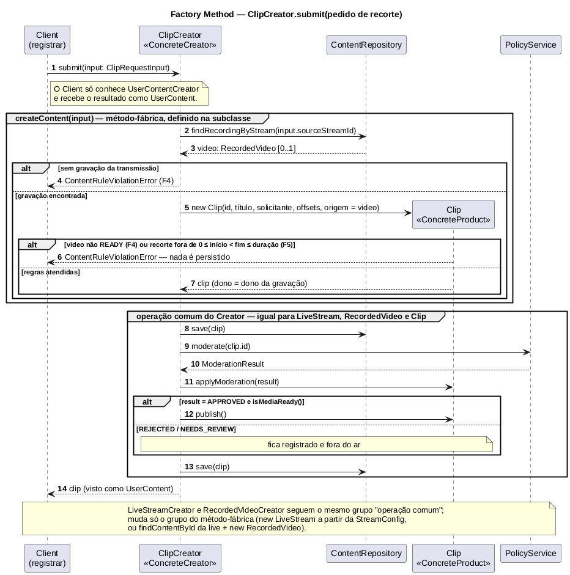

# 1.1.1.4. Sequência — Factory Method (`ClipCreator.submit`)

**Autor:** Matheus Lemes Amaral · **Data:** 16/10/2026 · **Escopo:** diagrama de sequência do Factory Method no caso do clipe, o mais completo dos três. O diagrama de classes e as regras estão em [1.1.1.3. Modelagem — Factory Method](/Base/Relatórios/1.1.1.SubEquipe_01/1.1.1.3.ModelagemFactoryMethod.md) e no [ADR-002](/Base/Relatórios/1.1.1.SubEquipe_01/ADR/ADR-002-factory-method-user-content.md).

## Diagrama

*Figura 1 — Diagrama de sequência do Factory Method, v1: um espectador pede o recorte de uma gravação. Autoria: Matheus Lemes Amaral, 2026. Fonte editável: <a href="Base/Relatórios/1.1.1.SubEquipe_01/assets/factory-method/factory-method-sequencia-v1.puml" target="_blank" rel="noopener"><code>factory-method-sequencia-v1.puml</code></a> (PlantUML) · <a href="Base/Relatórios/1.1.1.SubEquipe_01/assets/factory-method/factory-method-sequencia-v1.svg" target="_blank" rel="noopener">SVG</a>.*

## Como ler

| Mensagens | O que acontece | Elo |
| --- | --- | --- |
| 1 | O Client chama `submit` sem saber que o criador é um `ClipCreator`: a função cliente recebe qualquer `UserContentCreator`. | Participante Client |
| 2–7 | **Método-fábrica** (`createContent`), a única parte definida na subclasse: localizar a gravação da transmissão e instanciar `Clip`. | ADR-002, DF1 e DF4 |
| 4 | Sem gravação para a transmissão: erro F4, nada é persistido. | F4, DF8 |
| 5–6 | O construtor de `Clip` confere F4 (gravação `READY`) e F5 (janela do recorte) e copia o dono da gravação. | F4, F5, regra 7 do v3 (DF3) |
| 8–13 | **Operação comum do Creator**, a mesma para os três tipos: persistir, moderar pelo id, registrar o veredito, publicar só com `APPROVED` e mídia pronta, persistir de novo. | DF2, F6 (regra 8 do v3) |
| 14 | O clipe volta ao Client como `UserContent`. | Product |

A nota final do diagrama registra a diferença para os outros dois criadores: só o grupo do método-fábrica muda. No `LiveStreamCreator` ele é um `new LiveStream` a partir da `StreamConfig`; no `RecordedVideoCreator`, um `findContentById` da live seguido de `new RecordedVideo`. Nesses dois casos a mídia ainda não está pronta (`CREATED` e `PROCESSING`), então o conteúdo é registrado e moderado, mas a mensagem `publish()` não acontece (DF5).

## Correspondência com o código

O diagrama foi desenhado a partir do código já implementado: cada mensagem corresponde a uma chamada real.

| Elemento | Arquivo no [repositório de código](https://github.com/Bappoz/g6-streaming-entrega03-subgrupo01-codigo) |
| --- | --- |
| Client | `src/criacionais/factory-method/demo.ts` (função `registrar`) |
| Mensagens 2–7 | `ClipCreator.createContent` em `clip-creator.ts` e construtor de `Clip` em `clip.ts` |
| Mensagens 8–13 | `UserContentCreator.submit` em `user-content-creator.ts` |
| Ordem das mensagens 8–13 | teste "persiste antes de moderar, porque a política recebe só o id" em `user-content-creator.test.ts` |
| Caminho de erro (4 e 6) | testes "recusa transmissão sem gravação com F4" e "recusa recorte fora da gravação com F5, sem persistir o clipe" em `clip-creator.test.ts` |

A ordem `save → moderate → save` não é só desenho: um teste registra as chamadas a repositório e política e confere a sequência. Se o código mudar a ordem, o teste falha e o diagrama precisa ser revisto.

## Senso crítico

- **Um caso, não três.** O clipe foi escolhido porque tem os dois caminhos de erro e a publicação imediata; desenhar os outros dois repetiria o grupo da operação comum.
- **O fluxo assíncrono do v3 não aparece.** No modelo da Entrega 02, o pedido feito antes de a gravação ficar pronta espera em `WAITING_RECORDING`; aqui ele é recusado (DF8). A espera é do `ClipService`, não do padrão de criação.
- **Template Method dentro do Factory Method.** O grupo "operação comum" é um Template Method sobre o método-fábrica. O GoF registra essa combinação como frequente, mas ela deixa dois padrões no mesmo método e merece ser dita na apresentação.

## Histórico de versões

| Versão | Data | Autor | Descrição | Revisor |
| --- | --- | --- | --- | --- |
| 1.0 | 16/10/2026 | [@1emes](https://github.com/1emes) | Diagrama de sequência do Factory Method (`ClipCreator.submit`) | A preencher |
