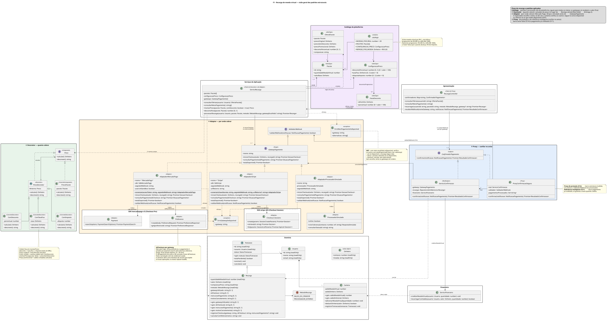
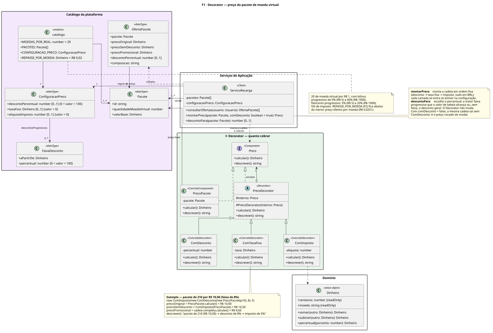
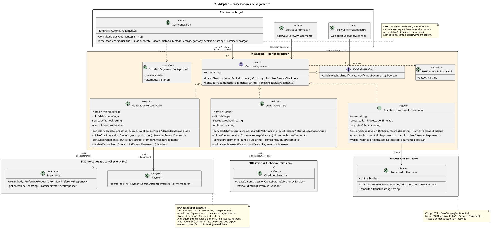
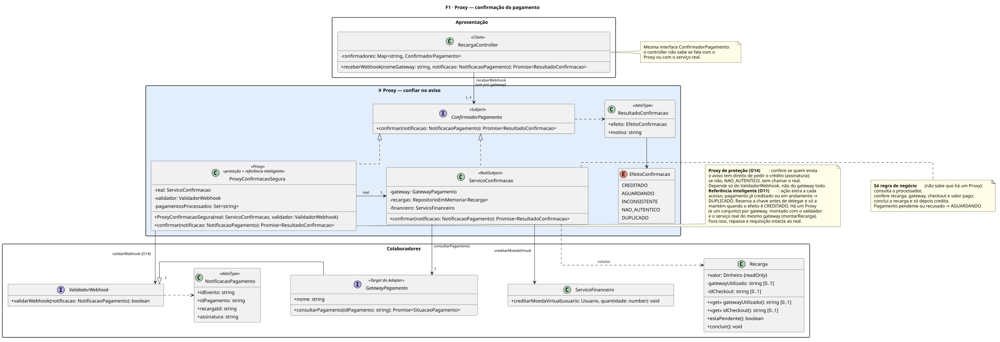

# F1 · Recarga de Moeda Virtual — SubEquipe_02

> **Etapa da história:** 1 · Recarga de moeda virtual ([visão geral](/Base/Relatórios/1.1.2.SubEquipe_02/README.md))
>
> **Padrões aplicados:** Decorator · Adapter · Proxy
>
> **Status:** 🟢 Concluída: modelagem, código integrado na [`main`](https://github.com/UnBArqDsw2026-2-Turma01/2026.2-T01-_G6_ProjetoStreamingVideo_SubEquipe02_Codigo/tree/main/src/f1-recarga) e vídeos de cada padrão.
>
> **Responsável:** Davi Severiano Freitas

## 1. Participantes na Frente

| Membro | Papel na frente |
| -- | -- |
| Davi Severiano Freitas | Modelagem, implementação, testes e vídeo dos três padrões da frente |
| Daniel de Oliveira Lira | Revisão dos diagramas da frente |

## 2. Metodologia da Frente

A frente seguiu a ordem em que o espectador vive a recarga: primeiro o preço exibido no modal (Decorator), depois o checkout no processador de pagamento (Adapter) e, por fim, o aviso de pagamento que libera o crédito (Proxy). Cada padrão foi modelado em PlantUML como diagrama de classes do recorte em que é aplicado, conforme definido na [Ata S2_03](/Projeto/Atas/Atas_Sg2/ata-S2-03-2026-10-13.md), e implementado em TypeScript com testes em Jest.

A implementação foi feita em duas etapas. Na primeira, os três padrões foram construídos e testados contra um processador de pagamento **simulado**, sem internet nem credenciais, para isolar o desenho dos padrões das particularidades das APIs externas. Na segunda, foram incorporados dois processadores **reais em modo de teste** — Mercado Pago (Checkout Pro) e Stripe (Checkout Session) —, cada um com o seu adaptador. A troca não exigiu alteração no `ServicoRecarga` nem no Proxy, o que serviu de verificação prática do Adapter.

Ao longo do trabalho, cinco decisões foram revistas, com base na liberdade de adaptação registrada na [Ata S2_03, D05](/Projeto/Atas/Atas_Sg2/ata-S2-03-2026-10-13.md):

| Decisão revista | Antes | Depois | Motivo |
| -- | -- | -- | -- |
| Conversão de moeda no preço | Decorator `ComConversaoMoeda` | Removido; todo o preço em reais | A [RN01](https://unbarqdsw2026-2-turma01.github.io/2026.2-T01-_G6_ProjetoStreamingVideo_Entrega_01/#/Base/Relatorios/1.1.2.SubEquipe_02/3.EngenhariaReversa?id=_63-regras-de-negócio-inferidas) registra que os pacotes são oferecidos em reais, com imposto incluso, no Brasil (Figuras 7 a 9 da Entrega 01). Por isso os adaptadores foram configurados para cobrar em BRL, e a camada de conversão deixou de ter uso |
| Escolha do processador | O sistema escolhia, com troca automática (O07) | O espectador escolhe o meio no modal. Se ele estiver indisponível, o sistema verifica os demais com `estaDisponivel()`, sem criar cobrança: havendo um único disponível, a recarga segue nele; havendo vários, o modal oferece só os disponíveis; sem escolha, vale a troca automática em ordem | No [BPMN de compra da Entrega 01](https://unbarqdsw2026-2-turma01.github.io/2026.2-T01-_G6_ProjetoStreamingVideo_Entrega_01/#/Base/Relatorios/1.1.2.SubEquipe_02/4.BPMN) (§5.2), o espectador escolhe a forma de pagamento em um gateway de decisão (B9). A operacionalização [O07](https://unbarqdsw2026-2-turma01.github.io/2026.2-T01-_G6_ProjetoStreamingVideo_Entrega_01/#/Base/Relatorios/1.1.2.SubEquipe_02/2.NFRFramework), porém, prevê troca automática para um processador de reserva. A frente conciliou os dois: a troca automática foi mantida quando não há escolha; com meio escolhido, o sistema informa a indisponibilidade e devolve as alternativas, sem trocar por conta própria. Essa conciliação é uma decisão de projeto da frente, e não algo modelado no BPMN. Quando só resta um meio, não há o que perguntar, e a troca automática volta a valer |
| Pacotes e promoção | Definidos nos testes e no demo | Centralizados em `catalogo.ts` | Os mesmos pacotes e a mesma promoção valem para qualquer meio de pagamento |
| Desconto da promoção | Um desconto único de 29% para todos os pacotes | Desconto progressivo por faixa de valor (`FaixaDesconto`), de 5% (R$ 5) a 33% (R$ 1000); vale a maior faixa que o pacote alcança | Pacotes maiores com desconto maior, para incentivar recargas maiores (decisão da frente; só o desconto de 29% foi observado). A mudança não alterou nenhuma classe do Decorator: só o percentual que o `ServicoRecarga` passa ao `ComDesconto` (`descontoPara`) |
| Preço exibido no modal | Preço de tabela riscado e preço promocional | Preço sem desconto, já com imposto (`precoSemDesconto`), riscado, e preço promocional | O preço exibido ao espectador já inclui o imposto (RN01). O riscado é a mesma cadeia de decoradores sem a camada de desconto, o que faz o percentual exibido fechar com o total |

#### Revisão dos diagramas pela equipe

Em 16/10/2026, os diagramas foram revisados por Daniel de Oliveira Lira, integrante da subequipe, com base nos slides da disciplina. Cada questionamento foi analisado por Davi Severiano Freitas e confrontado com o livro do GoF [R01], com os slides e vídeos da professora e com três vídeos sobre os padrões da frente: *Decorator Pattern* (ep. 3), *Adapter Pattern* (ep. 8) e *Proxy Pattern* (ep. 10), da série *Design Patterns* [L09 a L11]. As correções aceitas foram aplicadas aos diagramas e, quando necessário, ao código, em 17/10/2026, para que os dois continuem idênticos:

| Ponto levantado | Correção |
| -- | -- |
| Os adaptadores não explicitavam os métodos do Target que adaptam | Os três adaptadores passaram a listar `iniciarCheckout`, `consultarPagamento` e `validarWebhook` |
| Os Adaptees tinham nomes de código (`+preference.create()`), e não operações UML | Os Adaptees passaram a ser as classes reais dos SDKs — `Preference` e `Payment` (Mercado Pago) e `Checkout::Sessions` (Stripe) —, com operações UML válidas e fiéis ao código |
| O Proxy referenciava a interface (Subject), e não o RealSubject | O Proxy guarda a referência ao `ServicoConfirmacao`, como no modelo clássico; o código foi ajustado (`real: ServicoConfirmacao`) |
| O Proxy dependia do `GatewayPagamento` inteiro | A verificação de assinatura foi separada na interface `ValidadorWebhook`, que o `GatewayPagamento` estende; o Proxy depende só dela |
| Estruturas de dados representadas como interfaces UML | `Pacote`, `ConfiguracaoPreco`, `OfertaPacote`, `NotificacaoPagamento` e `ResultadoConfirmacao` passaram a ser classes `<<dataType>>` |
| Faltavam as restrições de valor da configuração de preço | Mantida a multiplicidade `[0..1]` (campo opcional) e acrescentadas as restrições `{0 < valor < 100}` e `{valor > 0}`, as mesmas validadas nos construtores dos decoradores |
| Atributos do domínio apareciam todos como públicos | Campos alteráveis aparecem como privados, com leitura por `<<get>>`; campos imutáveis aparecem como públicos `{readOnly}`, como no código |

| Evento | Data | Registro |
| -- | -- | -- |
| Definição da frente e dos padrões | 10/10/2026 | [Ata S2_02](/Projeto/Atas/Atas_Sg2/ata-S2-02-2026-10-10.md) |
| Definição do tipo de diagrama e liberdade de adaptação dos padrões | 13/10/2026 | [Ata S2_03](/Projeto/Atas/Atas_Sg2/ata-S2-03-2026-10-13.md) |
| Implementação dos três padrões, integração com processadores reais em modo de teste e diagramas | 15/10/2026 | [Histórico de `src/f1-recarga`](https://github.com/UnBArqDsw2026-2-Turma01/2026.2-T01-_G6_ProjetoStreamingVideo_SubEquipe02_Codigo/commits/main/src/f1-recarga) |
| Integração da F1 na `main` (PR #1) | 16/10/2026 | [PR #1](https://github.com/UnBArqDsw2026-2-Turma01/2026.2-T01-_G6_ProjetoStreamingVideo_SubEquipe02_Codigo/pull/1) |
| Revisão dos diagramas por Daniel de Oliveira Lira | 16/10/2026 | Tabela "Revisão dos diagramas pela equipe", acima |
| Alinhamento do código e dos diagramas após a revisão | 17/10/2026 | [3f3545e](https://github.com/UnBArqDsw2026-2-Turma01/2026.2-T01-_G6_ProjetoStreamingVideo_SubEquipe02_Codigo/commit/3f3545e) |
| Front-end integrado e refinamento da recarga (desconto progressivo, imposto embutido, meios indisponíveis) | 18/10/2026 | [Ata S2_05](/Projeto/Atas/Atas_Sg2/ata-S2-05-2026-10-18.md) · [PR #4](https://github.com/UnBArqDsw2026-2-Turma01/2026.2-T01-_G6_ProjetoStreamingVideo_SubEquipe02_Codigo/pull/4) |

O uso de IA generativa nesta frente está descrito em [1.1.2.4. IA Generativa](/Base/Relatórios/1.1.2.SubEquipe_02/1.1.2.4.IAGenerativa.md).

## 3. Contexto (problema)

Na recarga, o espectador abre o modal de moeda virtual, escolhe um pacote e paga por um meio de pagamento externo. Três problemas de projeto surgem nessa etapa:

| # | Problema | Padrão |
| -- | -- | -- |
| P1 | O preço do pacote recebe regras de promoção (desconto, taxa, imposto) que mudam com o tempo e se combinam de formas diferentes; o modal precisa mostrar o preço sem desconto (riscado) e o promocional | Decorator |
| P2 | Os processadores de pagamento têm interfaces incompatíveis entre si, mas o sistema precisa tratá-los de forma uniforme, deixar o espectador escolher o meio e reagir quando um deles estiver indisponível | Adapter |
| P3 | O aviso de pagamento chega pela rede e pode ser falsificado ou reenviado; a moeda virtual só pode ser creditada uma vez, e só a partir de um aviso autêntico | Proxy |

**Modelos anteriores relevantes**: BPMN de compra de moeda virtual (Entrega 01) · diagrama de classes da Modelagem Estática, com a interface `GatewayPagamento` (`iniciarCheckout`, `solicitarTransferencia` e `validarWebhook`, refinamento A07) e `Recarga.calcularValorTotal()` (Entrega 02) · diagrama de sequência da Recarga, com a confirmação por webhook e o tratamento de aviso duplicado (Entrega 02).

## 4. Fundamentação Teórica

Os três padrões pertencem à família **estrutural** do catálogo GoF, que trata de como classes e objetos se compõem para formar estruturas maiores [R01]. Os três usam o mesmo recurso — um objeto que implementa uma interface e guarda uma referência a outro objeto —, mas com intenções diferentes.

| Padrão | Intenção (em síntese) | Participantes | Variante adotada |
| -- | -- | -- | -- |
| Decorator | Acrescentar responsabilidades a um objeto em tempo de execução, como alternativa à criação de subclasses para cada combinação | Component, ConcreteComponent, Decorator, ConcreteDecorator | Decorator abstrato com delegação padrão; camadas empilhadas por composição |
| Adapter | Converter a interface de uma classe na interface que o cliente espera, permitindo a colaboração entre classes incompatíveis | Client, Target, Adapter, Adaptee | Adaptador de objeto (composição), um por processador |
| Proxy | Fornecer um substituto que controla o acesso a outro objeto, com a mesma interface dele | Client, Subject, Proxy, RealSubject | Proxy de proteção combinado com referência inteligente; o Proxy referencia o RealSubject, como no modelo clássico |

A diferença entre Decorator e Proxy, que compartilham a mesma estrutura, está na intenção: o Decorator **acrescenta comportamento** ao resultado (cada camada muda o preço), enquanto o Proxy **decide se a chamada chega** ao objeto real (o aviso é barrado ou repassado intacto).

## 5. Padrões Aplicados

### 5.0. Visão geral

A visão geral reúne os três padrões na ordem da história: ① o Decorator calcula quanto cobrar, ② o Adapter decide por onde cobrar e ③ o Proxy decide se o aviso de pagamento é confiável. O catálogo da plataforma fornece pacotes e promoção iguais para todos os meios de pagamento.

*Figura 1 — Visão geral dos padrões estruturais da F1 (clique para ampliar). Autor: Davi Severiano Freitas, 18/10/2026. Arquivo-fonte: [`assets/f1-visao-geral.puml`](assets/f1-visao-geral.puml ':ignore').*

---

### 5.1. Decorator — preço do pacote

**Escolha e justificativa.** O preço do pacote é o preço de tabela acrescido de regras que variam: hoje, um desconto progressivo que vai de 5% a 33% conforme o pacote, e imposto de 5%; amanhã, outra promoção ou uma taxa. Resolver isso com subclasses exigiria uma classe para cada combinação; resolver com condicionais concentraria todas as regras em `Recarga.calcularValorTotal()`, da Entrega 02. Com o Decorator, cada regra é uma classe pequena que envolve o preço anterior, e a combinação é montada em tempo de execução a partir da configuração. O mesmo encadeamento permite mostrar no modal o **preço sem desconto**, riscado (a cadeia montada sem a camada de desconto), e o **promocional** (a cadeia completa). Trocar o desconto único pelo progressivo não exigiu nenhuma classe nova: mudou só o percentual passado ao `ComDesconto`.

**Mapeamento dos participantes**

| Papel no padrão | Classe no sistema | Responsabilidade |
| -- | -- | -- |
| Component | `Preco` | Interface comum: `calcular(): Dinheiro` e `descrever(): string` |
| ConcreteComponent | `PrecoPacote` | Preço de tabela do pacote, sem regras |
| Decorator | `PrecoDecorator` | Classe abstrata que é um `Preco` e guarda o `Preco` envolvido (`interno`); por padrão, apenas delega |
| ConcreteDecorator | `ComDesconto`, `ComTaxaFixa`, `ComImposto` | Cada um aplica a sua regra sobre o resultado da camada interna |
| Client | `ServicoRecarga` | Monta a cadeia em `montarPreco`, na ordem desconto → taxa fixa → imposto, conforme `ConfiguracaoPreco`; escolhe o percentual do pacote em `descontoPara` |

**Modelagem (UML)**

*Figura 2 — Decorator do preço do pacote, com o catálogo e um exemplo calculado. Autor: Davi Severiano Freitas, 18/10/2026. Arquivo-fonte: [`assets/f1-decorator.puml`](assets/f1-decorator.puml ':ignore').*

**Implementação**

| Participante | Código |
| -- | -- |
| `Preco` | [`preco/Preco.ts`](https://github.com/UnBArqDsw2026-2-Turma01/2026.2-T01-_G6_ProjetoStreamingVideo_SubEquipe02_Codigo/blob/main/src/f1-recarga/preco/Preco.ts) |
| `PrecoPacote` | [`preco/PrecoPacote.ts`](https://github.com/UnBArqDsw2026-2-Turma01/2026.2-T01-_G6_ProjetoStreamingVideo_SubEquipe02_Codigo/blob/main/src/f1-recarga/preco/PrecoPacote.ts) |
| `PrecoDecorator` | [`preco/PrecoDecorator.ts`](https://github.com/UnBArqDsw2026-2-Turma01/2026.2-T01-_G6_ProjetoStreamingVideo_SubEquipe02_Codigo/blob/main/src/f1-recarga/preco/PrecoDecorator.ts) |
| `ComDesconto`, `ComTaxaFixa`, `ComImposto` | [`preco/`](https://github.com/UnBArqDsw2026-2-Turma01/2026.2-T01-_G6_ProjetoStreamingVideo_SubEquipe02_Codigo/tree/main/src/f1-recarga/preco) |
| Montagem da cadeia (`montarPreco`) e ofertas do modal (`consultarOfertas`) | [`ServicoRecarga.ts`](https://github.com/UnBArqDsw2026-2-Turma01/2026.2-T01-_G6_ProjetoStreamingVideo_SubEquipe02_Codigo/blob/main/src/f1-recarga/ServicoRecarga.ts) |
| Pacotes e promoção vigente | [`catalogo.ts`](https://github.com/UnBArqDsw2026-2-Turma01/2026.2-T01-_G6_ProjetoStreamingVideo_SubEquipe02_Codigo/blob/main/src/f1-recarga/catalogo.ts) |

Cada decorador concreto chama `this.interno.calcular()` e aplica a sua regra sobre o valor recebido; `descrever()` acrescenta a própria camada à descrição interna, produzindo, por exemplo, *"pacote de 210 (R$ 10,00) → desconto de 8% → imposto de 5%"*: o pacote de R$ 10,00 sai riscado a R$ 10,50 e é vendido por R$ 9,66. Todos os valores são `Dinheiro`, em centavos inteiros, como exige a base compartilhada. Os parâmetros da `ConfiguracaoPreco` são opcionais (multiplicidade `[0..1]`) e têm restrições de valor — desconto entre 0% e 100%, taxa e alíquota positivas —, verificadas nos construtores dos decoradores.

**Teste**

[`tests/f1-recarga/preco.test.ts`](https://github.com/UnBArqDsw2026-2-Turma01/2026.2-T01-_G6_ProjetoStreamingVideo_SubEquipe02_Codigo/blob/main/tests/f1-recarga/preco.test.ts) verifica cada camada isoladamente, o empilhamento desconto → imposto, a rejeição de parâmetros inválidos e que, com um valor fixo, **a ordem das camadas muda o resultado** (taxa antes do desconto também é descontada). Os blocos "ofertas e preço" e "desconto progressivo" de [`ServicoRecarga.test.ts`](https://github.com/UnBArqDsw2026-2-Turma01/2026.2-T01-_G6_ProjetoStreamingVideo_SubEquipe02_Codigo/blob/main/tests/f1-recarga/ServicoRecarga.test.ts) verificam os preços exibidos no modal, a ordem de montagem e a escolha da faixa de desconto. [`catalogo.test.ts`](https://github.com/UnBArqDsw2026-2-Turma01/2026.2-T01-_G6_ProjetoStreamingVideo_SubEquipe02_Codigo/blob/main/tests/f1-recarga/catalogo.test.ts) verifica que o desconto cresce com o pacote, que o percentual exibido fecha com o preço final e que o repasse por moeda da F2 nunca passa do preço efetivo de venda.

**Vídeo**

*Vídeo 1 — Subequipe 02 - Frente 1 - Decorator: conceito do padrão, diagrama, código e execução no front-end. Autor: Davi Severiano Freitas, 18/10/2026. [Assistir no YouTube](https://youtu.be/bKWOLcni8D4).*

---

### 5.2. Adapter — processadores de pagamento

**Escolha e justificativa.** A Entrega 02 já definia a interface `GatewayPagamento`, com `iniciarCheckout` e `validarWebhook` (refinamento A07 da Modelagem Estática). Cada processador real, porém, fala de um jeito: o Mercado Pago recebe o valor em reais com casas decimais e identifica a recarga por `external_reference`; o Stripe recebe centavos e a moeda em minúsculas e usa `client_reference_id`; os status, os erros e o formato de resposta também diferem. O Adapter mantém `GatewayPagamento` como a única interface conhecida pelo sistema e coloca, em uma classe por processador, toda a tradução de entrada, saída e falhas. Isso permite oferecer vários meios ao espectador e acrescentar um novo processador sem tocar no `ServicoRecarga` nem no Proxy.

Em relação à Entrega 02, o Target mudou em três pontos: `solicitarTransferencia` ficou de fora, porque pertence ao saque, que está fora do escopo desta entrega; entrou `consultarPagamento`, usado pelo serviço de confirmação para não depender do conteúdo do aviso; e entrou `estaDisponivel`, que verifica, sem criar cobrança, se o processador responde.

O contrato inclui as falhas: indisponibilidade do processador (rede, erro 5xx, limite de requisições, moeda não atendida) vira `ErroGatewayIndisponivel`. O `ServicoRecarga` reage de dois modos (O07). Com o meio escolhido pelo espectador, consulta os demais com `estaDisponivel()`: se houver um único disponível, a recarga segue nele; se houver vários, cancela e lança `ErroMeioPagamentoIndisponivel` só com os disponíveis, para o modal oferecer; se não houver nenhum, cancela sem alternativas. Sem escolha, tenta os gateways em ordem.

**Mapeamento dos participantes**

| Papel no padrão | Classe no sistema | Responsabilidade |
| -- | -- | -- |
| Client | `ServicoRecarga` (e, na confirmação, `ProxyConfirmacaoSegura` e `ServicoConfirmacao`) | Cria o checkout no meio escolhido ou com troca automática; consulta e valida avisos |
| Target | `GatewayPagamento` (estende `ValidadorWebhook`) | `iniciarCheckout`, `consultarPagamento` e `estaDisponivel`, mais o `validarWebhook` herdado, com `SessaoCheckout` e `SituacaoPagamento` no vocabulário do sistema |
| Adapter | `AdaptadorMercadoPago`, `AdaptadorStripe`, `AdaptadorProcessadorSimulado` | Implementam os quatro métodos do Target, traduzindo chamadas, respostas, status e erros; não contêm regra de negócio |
| Adaptee | `Preference` e `Payment` (SDK `mercadopago` v3), `Checkout::Sessions` (SDK `stripe` v23), `ProcessadorSimulado` | APIs com formatos próprios e incompatíveis com o Target |

**Modelagem (UML)**

*Figura 3 — Adapter dos processadores de pagamento, com os clientes do Target, os três adaptadores e as classes dos SDKs. Autor: Davi Severiano Freitas, 18/10/2026. Arquivo-fonte: [`assets/f1-adapter.puml`](assets/f1-adapter.puml ':ignore').*

**Implementação**

| Participante | Código |
| -- | -- |
| `GatewayPagamento`, `ValidadorWebhook` e tipos do Target | [`pagamento/GatewayPagamento.ts`](https://github.com/UnBArqDsw2026-2-Turma01/2026.2-T01-_G6_ProjetoStreamingVideo_SubEquipe02_Codigo/blob/main/src/f1-recarga/pagamento/GatewayPagamento.ts) |
| `AdaptadorMercadoPago` e `SdkMercadoPago` | [`pagamento/mercadopago/AdaptadorMercadoPago.ts`](https://github.com/UnBArqDsw2026-2-Turma01/2026.2-T01-_G6_ProjetoStreamingVideo_SubEquipe02_Codigo/blob/main/src/f1-recarga/pagamento/mercadopago/AdaptadorMercadoPago.ts) |
| `AdaptadorStripe` e `SdkStripe` | [`pagamento/stripe/AdaptadorStripe.ts`](https://github.com/UnBArqDsw2026-2-Turma01/2026.2-T01-_G6_ProjetoStreamingVideo_SubEquipe02_Codigo/blob/main/src/f1-recarga/pagamento/stripe/AdaptadorStripe.ts) |
| `AdaptadorProcessadorSimulado` e `ProcessadorSimulado` | [`pagamento/simulado/`](https://github.com/UnBArqDsw2026-2-Turma01/2026.2-T01-_G6_ProjetoStreamingVideo_SubEquipe02_Codigo/tree/main/src/f1-recarga/pagamento/simulado) |
| Erros do contrato | [`ErroGatewayIndisponivel.ts`](https://github.com/UnBArqDsw2026-2-Turma01/2026.2-T01-_G6_ProjetoStreamingVideo_SubEquipe02_Codigo/blob/main/src/f1-recarga/pagamento/ErroGatewayIndisponivel.ts) · [`ErroMeioPagamentoIndisponivel.ts`](https://github.com/UnBArqDsw2026-2-Turma01/2026.2-T01-_G6_ProjetoStreamingVideo_SubEquipe02_Codigo/blob/main/src/f1-recarga/pagamento/ErroMeioPagamentoIndisponivel.ts) |
| Escolha do meio e troca automática (Client) | [`ServicoRecarga.ts`](https://github.com/UnBArqDsw2026-2-Turma01/2026.2-T01-_G6_ProjetoStreamingVideo_SubEquipe02_Codigo/blob/main/src/f1-recarga/ServicoRecarga.ts) (`iniciarCheckoutNoEscolhido` e `iniciarCheckoutComFallback`) |

Os adaptadores acessam os SDKs oficiais por meio de interfaces de recorte (`SdkMercadoPago` e `SdkStripe`), que expõem só as operações usadas de `Preference`, `Payment` e `Checkout::Sessions`. Para `estaDisponivel`, o Mercado Pago faz uma busca de um único pagamento (`Payment.search`) e o Stripe lista uma única sessão (`Sessions.list`); nenhum dos dois cria cobrança. O método estático `conectar` liga cada adaptador ao SDK real; nos testes, o mesmo adaptador recebe um dublê com o formato da API. O `idCheckout` devolvido é o id da preferência no Mercado Pago e o id da sessão no Stripe, e é ele que circula como `idPagamento` na consulta e no aviso.

**Teste**

Os testes de [`tests/f1-recarga/pagamento/`](https://github.com/UnBArqDsw2026-2-Turma01/2026.2-T01-_G6_ProjetoStreamingVideo_SubEquipe02_Codigo/tree/main/tests/f1-recarga/pagamento) verificam, para cada adaptador, a tradução do checkout (centavos para reais no Mercado Pago, moeda em minúsculas no Stripe, referência da recarga), a tradução dos status (pendente, aprovado, recusado, sessão expirada), a conversão de indisponibilidade em `ErroGatewayIndisponivel`, a propagação de erros de requisição sem troca de meio e a validação da assinatura do aviso. Os dublês dos SDKs ficam em [`fakes.ts`](https://github.com/UnBArqDsw2026-2-Turma01/2026.2-T01-_G6_ProjetoStreamingVideo_SubEquipe02_Codigo/blob/main/tests/f1-recarga/fakes.ts). Em [`ServicoRecarga.test.ts`](https://github.com/UnBArqDsw2026-2-Turma01/2026.2-T01-_G6_ProjetoStreamingVideo_SubEquipe02_Codigo/blob/main/tests/f1-recarga/ServicoRecarga.test.ts), o bloco "recarga pelo processador externo" verifica a escolha do meio, a troca automática para o único meio disponível, as alternativas oferecidas quando há vários (sem incluir os que também estão fora do ar) e a troca automática sem escolha.

**Vídeo**

*Vídeo 2 — Subequipe 02 - Frente 1 - Adapter: conceito do padrão, diagrama, código e execução no front-end. Autor: Davi Severiano Freitas, 18/10/2026. [Assistir no YouTube](https://youtu.be/TQr0n8cG8DA).*

---

### 5.3. Proxy — confirmação do pagamento

**Escolha e justificativa.** O crédito de moeda virtual depende de um aviso que chega pela rede (webhook). Esse aviso pode ser falsificado para injetar saldo (O14) ou reenviado pelo processador, o que creditaria a mesma compra duas vezes (O11). Colocar essas verificações dentro do serviço de confirmação misturaria segurança com regra de negócio. O Proxy fica diante do serviço real com a mesma interface: barra o aviso não autêntico e o pagamento já creditado, e só repassa o restante. O `RecargaController` não sabe se fala com o Proxy ou com o serviço real.

São dois tipos de proxy do GoF no mesmo objeto. Como **proxy de proteção**, ele verifica se quem envia o aviso tem o direito de pedir o crédito; para isso precisa de um meio de verificação, a assinatura do processador, e por isso depende do `ValidadorWebhook` — e só dele, não da cobrança nem da consulta. Como **referência inteligente**, executa uma ação extra a cada acesso: registra os pagamentos já creditados para barrar a repetição.

**Mapeamento dos participantes**

| Papel no padrão | Classe no sistema | Responsabilidade |
| -- | -- | -- |
| Client | `RecargaController` | Recebe o aviso pela rota do gateway e o entrega ao confirmador daquele gateway |
| Subject | `ConfirmadorPagamento` | `confirmar(notificacao): Promise<ResultadoConfirmacao>` |
| Proxy | `ProxyConfirmacaoSegura` | Guarda a referência ao RealSubject (`real: ServicoConfirmacao`); proteção (valida a assinatura pelo `ValidadorWebhook`, O14) e referência inteligente (conjunto de pagamentos já creditados, O11) |
| RealSubject | `ServicoConfirmacao` | Consulta a situação no processador, confere recarga, gateway, checkout e valor, conclui a recarga e credita a moeda virtual |

**Modelagem (UML)**

*Figura 4 — Proxy da confirmação do pagamento, com os desfechos possíveis de um aviso. Autor: Davi Severiano Freitas, 17/10/2026. Arquivo-fonte: [`assets/f1-proxy.puml`](assets/f1-proxy.puml ':ignore').*

**Implementação**

| Participante | Código |
| -- | -- |
| `ConfirmadorPagamento`, `ResultadoConfirmacao`, `EfeitoConfirmacao` | [`confirmacao/ConfirmadorPagamento.ts`](https://github.com/UnBArqDsw2026-2-Turma01/2026.2-T01-_G6_ProjetoStreamingVideo_SubEquipe02_Codigo/blob/main/src/f1-recarga/confirmacao/ConfirmadorPagamento.ts) |
| `ProxyConfirmacaoSegura` | [`confirmacao/ProxyConfirmacaoSegura.ts`](https://github.com/UnBArqDsw2026-2-Turma01/2026.2-T01-_G6_ProjetoStreamingVideo_SubEquipe02_Codigo/blob/main/src/f1-recarga/confirmacao/ProxyConfirmacaoSegura.ts) |
| `ServicoConfirmacao` | [`confirmacao/ServicoConfirmacao.ts`](https://github.com/UnBArqDsw2026-2-Turma01/2026.2-T01-_G6_ProjetoStreamingVideo_SubEquipe02_Codigo/blob/main/src/f1-recarga/confirmacao/ServicoConfirmacao.ts) |
| `RecargaController` | [`RecargaController.ts`](https://github.com/UnBArqDsw2026-2-Turma01/2026.2-T01-_G6_ProjetoStreamingVideo_SubEquipe02_Codigo/blob/main/src/f1-recarga/RecargaController.ts) |
| Composição (um Proxy por gateway, com o validador e o serviço real do mesmo gateway) | [`montarRecarga.ts`](https://github.com/UnBArqDsw2026-2-Turma01/2026.2-T01-_G6_ProjetoStreamingVideo_SubEquipe02_Codigo/blob/main/src/f1-recarga/montarRecarga.ts) |

Cada gateway tem o seu próprio Proxy, montado com o validador e o serviço real daquele gateway; por isso as chaves de pagamentos de processadores diferentes nunca se misturam. O Proxy reserva a chave do pagamento **antes** de delegar, o que impede que dois avisos simultâneos passem juntos, e só mantém a reserva quando o efeito é `CREDITADO`. Um aviso de pagamento ainda pendente (`AGUARDANDO`) libera a chave, porque o próximo aviso do mesmo pagamento pode trazer a aprovação. O serviço real não confia no conteúdo do aviso: consulta o processador e, em caso de divergência de referência, gateway, checkout ou valor, devolve `INCONSISTENTE` sem creditar. Ele também conclui a recarga antes de creditar, como defesa em profundidade.

**Teste**

[`tests/f1-recarga/confirmacao.test.ts`](https://github.com/UnBArqDsw2026-2-Turma01/2026.2-T01-_G6_ProjetoStreamingVideo_SubEquipe02_Codigo/blob/main/tests/f1-recarga/confirmacao.test.ts) verifica o crédito com aviso autêntico, a rejeição de assinatura inválida ou de outro gateway (O14), a não duplicação em reenvio e em **dois avisos simultâneos** (O11), o aviso pendente que não bloqueia o seguinte, a recusa que mantém a recarga pendente, as inconsistências de valor, referência e rota, a falha do processador durante a consulta (com reenvio bem-sucedido depois) e que o Proxy **não chama** o serviço real para avisos barrados (o teste usa um `ServicoConfirmacao` de verdade, com o `confirmar` espionado).

**Vídeo**

*Vídeo 3 — Subequipe 02 - Frente 1 - Proxy: conceito do padrão, diagrama e código. Autor: Davi Severiano Freitas, 18/10/2026. [Assistir no YouTube](https://youtu.be/lYXL4zcAL70).*

## 6. Rastreabilidade & Elos com Outros Artefatos

| Problema ou requisito | Artefato de origem | Elemento do modelo | Código | Evidência de execução |
| -- | -- | -- | -- | -- |
| P1 · Preço em reais com imposto incluso (RN01) e desconto promocional (29% observado; progressivo de 5% a 33% no catálogo) | [Engenharia Reversa — Entrega 01, §6.3](https://unbarqdsw2026-2-turma01.github.io/2026.2-T01-_G6_ProjetoStreamingVideo_Entrega_01/#/Base/Relatorios/1.1.2.SubEquipe_02/3.EngenhariaReversa?id=_63-regras-de-negócio-inferidas) (RN01, Figuras 7 a 9; promoção de 29% observada na Figura 2) | `Recarga.calcularValorTotal()` (Entrega 02) → `Preco` e decoradores | [`preco/`](https://github.com/UnBArqDsw2026-2-Turma01/2026.2-T01-_G6_ProjetoStreamingVideo_SubEquipe02_Codigo/tree/main/src/f1-recarga/preco) · [`catalogo.ts`](https://github.com/UnBArqDsw2026-2-Turma01/2026.2-T01-_G6_ProjetoStreamingVideo_SubEquipe02_Codigo/blob/main/src/f1-recarga/catalogo.ts) | [`preco.test.ts`](https://github.com/UnBArqDsw2026-2-Turma01/2026.2-T01-_G6_ProjetoStreamingVideo_SubEquipe02_Codigo/blob/main/tests/f1-recarga/preco.test.ts) |
| P2 · Escolha da forma de pagamento pelo espectador | [BPMN — Entrega 01](https://unbarqdsw2026-2-turma01.github.io/2026.2-T01-_G6_ProjetoStreamingVideo_Entrega_01/#/Base/Relatorios/1.1.2.SubEquipe_02/4.BPMN) (§5.2: gateway de decisão B9, forma de pagamento) | `consultarMeiosPagamento` · `processarRecarga(..., gatewayEscolhido)` | [`ServicoRecarga.ts`](https://github.com/UnBArqDsw2026-2-Turma01/2026.2-T01-_G6_ProjetoStreamingVideo_SubEquipe02_Codigo/blob/main/src/f1-recarga/ServicoRecarga.ts) | [`ServicoRecarga.test.ts`](https://github.com/UnBArqDsw2026-2-Turma01/2026.2-T01-_G6_ProjetoStreamingVideo_SubEquipe02_Codigo/blob/main/tests/f1-recarga/ServicoRecarga.test.ts) |
| P2 · Processadores com interfaces distintas; reação à indisponibilidade (O07) | [NFR Framework — Entrega 01](https://unbarqdsw2026-2-turma01.github.io/2026.2-T01-_G6_ProjetoStreamingVideo_Entrega_01/#/Base/Relatorios/1.1.2.SubEquipe_02/2.NFRFramework) (O07) · interface `GatewayPagamento` ([Modelagem Estática — Entrega 02](https://unbarqdsw2026-2-turma01.github.io/2026.2-T01-_G6_ProjetoStreamingVideo_Entrega_02/#/Base/Relatórios/1.1.2.SubEquipe_02/1.1.2.1.Foco01.ModelagemEstatica), refinamento A07) | `GatewayPagamento` e adaptadores | [`pagamento/`](https://github.com/UnBArqDsw2026-2-Turma01/2026.2-T01-_G6_ProjetoStreamingVideo_SubEquipe02_Codigo/tree/main/src/f1-recarga/pagamento) | [`tests/f1-recarga/pagamento/`](https://github.com/UnBArqDsw2026-2-Turma01/2026.2-T01-_G6_ProjetoStreamingVideo_SubEquipe02_Codigo/tree/main/tests/f1-recarga/pagamento) |
| P3 · Confirmação autêntica (O14) e sem crédito duplicado (O11) | [NFR Framework — Entrega 01](https://unbarqdsw2026-2-turma01.github.io/2026.2-T01-_G6_ProjetoStreamingVideo_Entrega_01/#/Base/Relatorios/1.1.2.SubEquipe_02/2.NFRFramework) (O11, O14) · `validarWebhook` ([Modelagem Estática — Entrega 02](https://unbarqdsw2026-2-turma01.github.io/2026.2-T01-_G6_ProjetoStreamingVideo_Entrega_02/#/Base/Relatórios/1.1.2.SubEquipe_02/1.1.2.1.Foco01.ModelagemEstatica), refinamento A07) · tratamento de webhook duplicado ([Modelagem Dinâmica — Entrega 02](https://unbarqdsw2026-2-turma01.github.io/2026.2-T01-_G6_ProjetoStreamingVideo_Entrega_02/#/Base/Relatórios/1.1.2.SubEquipe_02/1.1.2.2.Foco02.ModelagemDinamica)) | `ProxyConfirmacaoSegura` diante do `ServicoConfirmacao` | [`confirmacao/`](https://github.com/UnBArqDsw2026-2-Turma01/2026.2-T01-_G6_ProjetoStreamingVideo_SubEquipe02_Codigo/tree/main/src/f1-recarga/confirmacao) | [`confirmacao.test.ts`](https://github.com/UnBArqDsw2026-2-Turma01/2026.2-T01-_G6_ProjetoStreamingVideo_SubEquipe02_Codigo/blob/main/tests/f1-recarga/confirmacao.test.ts) |
| Recarga paga com o saldo do criador (SQ08) | [Engenharia Reversa complementar — Entrega 02](https://unbarqdsw2026-2-turma01.github.io/2026.2-T01-_G6_ProjetoStreamingVideo_Entrega_02/#/Base/Relatórios/1.1.2.SubEquipe_02/1.1.2.4.Extra.EngenhariaReversa) | `ServicoFinanceiro.recarregarComSaldo` (fora dos padrões) | [`ServicoFinanceiro.ts`](https://github.com/UnBArqDsw2026-2-Turma01/2026.2-T01-_G6_ProjetoStreamingVideo_SubEquipe02_Codigo/blob/main/src/financeiro/ServicoFinanceiro.ts) | [`ServicoFinanceiro.test.ts`](https://github.com/UnBArqDsw2026-2-Turma01/2026.2-T01-_G6_ProjetoStreamingVideo_SubEquipe02_Codigo/blob/main/tests/financeiro/ServicoFinanceiro.test.ts) |

## 7. Senso Crítico

**O que a frente entrega bem.** Os três padrões resolvem problemas que já estavam no modelo das entregas anteriores: `GatewayPagamento` e `validarWebhook` vieram da Entrega 02, e o cálculo de preço substitui `Recarga.calcularValorTotal()`. Os padrões também se mostraram úteis na prática. Dois processadores reais foram integrados depois que o sistema já funcionava com o simulado, sem alteração no `ServicoRecarga` nem no Proxy (Adapter). O desconto único virou progressivo, e o preço riscado passou a incluir o imposto, sem nenhuma classe nova (Decorator). O Proxy foi testado em casos que costumam escapar, como dois avisos simultâneos e um aviso pendente seguido do aprovado. A frente tem 82 testes automatizados e roda sem internet.

**Limitações reconhecidas.**

| Limitação | Consequência | Como seria em produção |
| -- | -- | -- |
| O aviso que passa pelo Proxy é **simulado**, com assinatura HMAC própria (`AssinaturaWebhook`); nos demos com processador real, a aprovação é detectada por consulta periódica, e só então o aviso é gerado | O Proxy é exercitado de ponta a ponta, mas não com o webhook real do Mercado Pago nem do Stripe | Cada adaptador validaria o formato de assinatura do seu processador (cabeçalhos próprios e carimbo de tempo); o Proxy não mudaria, porque só chama `validarWebhook` |
| O conjunto de pagamentos já creditados vive **em memória** | Perde-se ao reiniciar; não serve a mais de uma instância | Tabela com restrição de unicidade na chave do pagamento |
| O11, na Entrega 01, é uma chave de idempotência **na requisição de compra**; aqui ele foi aplicado **no crédito** | Evita crédito duplicado, mas não envia chave de idempotência ao criar o checkout | Enviar a chave de idempotência também na criação da preferência ou da sessão |
| O07 prevê troca **automática** de processador; com meio escolhido, a frente só troca sozinha quando resta um único disponível | Com vários disponíveis, a indisponibilidade exige uma nova ação do espectador | Decisão a validar com o negócio: troca automática com aviso ao espectador, ou escolha explícita, como foi adotado |
| O nome `idPagamento` carrega, na verdade, o **id do checkout** (preferência ou sessão) | Exige documentação para não confundir com o id interno do pagamento | Renomear para `idCheckout` no Target, na consulta e no aviso |
| Os ids das recargas recomeçam a cada execução (`recarga-1`, `recarga-2`...) | A mesma referência se repete no Mercado Pago entre execuções; o adaptador contorna isso considerando só pagamentos posteriores à preferência | Ids globalmente únicos |
| A ordem das camadas do Decorator é garantida por `montarPreco`, e não pelo tipo `Preco` | Uma montagem manual pode empilhar camadas em ordem inválida | Construtor de preço que imponha a ordem |
| `ComTaxaFixa` não tem lastro observado na recarga, e a alíquota de 5% é ilustrativa; os pacotes, o bônus progressivo e as faixas de desconto do catálogo são parâmetros definidos pela frente (só o desconto de 29% foi observado) | Parte da configuração de preço não é rastreável à engenharia reversa | Valores vindos de configuração validada com o negócio |
| A recarga paga com saldo do criador exigiu um método novo na base compartilhada (`recarregarComSaldo`) | Alteração em `src/financeiro`, que afeta todas as frentes | Combinada com a equipe antes do merge, conforme as regras do repositório |
| O repasse por moeda da F2 (`REPASSE_POR_MOEDA`) é lido diretamente do catálogo da F1 | Acoplamento entre frentes fora de `src/contratos` | Valor exposto por um contrato compartilhado, testado contra o catálogo (o teste já existe em `catalogo.test.ts`) |

**O que faria diferente.** Começaria a usar a IA mais tarde na execução do projeto, depois de modelar e implementar os padrões por conta própria. As sugestões da IA foram, em sua maioria, precisas, mas usá-la desde o início atrapalha o desenvolvimento do próprio raciocínio sobre os padrões. Quanto ao projeto em si, acredito que ele foi consistente e não mudaria nada: a evolução que ele teve foi natural, e não havia como prevê-la desde o início.
## 8. Participantes & Comprobatórios

| Membro | Contribuição | Comprobatório (commit/PR) |
| -- | -- | -- |
| Davi Severiano Freitas | Recarga com saldo do criador na base financeira | [7e33827](https://github.com/UnBArqDsw2026-2-Turma01/2026.2-T01-_G6_ProjetoStreamingVideo_SubEquipe02_Codigo/commit/7e33827) |
| Davi Severiano Freitas | Decorator do preço | [55939ea](https://github.com/UnBArqDsw2026-2-Turma01/2026.2-T01-_G6_ProjetoStreamingVideo_SubEquipe02_Codigo/commit/55939ea) · [eafaaaa](https://github.com/UnBArqDsw2026-2-Turma01/2026.2-T01-_G6_ProjetoStreamingVideo_SubEquipe02_Codigo/commit/eafaaaa) · [edb8760](https://github.com/UnBArqDsw2026-2-Turma01/2026.2-T01-_G6_ProjetoStreamingVideo_SubEquipe02_Codigo/commit/edb8760) |
| Davi Severiano Freitas | Adapter dos processadores, Mercado Pago e Stripe reais, escolha do meio | [ef3627b](https://github.com/UnBArqDsw2026-2-Turma01/2026.2-T01-_G6_ProjetoStreamingVideo_SubEquipe02_Codigo/commit/ef3627b) · [b792939](https://github.com/UnBArqDsw2026-2-Turma01/2026.2-T01-_G6_ProjetoStreamingVideo_SubEquipe02_Codigo/commit/b792939) · [5df532e](https://github.com/UnBArqDsw2026-2-Turma01/2026.2-T01-_G6_ProjetoStreamingVideo_SubEquipe02_Codigo/commit/5df532e) · [dc8693b](https://github.com/UnBArqDsw2026-2-Turma01/2026.2-T01-_G6_ProjetoStreamingVideo_SubEquipe02_Codigo/commit/dc8693b) |
| Davi Severiano Freitas | Proxy da confirmação, `Recarga`, `ServicoRecarga` e `RecargaController` | [ec413f3](https://github.com/UnBArqDsw2026-2-Turma01/2026.2-T01-_G6_ProjetoStreamingVideo_SubEquipe02_Codigo/commit/ec413f3) · [e0d6d14](https://github.com/UnBArqDsw2026-2-Turma01/2026.2-T01-_G6_ProjetoStreamingVideo_SubEquipe02_Codigo/commit/e0d6d14) |
| Davi Severiano Freitas | Alinhamento do código e dos diagramas após a revisão da equipe (`ValidadorWebhook`, Proxy referenciando o RealSubject) | [3f3545e](https://github.com/UnBArqDsw2026-2-Turma01/2026.2-T01-_G6_ProjetoStreamingVideo_SubEquipe02_Codigo/commit/3f3545e) |
| Davi Severiano Freitas | Demonstrações, documentação do código e diagramas | [5585373](https://github.com/UnBArqDsw2026-2-Turma01/2026.2-T01-_G6_ProjetoStreamingVideo_SubEquipe02_Codigo/commit/5585373) · [1fd8f8e](https://github.com/UnBArqDsw2026-2-Turma01/2026.2-T01-_G6_ProjetoStreamingVideo_SubEquipe02_Codigo/commit/1fd8f8e) · [5a018c9](https://github.com/UnBArqDsw2026-2-Turma01/2026.2-T01-_G6_ProjetoStreamingVideo_SubEquipe02_Codigo/commit/5a018c9) · [5b6f450](https://github.com/UnBArqDsw2026-2-Turma01/2026.2-T01-_G6_ProjetoStreamingVideo_SubEquipe02_Codigo/commit/5b6f450) · [0423398](https://github.com/UnBArqDsw2026-2-Turma01/2026.2-T01-_G6_ProjetoStreamingVideo_SubEquipe02_Codigo/commit/0423398) |
| Davi Severiano Freitas | Refinamento da recarga no front-end: desconto progressivo, imposto embutido, meios indisponíveis e repasse; diagramas atualizados | [b7b5376](https://github.com/UnBArqDsw2026-2-Turma01/2026.2-T01-_G6_ProjetoStreamingVideo_SubEquipe02_Codigo/commit/b7b5376) · [a52f90f](https://github.com/UnBArqDsw2026-2-Turma01/2026.2-T01-_G6_ProjetoStreamingVideo_SubEquipe02_Codigo/commit/a52f90f) · [d7e2acf](https://github.com/UnBArqDsw2026-2-Turma01/2026.2-T01-_G6_ProjetoStreamingVideo_SubEquipe02_Codigo/commit/d7e2acf) |
| Daniel de Oliveira Lira | Revisão dos diagramas da frente à luz dos slides da disciplina | §2, "Revisão dos diagramas pela equipe" |

## 9. Referências

As referências estão catalogadas em [1.1.2.5. Referências — SubEquipe_02](/Base/Relatórios/1.1.2.SubEquipe_02/1.1.2.5.Referencias.md).

| # | Onde foi usada nesta página |
| -- | -- |
| R01 · GoF (Gamma et al.) | §2 Revisão dos diagramas; §4 Fundamentação teórica (intenção e participantes dos três padrões) |
| L06 · Mercado Pago — Checkout Pro | §5.2 `AdaptadorMercadoPago` |
| L07 · Mercado Pago — Webhooks | §7 Limitação da assinatura simulada |
| L08 · Stripe — Checkout Sessions | §5.2 `AdaptadorStripe` |
| L09 a L11 · Vídeos da série *Design Patterns* (Decorator, Adapter e Proxy) | §2 Revisão dos diagramas |
| A01 a A04 · Artefatos internos (NFR, Engenharia Reversa, Modelagem Estática e Dinâmica) | §2, §3, §5 e §6 |

---

## Histórico de Versões

| Versão | Data | Descrição | Autor(es) | Revisor(es) |
| -- | -- | -- | -- | -- |
| 1.0 | 11/10/2026 | Criação do molde da página da Frente 1 | Davi Severiano Freitas | |
| 1.1 | 17/10/2026 | Preenchimento completo com modelagem, implementação, testes, execução, rastreabilidade e senso crítico da F1; diagramas e texto atualizados após revisão da equipe (Adapter, Proxy e notação UML) | Davi Severiano Freitas | Daniel de Oliveira Lira |
| 1.2 | 18/10/2026 | Atualização com o refinamento da recarga no front-end (desconto progressivo, preço riscado com imposto, `estaDisponivel` e troca para o único meio disponível); seção de execução e vídeos; senso crítico completo | Davi Severiano Freitas | |
| 1.3 | 18/10/2026 | Vídeos de cada padrão incorporados às subseções 5.1 a 5.3; remoção da seção de execução e vídeo, já que a execução é mostrada nos vídeos; renumeração das seções seguintes | Davi Severiano Freitas | |
| 1.4 | 19/10/2026 | Vídeos exibidos como miniaturas clicáveis, compatíveis com o GitHub; legenda do vídeo do Proxy ajustada ao conteúdo; reescrita do "O que faria diferente" no senso crítico | Davi Severiano Freitas | |