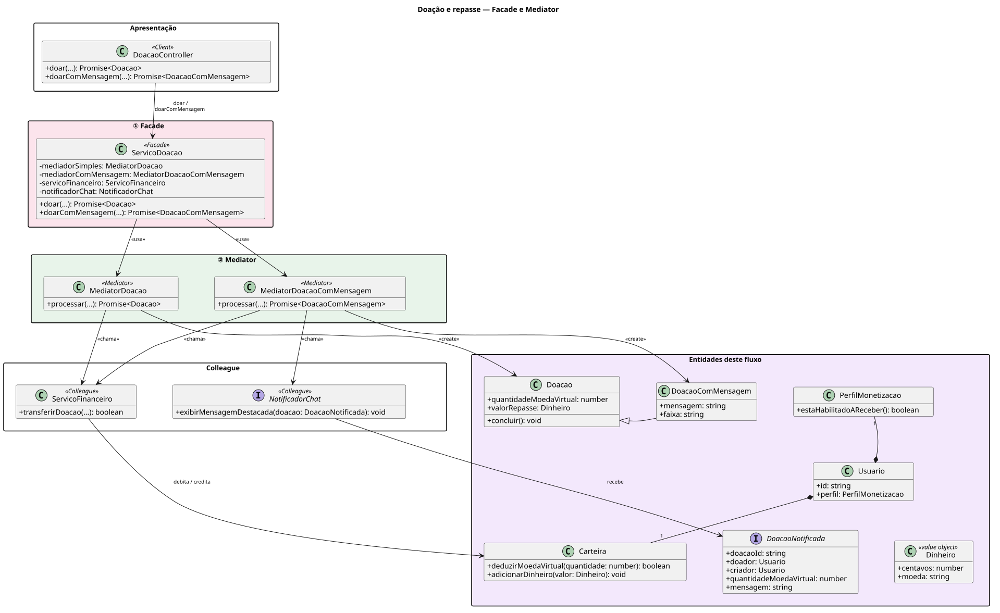
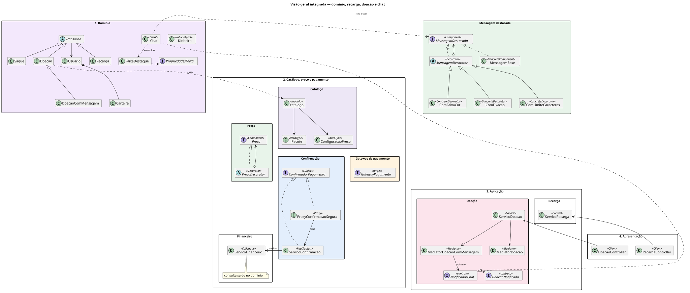

# Doação com Mensagem e Repasse ao Criador - SubEquipe_02

> **Etapas da história**: 2 · Doação com mensagem e 4 · Repasse ao criador ([visão geral](/Base/Relatórios/1.1.2.SubEquipe_02/README.md)).
> **Padrões aplicados**: **Facade** · **Mediator**.
> **Status**: 🟢 Código e diagrama disponíveis (`feature/f3-chat`) · **Responsáveis**: Daniel de Oliveira Lira e Pedro Henrique Freire Rodrigues.
> **Repositório**: [src/f2-doacao](https://github.com/UnBArqDsw2026-2-Turma01/2026.2-T01-_G6_ProjetoStreamingVideo_SubEquipe02_Codigo/tree/feature/f3-chat/src/f2-doacao).

## 1. Participantes na Frente

| Membro | Papel na frente |
| -- | -- |
| Daniel de Oliveira Lira | Responsável compartilhado da Doação e Repasse ([Ata S2_02](/Projeto/Atas/Atas_Sg2/ata-S2-02-2026-10-10.md)) |
| Pedro Henrique Freire Rodrigues | Responsável compartilhado da Doação e Repasse ([Ata S2_02](/Projeto/Atas/Atas_Sg2/ata-S2-02-2026-10-10.md)) |

Detalhamento individual de contribuição permanece a preencher pelos integrantes.

## 2. Metodologia da Frente

A frente foi definida na S2_02 (Facade + Proxy de repasse no plano inicial). A modelagem PlantUML e a implementação TypeScript convergiram para **Facade + Mediator**: a fachada expõe a operação ao controller; o mediator orquestra `ServicoFinanceiro` e `NotificadorChat` sem que esses colegas se conheçam. Ferramentas: TypeScript, Jest, PlantUML.

| Evento | Data | Registro |
| -- | -- | --- |
| Definição da frente e dos padrões (plano inicial) | 10/10/2026 | [Ata S2_02](/Projeto/Atas/Atas_Sg2/ata-S2-02-2026-10-10.md) |
| Implementação e diagrama alinhados a Facade+Mediator | branch `feature/f3-chat` | [`assets/doacao-visao-geral.puml`](assets/doacao-visao-geral.puml ':ignore') · [src/f2-doacao](https://github.com/UnBArqDsw2026-2-Turma01/2026.2-T01-_G6_ProjetoStreamingVideo_SubEquipe02_Codigo/tree/feature/f3-chat/src/f2-doacao) |

## 3. Contexto (problema)

Na doação, o espectador envia moeda virtual a um criador, junto com uma mensagem. A doação aciona dois efeitos paralelos: o repasse ao criador e a exibição da mensagem destacada no chat - esta última de forma assíncrona / best-effort, sem condicionar o repasse ([Ata S2_02, D05](/Projeto/Atas/Atas_Sg2/ata-S2-02-2026-10-10.md)).

| # | Problema | Padrão |
| -- | -- | -- |
| P1 | Uma operação simples de doação precisa, internamente, validar partes, transferir saldo e (opcionalmente) notificar o chat, sem expor essa coordenação a quem a utiliza | Facade |
| P2 | Financeiro e chat não devem conhecer um ao outro; a sequência (transferir → concluir → notificar) fica centralizada | Mediator |

**Proxy de repasse (não aplicado).** A Ata S2_02 previa Proxy para evitar repasse duplicado; na implementação atual essa responsabilidade não aparece como Proxy na Doação e Repasse - a orquestração ficou no Mediator e a transferência no `ServicoFinanceiro`.

**Modelos anteriores relevantes**: diagrama de sequência da Doação, `ServicoDoacao` e `ServicoFinanceiro` (Entrega 02).

## 4. Fundamentação Teórica

| Padrão | Intenção (GoF) | Participantes |
| -- | -- | -- |
| Facade | Fornecer uma interface unificada para um conjunto de interfaces de um subsistema | Facade, Client, (subsistemas encapsulados) |
| Mediator | Definir um objeto que encapsula como um conjunto de objetos interage, promovendo acoplamento fraco | Mediator, Colleague |

Fontes: Gamma et al. (GoF); material complementar UnB (Mediator); ver [Referências](/Base/Relatórios/1.1.2.SubEquipe_02/1.1.2.5.Referencias.md).

## 5. Padrões Aplicados

### 5.1. Facade - operação de doação

**Escolha e justificativa.** O controller só precisa chamar `doar` / `doarComMensagem`. `ServicoDoacao` encaminha aos mediators e não concentra regra de orquestração - papel clássico de Facade sobre a superfície da frente.

**Mapeamento dos participantes**

| Papel no padrão | Classe no sistema | Responsabilidade |
| -- | -- | -- |
| Facade | `ServicoDoacao` | Expõe `doar` / `doarComMensagem` e opções de faixa; encaminha aos mediators |
| Client | `DoacaoController` | Recebe a requisição da doação e usa a fachada |
| Composição | `montarDoacao` | Monta Facade + Mediators + colleagues |

**Modelagem (UML)**

[](assets/doacao-visao-geral.svg ':ignore')

*Figura 1 - Visão geral da Doação e Repasse (Facade + Mediator) (clique para ampliar). Autores: Daniel de Oliveira Lira e Pedro Henrique Freire Rodrigues, 18/10/2026. Arquivo-fonte: [`assets/doacao-visao-geral.puml`](assets/doacao-visao-geral.puml ':ignore').*

**Implementação**

- [`ServicoDoacao.ts`](https://github.com/UnBArqDsw2026-2-Turma01/2026.2-T01-_G6_ProjetoStreamingVideo_SubEquipe02_Codigo/blob/feature/f3-chat/src/f2-doacao/ServicoDoacao.ts)
- [`DoacaoController.ts`](https://github.com/UnBArqDsw2026-2-Turma01/2026.2-T01-_G6_ProjetoStreamingVideo_SubEquipe02_Codigo/blob/feature/f3-chat/src/f2-doacao/DoacaoController.ts)
- [`montarDoacao.ts`](https://github.com/UnBArqDsw2026-2-Turma01/2026.2-T01-_G6_ProjetoStreamingVideo_SubEquipe02_Codigo/blob/feature/f3-chat/src/f2-doacao/montarDoacao.ts)

**Teste**

- [`tests/f2-doacao/ServicoDoacao.test.ts`](https://github.com/UnBArqDsw2026-2-Turma01/2026.2-T01-_G6_ProjetoStreamingVideo_SubEquipe02_Codigo/blob/feature/f3-chat/tests/f2-doacao/ServicoDoacao.test.ts)
- [`tests/f2-doacao/DoacaoController.test.ts`](https://github.com/UnBArqDsw2026-2-Turma01/2026.2-T01-_G6_ProjetoStreamingVideo_SubEquipe02_Codigo/blob/feature/f3-chat/tests/f2-doacao/DoacaoController.test.ts)

---

### 5.2. Mediator - orquestração doação / repasse / chat

**Escolha e justificativa.** Em vez de Proxy de repasse, a Doação e Repasse centraliza a sequência em `MediatorDoacao` (sem mensagem) e `MediatorDoacaoComMensagem` (com notificação best-effort ao chat). Os colleagues (`ServicoFinanceiro`, `NotificadorChat`) não se referenciam mutuamente.

**Mapeamento dos participantes**

| Papel no padrão | Classe no sistema | Responsabilidade |
| -- | -- | -- |
| Mediator | `MediatorDoacao` | Valida partes, cria `Doacao`, transfere via financeiro, conclui e registra |
| Mediator | `MediatorDoacaoComMensagem` | Idem com `DoacaoComMensagem` + notificação ao chat (falha no chat não estorna) |
| Colleague | `ServicoFinanceiro` | Transferência de moeda virtual |
| Colleague | `NotificadorChat` (contrato; stub `NotificadorChatProvisorio` ou `Chat` da Mensagem Destacada) | Notifica a doação para destaque no chat |
| Client do Mediator | `ServicoDoacao` (Facade) | Encaminha a chamada ao mediator adequado |

**Modelagem (UML)**

O diagrama da seção 5.1 (`doacao-visao-geral`) já destaca os estereótipos `<<Mediator>>` / `<<Colleague>>` e as associações `<<chama>>` / `<<usa>>`. O mapa integrado abaixo situa a Doação e Repasse no domínio e na ligação com a Recarga:

[](assets/visao-geral-integrada.svg ':ignore')

*Figura 2 - Mapa integrado (domínio + Recarga + Doação e Repasse), com o trecho da doação/Mediator (clique para ampliar). Autores: Daniel de Oliveira Lira e Pedro Henrique Freire Rodrigues, 18/10/2026. Arquivo-fonte: [`assets/visao-geral-integrada.puml`](assets/visao-geral-integrada.puml ':ignore').*

**Implementação**

- [`MediatorDoacao.ts`](https://github.com/UnBArqDsw2026-2-Turma01/2026.2-T01-_G6_ProjetoStreamingVideo_SubEquipe02_Codigo/blob/feature/f3-chat/src/f2-doacao/MediatorDoacao.ts)
- [`MediatorDoacaoComMensagem.ts`](https://github.com/UnBArqDsw2026-2-Turma01/2026.2-T01-_G6_ProjetoStreamingVideo_SubEquipe02_Codigo/blob/feature/f3-chat/src/f2-doacao/MediatorDoacaoComMensagem.ts)
- Colleague financeiro: [`ServicoFinanceiro.ts`](https://github.com/UnBArqDsw2026-2-Turma01/2026.2-T01-_G6_ProjetoStreamingVideo_SubEquipe02_Codigo/blob/feature/f3-chat/src/financeiro/ServicoFinanceiro.ts)
- Contrato de chat: [`NotificadorChat.ts`](https://github.com/UnBArqDsw2026-2-Turma01/2026.2-T01-_G6_ProjetoStreamingVideo_SubEquipe02_Codigo/blob/feature/f3-chat/src/contratos/NotificadorChat.ts)

**Teste**

- Suíte [`tests/f2-doacao/`](https://github.com/UnBArqDsw2026-2-Turma01/2026.2-T01-_G6_ProjetoStreamingVideo_SubEquipe02_Codigo/tree/feature/f3-chat/tests/f2-doacao) (cenários de doação simples e com mensagem, incluindo falha de chat sem invalidar a doação)

## 6. Execução e Vídeo

**Pré-requisitos**: Node.js + npm; clone do [SubEquipe02_Codigo](https://github.com/UnBArqDsw2026-2-Turma01/2026.2-T01-_G6_ProjetoStreamingVideo_SubEquipe02_Codigo); `npm install` na raiz; branch `feature/f3-chat`.

**Comandos**

```bash
npm test                 # inclui tests/f2-doacao
npm run demo:f2          # Facade + Mediator (doação simples e com mensagem)
```

**Cenário demonstrado**: doação com transferência financeira e notificação ao chat; cenário em que a falha do notificador não desfaz a doação (D05).

**Resultado esperado**: saída do demo mostrando doação concluída e estado da notificação (`notificacaoChatEnviada` / aviso).

### 🎬 Vídeo da frente

*(Pendente: inserção do vídeo)*

| Vídeo | Duração | Responsáveis | Link |
| -- | -- | -- | -- |
| Doação com mensagem e Repasse | - | Daniel de Oliveira Lira e Pedro Henrique Freire Rodrigues | Pendente |

## 7. Rastreabilidade & Elos com Outros Artefatos

| Problema ou requisito | Artefato de origem | Elemento do modelo | Código | Evidência de execução |
| -- | -- | -- | -- | -- |
| P1 · Doação coordenando financeiro e chat | [Modelagem Dinâmica - Entrega 02](https://unbarqdsw2026-2-turma01.github.io/2026.2-T01-_G6_ProjetoStreamingVideo_Entrega_02/#/Base/Relatórios/1.1.2.SubEquipe_02/1.1.2.2.Foco02.ModelagemDinamica) | `ServicoDoacao` · Mediators | [`src/f2-doacao/`](https://github.com/UnBArqDsw2026-2-Turma01/2026.2-T01-_G6_ProjetoStreamingVideo_SubEquipe02_Codigo/tree/feature/f3-chat/src/f2-doacao) | `npm run demo:f2` · vídeo Pendente |
| P2 · Orquestração sem acoplamento entre colleagues | [Ata S2_02, D05](/Projeto/Atas/Atas_Sg2/ata-S2-02-2026-10-10.md) (efeito assíncrono no chat) | `MediatorDoacaoComMensagem` | [`MediatorDoacaoComMensagem.ts`](https://github.com/UnBArqDsw2026-2-Turma01/2026.2-T01-_G6_ProjetoStreamingVideo_SubEquipe02_Codigo/blob/feature/f3-chat/src/f2-doacao/MediatorDoacaoComMensagem.ts) | `npm run demo:f2` |
| Repasse independente da exibição no chat (SC04) | [Engenharia Reversa complementar - Entrega 02](https://unbarqdsw2026-2-turma01.github.io/2026.2-T01-_G6_ProjetoStreamingVideo_Entrega_02/#/Base/Relatórios/1.1.2.SubEquipe_02/1.1.2.4.Extra.EngenhariaReversa) | Notificação best-effort ao `NotificadorChat` | [`MediatorDoacaoComMensagem.ts`](https://github.com/UnBArqDsw2026-2-Turma01/2026.2-T01-_G6_ProjetoStreamingVideo_SubEquipe02_Codigo/blob/feature/f3-chat/src/f2-doacao/MediatorDoacaoComMensagem.ts) | `npm run demo:f2` |

## 8. Senso Crítico

**O que a frente entrega bem.** Facade + Mediator deixam claro o ponto de entrada (`DoacaoController` → `ServicoDoacao`) e a orquestração (`Mediator*`), coerentes com o PUML `doacao-visao-geral`.

**Limitações reconhecidas.** Proxy de repasse planejado na Ata S2_02 não foi implementado; vídeo ainda pendente; `historia-completa` ainda usa stubs provisórios em trechos da integração Doação e Repasse / Mensagem Destacada.

**O que faria diferente.** *A preencher pelos integrantes* (opinião pessoal).

## 9. Participantes & Comprobatórios

| Membro | Contribuição | Comprobatório (commit/PR) |
| -- | -- | -- |
| Daniel de Oliveira Lira | A preencher pelo integrante | A preencher |
| Pedro Henrique Freire Rodrigues | A preencher pelo integrante | A preencher |

## 10. Referências

As referências estão catalogadas em [1.1.2.5. Referências - SubEquipe_02](/Base/Relatórios/1.1.2.SubEquipe_02/1.1.2.5.Referencias.md).

| # | Onde foi usada nesta página |
| -- | -- |
| Gamma et al. (GoF) | Intenção e participantes de Facade e Mediator (§4–5) |
| Material complementar UnB (Mediator) | Modelagem e papéis Colleague/Mediator (§5.2) |
| Ata S2_02 | Definição da frente, D05 e plano inicial com Proxy (§2–3) |

---

## Histórico de Versões

| Versão | Data | Descrição | Autor(es) | Revisor(es) |
| -- | -- | -- | -- | -- |
| 1.0 | 11/10/2026 | Criação do molde da página da Doação e Repasse | Davi Severiano Freitas | |
| 1.1 | 17/10/2026 | Alinhamento a Facade+Mediator conforme código e `doacao-visao-geral` | Pedro Henrique Freire Rodrigues | |
| 1.2 | 18/10/2026 | Importação dos diagramas da Doação e Repasse para `assets/` e inserção das Figuras 1 e 2 no relatório | Pedro Henrique Freire Rodrigues | |
