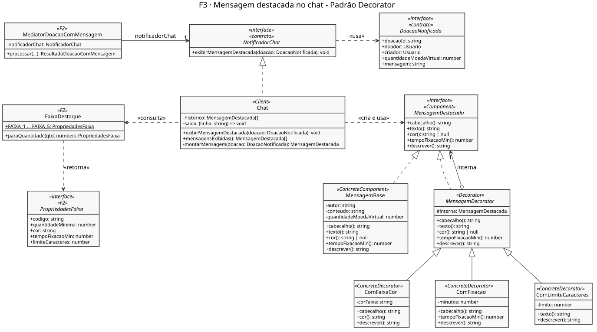

# F3 · Mensagem Destacada no Chat — SubEquipe_02

> **Etapa da história**: 3 · Mensagem destacada no chat ([visão geral](/Base/Relatórios/1.1.2.SubEquipe_02/README.md)).
> **Padrão aplicado**: **Decorator**.
> **Status**: 🟡 Modelagem, código e testes concluídos e integrados na `main` ([PR #3](https://github.com/UnBArqDsw2026-2-Turma01/2026.2-T01-_G6_ProjetoStreamingVideo_SubEquipe02_Codigo/pull/3)). Pendente: vídeo · **Responsável**: Mateus Rodrigues Barreto.
> **Repositório**: [src/f3-chat](https://github.com/UnBArqDsw2026-2-Turma01/2026.2-T01-_G6_ProjetoStreamingVideo_SubEquipe02_Codigo/tree/main/src/f3-chat).

## 1. Participantes na Frente

| Membro | Papel na frente |
| -- | -- |
| Mateus Rodrigues Barreto | Modelagem, implementação, testes e demonstração do Decorator da mensagem destacada; integração das três frentes e front-end da história ([Ata S2_04, D02](/Projeto/Atas/Atas_Sg2/ata-S2-04-2026-10-16.md)) |

## 2. Metodologia da Frente

A frente partiu do que a Entrega 02 já modelava para o chat (`FaixaDestaque` e `Chat.destacar`) e dos achados SC01 e SC02 da Engenharia Reversa, que definem as faixas de destaque. O trabalho seguiu quatro passos:

1. **Estudo do padrão**, com o material da disciplina sobre GoFs estruturais, comparando o Decorator com Adapter e Facade para confirmar que o problema era acrescentar comportamento a um objeto sem trocar a sua interface.
2. **Modelagem** em PlantUML, já alinhada ao contrato `NotificadorChat`, que é o ponto de encontro com a F2, e à `FaixaDestaque`, que a F2 usa para validar a doação.
3. **Implementação** em TypeScript, uma camada por classe, com testes Jest de cada camada isolada, das combinações e da integração com a F2.
4. **Integração** com a F1 e a F2 e construção do front-end comum da história, conforme a decisão D02 da S2_04.

**Mudanças de rumo.**

- O **emblema**, previsto como terceira camada no molde da página, saiu do escopo: os achados SC01 e SC02 só definem cor, fixação e limite de caracteres por faixa.
- O `ComLimiteCaracteres` começou **cortando** a mensagem no limite. Passou a **recusá-la**, porque cortar alteraria o que o espectador escreveu e divergiria da F2, que já recusa a doação nesse caso.
- A saída foi primeiro pelo **terminal** ([Ata S2_03](/Projeto/Atas/Atas_Sg2/ata-S2-03-2026-10-13.md)). No front-end, a cor e a fixação precisavam virar efeito visual, e não texto. Por isso o Component ganhou `cor()`, ao lado do `tempoFixacaoMin()` que já existia: a página pinta a mensagem e a mantém no topo do chat com os valores devolvidos pela pilha de decoradores.

**Ferramentas.** TypeScript, Jest, PlantUML e GitHub (pull requests).

| Evento | Data | Registro |
| -- | -- | -- |
| Definição da frente e do padrão | 10/10/2026 | [Ata S2_02](/Projeto/Atas/Atas_Sg2/ata-S2-02-2026-10-10.md) |
| Saída inicial pelo terminal; interface gráfica só depois da integração | 13/10/2026 | [Ata S2_03](/Projeto/Atas/Atas_Sg2/ata-S2-03-2026-10-13.md) |
| Diagrama, código, testes e demonstração da F3 | 16/10/2026 | Commits [`2203fa3`](https://github.com/UnBArqDsw2026-2-Turma01/2026.2-T01-_G6_ProjetoStreamingVideo_SubEquipe02_Codigo/commit/2203fa3) a [`e724b78`](https://github.com/UnBArqDsw2026-2-Turma01/2026.2-T01-_G6_ProjetoStreamingVideo_SubEquipe02_Codigo/commit/e724b78) · apresentação dos testes na [Ata S2_04](/Projeto/Atas/Atas_Sg2/ata-S2-04-2026-10-16.md) |
| Pull request da F3 aceito na `main` | 17/10/2026 | [PR #3](https://github.com/UnBArqDsw2026-2-Turma01/2026.2-T01-_G6_ProjetoStreamingVideo_SubEquipe02_Codigo/pull/3) |
| Integração das frentes e front-end | 17 e 18/10/2026 | Branch [`feature/integracao-front`](https://github.com/UnBArqDsw2026-2-Turma01/2026.2-T01-_G6_ProjetoStreamingVideo_SubEquipe02_Codigo/tree/feature/integracao-front) · [Ata S2_04, D02](/Projeto/Atas/Atas_Sg2/ata-S2-04-2026-10-16.md) |

## 3. Contexto (problema)

Após a doação, a mensagem do espectador é exibida no chat com destaque. A exibição é assíncrona: uma falha nesta etapa não invalida a doação nem o repasse ([Ata S2_02, D05](/Projeto/Atas/Atas_Sg2/ata-S2-02-2026-10-10.md)).

O destaque depende da faixa do valor doado (SC01, SC02):

| Faixa | A partir de | Cor | Fixação no topo do chat | Limite de caracteres |
| -- | --: | -- | -- | --: |
| FAIXA_1 | 200 | Azul | Não fixa | 50 |
| FAIXA_2 | 500 | Verde | 2 min | 150 |
| FAIXA_3 | 2.000 | Laranja | 10 min | 225 |
| FAIXA_4 | 5.000 | Rosa | 30 min | 250 |
| FAIXA_5 | 50.000 | Vermelho | 5 h | 350 |

| # | Problema | Padrão |
| -- | -- | -- |
| P1 | A mensagem recebe camadas de destaque (cor da faixa, fixação no topo e limite de caracteres) que variam conforme o valor doado e se combinam de formas diferentes (a FAIXA_1, por exemplo, não fixa), sem alterar a mensagem original | Decorator |

**Modelos anteriores relevantes**: `FaixaDestaque` e `Chat.destacar` (diagrama de classes da Entrega 02) · achados SC01 e SC02 sobre as faixas de destaque.

## 4. Fundamentação Teórica

| Padrão | Intenção (GoF) | Participantes |
| -- | -- | -- |
| Decorator | Agregar dinamicamente responsabilidades adicionais a um objeto, como alternativa flexível ao uso de subclasses para estender funcionalidades | **Component** (interface comum) · **ConcreteComponent** (objeto original) · **Decorator** (implementa o Component e guarda uma referência a outro Component) · **ConcreteDecorator** (acrescenta uma responsabilidade antes ou depois de delegar) |

O ponto central é que o decorador **é** um Component e **tem** um Component. Por isso as camadas se empilham em qualquer ordem e quantidade, e quem usa a mensagem não precisa saber quantas camadas ela tem. A alternativa por herança exigiria uma subclasse para cada combinação (mensagem azul, verde fixada, laranja fixada e assim por diante), e cada nova camada multiplicaria as classes.

Fontes: material da disciplina sobre GoFs estruturais, Gamma et al. (GoF) e SourceMaking (Decorator). Ver [Referências](/Base/Relatórios/1.1.2.SubEquipe_02/1.1.2.5.Referencias.md).

## 5. Padrão Aplicado

### 5.1. Decorator — camadas da mensagem destacada

**Escolha e justificativa.** Cada destaque das faixas é uma responsabilidade independente que se soma à mensagem: a cor muda a apresentação, a fixação determina quanto tempo ela fica no topo e o limite valida o texto. As faixas combinam essas responsabilidades de formas diferentes: todas têm cor e limite, mas só a partir da FAIXA_2 há fixação. Com o Decorator:

- cada destaque fica numa classe pequena, testável sozinha;
- o `Chat` monta só as camadas que a faixa pede;
- um destaque novo entra como mais um decorador, sem alterar a mensagem nem os outros destaques.

**Mapeamento dos participantes**

| Papel no padrão | Classe no sistema | Responsabilidade |
| -- | -- | -- |
| Component | `MensagemDestacada` (interface) | O que o chat sabe exibir: `cabecalho()`, `texto()`, `cor()`, `tempoFixacaoMin()` e `descrever()` |
| ConcreteComponent | `MensagemBase` | A mensagem da doação como chegou: autor, texto e valor, sem destaque |
| Decorator | `MensagemDecorator` (abstrata) | Implementa `MensagemDestacada`, guarda a camada interna e delega tudo a ela por padrão |
| ConcreteDecorator | `ComFaixaCor` | Define a cor da faixa (SC01) |
| ConcreteDecorator | `ComFixacao` | Define o tempo de fixação no topo do chat (SC01) |
| ConcreteDecorator | `ComLimiteCaracteres` | Recusa o texto acima do limite da faixa (SC02) |
| Client | `Chat` | Implementa o contrato `NotificadorChat` da F2 e monta a pilha de camadas conforme a `FaixaDestaque` do valor doado |

**Modelagem (UML)**

[](assets/f3-decorator.svg ':ignore')

*Figura 1 — Decorator da mensagem destacada e a ligação com a F2 pelo contrato `NotificadorChat` (clique para ampliar). Autor: Mateus Rodrigues Barreto, 18/10/2026. Arquivo-fonte: [`assets/f3-decorator.puml`](assets/f3-decorator.puml ':ignore').*

**Implementação**

| Participante | Arquivo | O que observar |
| -- | -- | -- |
| Component | [`MensagemDestacada.ts`](https://github.com/UnBArqDsw2026-2-Turma01/2026.2-T01-_G6_ProjetoStreamingVideo_SubEquipe02_Codigo/blob/main/src/f3-chat/MensagemDestacada.ts) | Interface única para a mensagem pura e para cada camada |
| ConcreteComponent | [`MensagemBase.ts`](https://github.com/UnBArqDsw2026-2-Turma01/2026.2-T01-_G6_ProjetoStreamingVideo_SubEquipe02_Codigo/blob/main/src/f3-chat/MensagemBase.ts) | Sem cor (`null`) e sem fixação (`0`) |
| Decorator | [`MensagemDecorator.ts`](https://github.com/UnBArqDsw2026-2-Turma01/2026.2-T01-_G6_ProjetoStreamingVideo_SubEquipe02_Codigo/blob/main/src/f3-chat/MensagemDecorator.ts) | `protected readonly interna: MensagemDestacada` e delegação de todos os métodos |
| ConcreteDecorators | [`ComFaixaCor.ts`](https://github.com/UnBArqDsw2026-2-Turma01/2026.2-T01-_G6_ProjetoStreamingVideo_SubEquipe02_Codigo/blob/main/src/f3-chat/ComFaixaCor.ts) · [`ComFixacao.ts`](https://github.com/UnBArqDsw2026-2-Turma01/2026.2-T01-_G6_ProjetoStreamingVideo_SubEquipe02_Codigo/blob/main/src/f3-chat/ComFixacao.ts) · [`ComLimiteCaracteres.ts`](https://github.com/UnBArqDsw2026-2-Turma01/2026.2-T01-_G6_ProjetoStreamingVideo_SubEquipe02_Codigo/blob/main/src/f3-chat/ComLimiteCaracteres.ts) | Cada um sobrescreve só o método da sua responsabilidade e delega o resto |
| Client | [`Chat.ts`](https://github.com/UnBArqDsw2026-2-Turma01/2026.2-T01-_G6_ProjetoStreamingVideo_SubEquipe02_Codigo/blob/main/src/f3-chat/Chat.ts) | `montarMensagem`, que empilha as camadas; `exibirMensagemDestacada`, que monta as linhas antes de exibir, para que uma recusa não deixe nada pela metade |

A montagem da pilha no `Chat`:

```ts
const faixa = FaixaDestaque.paraQuantidade(doacao.quantidadeMoedaVirtual);

let mensagem: MensagemDestacada = new MensagemBase(doacao.doador.nome, doacao.mensagem, doacao.quantidadeMoedaVirtual);
mensagem = new ComLimiteCaracteres(mensagem, faixa.limiteCaracteres);
mensagem = new ComFaixaCor(mensagem, faixa.cor);
if (faixa.tempoFixacaoMin > 0) {
  mensagem = new ComFixacao(mensagem, faixa.tempoFixacaoMin);
}
```

Uma camada repassando o que não é dela, e acrescentando o que é (`ComFaixaCor`):

```ts
override cabecalho(): string {
  return `[${this.corFaixa}] ${this.interna.cabecalho()}`;
}

override cor(): string {
  return this.corFaixa;
}
// texto() e tempoFixacaoMin() vêm de MensagemDecorator, que delega à camada interna
```

**Uso no front-end.** A página da história ([`src/web`](https://github.com/UnBArqDsw2026-2-Turma01/2026.2-T01-_G6_ProjetoStreamingVideo_SubEquipe02_Codigo/tree/feature/integracao-front/src/web)) não decide o destaque: lê `cor()` e `tempoFixacaoMin()` da mensagem que o `Chat` montou. Com isso, pinta a mensagem com a cor da faixa e a mantém fixada no topo do chat pelo tempo da faixa, retirando-a quando o tempo acaba.

**Teste**

28 testes, todos passando:

- [`tests/f3-chat/MensagemDecorator.test.ts`](https://github.com/UnBArqDsw2026-2-Turma01/2026.2-T01-_G6_ProjetoStreamingVideo_SubEquipe02_Codigo/blob/main/tests/f3-chat/MensagemDecorator.test.ts): cada camada isolada, empilhamento, retirada de uma camada sem quebrar as outras e preservação da mensagem original.
- [`tests/f3-chat/Chat.test.ts`](https://github.com/UnBArqDsw2026-2-Turma01/2026.2-T01-_G6_ProjetoStreamingVideo_SubEquipe02_Codigo/blob/main/tests/f3-chat/Chat.test.ts): a faixa certa para cada valor, a FAIXA_1 sem fixação, a recusa acima do limite sem saída parcial e a integração com a Facade da F2. Inclui o cenário em que a saída do chat falha e a doação e o repasse continuam válidos (D05).

**Relação com a Frente 1.** A [Frente 1](/Base/Relatórios/1.1.2.SubEquipe_02/1.1.2.1.F1.Recarga.md) aplica o mesmo padrão ao preço do pacote: `Preco` (Component), `PrecoPacote` (ConcreteComponent), `PrecoDecorator` (Decorator) e `ComDesconto`, `ComTaxaFixa` e `ComImposto` (ConcreteDecorators). A estrutura é idêntica, o que evidencia a generalidade do padrão, mas o uso difere:

| Aspecto | F1 · Preço | F3 · Mensagem |
| -- | -- | -- |
| O que se decora | Um valor numérico | A apresentação e as regras de exibição de uma mensagem |
| Efeito de cada camada | Transforma o valor (desconto, taxa, imposto) | Acrescenta uma propriedade (cor, fixação) ou uma validação (limite) |
| A ordem importa? | Sim: o imposto incide sobre o preço já com desconto | Pouco: cada camada mexe numa parte diferente; a ordem só afeta a montagem do cabeçalho no terminal |
| Quem monta a pilha | `ServicoRecarga`, pela configuração de preço | `Chat`, pela faixa do valor doado |

O `ComLimiteCaracteres` também mostra que um decorador pode **restringir**, e não só acrescentar: ele recusa a mensagem em vez de transformá-la.

## 6. Execução e Vídeo

**Pré-requisitos**: Node.js 20.12 ou mais recente e npm; clone do [SubEquipe02_Codigo](https://github.com/UnBArqDsw2026-2-Turma01/2026.2-T01-_G6_ProjetoStreamingVideo_SubEquipe02_Codigo); `npm install` na raiz.

**Comandos**

```bash
npm run demo:f3           # F3 no terminal: as cinco faixas, a recusa pelo limite e a integração com a F2
npx jest tests/f3-chat    # testes da F3
npm run demo              # história completa no terminal (F1 → F2 → F3 → repasse)
npm run web               # front-end da história em http://localhost:3000
```

**Cenário demonstrado** (`demo:f3`): a mesma mensagem é exibida com doações de cada faixa e recebe camadas diferentes. Em seguida, uma mensagem acima do limite da FAIXA_1 é recusada. Por fim, uma doação feita pela Facade da F2 aparece no chat da F3.

**Resultado esperado** (trecho):

```text
[chat] [AZUL] Espectador · 200 de moeda virtual
       "Valeu pela live!"
         camadas: mensagem → limite de 50 caracteres → cor AZUL

[chat] [LARANJA] Espectador · 2000 de moeda virtual · fixada por 10 min
       "Valeu pela live!"
         camadas: mensagem → limite de 225 caracteres → cor LARANJA → fixação de 10 min

  [Limite] Mensagem acima do limite da faixa é recusada, sem exibir nada (SC02):
    recusada: A mensagem tem 71 caracteres e excede o limite de 50 da faixa (SC02).
```

No front-end, a mesma pilha aparece como efeito visual: a mensagem vem na cor da faixa e, a partir da FAIXA_2, fica fixada no topo do chat em versão compacta, com a mensagem inteira ao passar o mouse. Um controle de velocidade (1x a 1000x) permite ver a fixação terminar sem esperar o tempo real.

### 🎬 Vídeo da frente

<!--
Para incorporar um vídeo do YouTube, substitua ID_DO_VIDEO e remova o comentário:
<iframe width="100%" height="400" src="https://www.youtube.com/embed/ID_DO_VIDEO" title="F3 · Mensagem destacada" frameborder="0" allowfullscreen></iframe>
-->
*(Pendente: inserção do vídeo)*

| Vídeo | Duração | Responsável | Link |
| -- | -- | -- | -- |
| F3 · Mensagem destacada no chat | *A preencher* | Mateus Rodrigues Barreto | *Pendente* |

## 7. Rastreabilidade & Elos com Outros Artefatos

| Problema ou requisito | Artefato de origem | Elemento do modelo | Código | Evidência de execução |
| -- | -- | -- | -- | -- |
| P1 · Camadas de destaque por faixa de valor (SC01, SC02) | [Engenharia Reversa complementar — Entrega 02](https://unbarqdsw2026-2-turma01.github.io/2026.2-T01-_G6_ProjetoStreamingVideo_Entrega_02/#/Base/Relatórios/1.1.2.SubEquipe_02/1.1.2.4.Extra.EngenhariaReversa) | `FaixaDestaque` · `Chat.destacar` (Entrega 02) → `MensagemDestacada`, `MensagemDecorator` e decoradores (Figura 1) | [`src/f3-chat/`](https://github.com/UnBArqDsw2026-2-Turma01/2026.2-T01-_G6_ProjetoStreamingVideo_SubEquipe02_Codigo/tree/main/src/f3-chat) | `npm run demo:f3` · [`MensagemDecorator.test.ts`](https://github.com/UnBArqDsw2026-2-Turma01/2026.2-T01-_G6_ProjetoStreamingVideo_SubEquipe02_Codigo/blob/main/tests/f3-chat/MensagemDecorator.test.ts) |
| Limite de caracteres por faixa (SC02) | [Engenharia Reversa complementar — Entrega 02](https://unbarqdsw2026-2-turma01.github.io/2026.2-T01-_G6_ProjetoStreamingVideo_Entrega_02/#/Base/Relatórios/1.1.2.SubEquipe_02/1.1.2.4.Extra.EngenhariaReversa) | `ComLimiteCaracteres` | [`ComLimiteCaracteres.ts`](https://github.com/UnBArqDsw2026-2-Turma01/2026.2-T01-_G6_ProjetoStreamingVideo_SubEquipe02_Codigo/blob/main/src/f3-chat/ComLimiteCaracteres.ts) | `npm run demo:f3` (recusa da mensagem de 71 caracteres) |
| Ligação com a doação (contrato entre F2 e F3) | [Ata S2_02](/Projeto/Atas/Atas_Sg2/ata-S2-02-2026-10-10.md) · [F2](/Base/Relatórios/1.1.2.SubEquipe_02/1.1.2.2.F2.DoacaoRepasse.md) | `NotificadorChat` ← `Chat` | [`Chat.ts`](https://github.com/UnBArqDsw2026-2-Turma01/2026.2-T01-_G6_ProjetoStreamingVideo_SubEquipe02_Codigo/blob/main/src/f3-chat/Chat.ts) · [`NotificadorChat.ts`](https://github.com/UnBArqDsw2026-2-Turma01/2026.2-T01-_G6_ProjetoStreamingVideo_SubEquipe02_Codigo/blob/main/src/contratos/NotificadorChat.ts) | [`Chat.test.ts`](https://github.com/UnBArqDsw2026-2-Turma01/2026.2-T01-_G6_ProjetoStreamingVideo_SubEquipe02_Codigo/blob/main/tests/f3-chat/Chat.test.ts) (integração com a F2) · `npm run demo` |
| Exibição assíncrona, sem estorno em caso de falha (SC04, D05) | [Engenharia Reversa complementar — Entrega 02](https://unbarqdsw2026-2-turma01.github.io/2026.2-T01-_G6_ProjetoStreamingVideo_Entrega_02/#/Base/Relatórios/1.1.2.SubEquipe_02/1.1.2.4.Extra.EngenhariaReversa) · [Ata S2_02, D05](/Projeto/Atas/Atas_Sg2/ata-S2-02-2026-10-10.md) | Notificação ao `Chat` pelo `MediatorDoacaoComMensagem` | `Chat` deixa o erro subir; a F2 mantém a doação e registra o aviso | [`Chat.test.ts`](https://github.com/UnBArqDsw2026-2-Turma01/2026.2-T01-_G6_ProjetoStreamingVideo_SubEquipe02_Codigo/blob/main/tests/f3-chat/Chat.test.ts) ("se a saída do chat falhar, a doação e o repasse continuam válidos (D05)") |
| Interface gráfica depois da integração | [Ata S2_03](/Projeto/Atas/Atas_Sg2/ata-S2-03-2026-10-13.md) · [Ata S2_04, D02](/Projeto/Atas/Atas_Sg2/ata-S2-04-2026-10-16.md) | `cor()` e `tempoFixacaoMin()` do Component | [`src/web/`](https://github.com/UnBArqDsw2026-2-Turma01/2026.2-T01-_G6_ProjetoStreamingVideo_SubEquipe02_Codigo/tree/feature/integracao-front/src/web) | `npm run web` |

## 8. Senso Crítico

**O que a frente entrega bem.** Cada destaque das faixas virou uma classe pequena e testada sozinha. O `Chat` monta só as camadas que a faixa pede, e o padrão aparece de verdade na história: a mesma pilha que gera as linhas no terminal decide a cor e a fixação na página. A F3 se liga à F2 só pelo contrato `NotificadorChat`. Por isso, a troca do chat provisório pelo real não exigiu mudança na F2.

**Limitações reconhecidas.**

- Há duas representações do destaque: `cabecalho()` gera texto para o terminal, e `cor()` e `tempoFixacaoMin()` dão os valores para a interface. Elas precisam ser mantidas coerentes.
- O limite de caracteres é verificado duas vezes: na F2, que recusa a doação, e no `ComLimiteCaracteres`, como defesa do próprio chat. A regra está em um lugar só (`FaixaDestaque`), mas a verificação se repete.
- A F3 informa por quanto tempo a mensagem fica fixada, mas quem conta esse tempo é a página. O domínio não tem um relógio próprio.
- Doações sem mensagem não aparecem no chat, porque a F2 só notifica o chat na doação com mensagem.

**O que faria diferente.** Colocaria no Component, desde o início, as propriedades estruturadas do destaque (cor e fixação), e não só o cabeçalho em texto. Assim, o front-end não teria exigido a mudança posterior na interface.

## 9. Participantes & Comprobatórios

| Membro | Contribuição | Comprobatório (commit/PR) |
| -- | -- | -- |
| Mateus Rodrigues Barreto | Diagrama, código e testes do Decorator da F3 e demonstração no terminal | [PR #3](https://github.com/UnBArqDsw2026-2-Turma01/2026.2-T01-_G6_ProjetoStreamingVideo_SubEquipe02_Codigo/pull/3) · [`2203fa3`](https://github.com/UnBArqDsw2026-2-Turma01/2026.2-T01-_G6_ProjetoStreamingVideo_SubEquipe02_Codigo/commit/2203fa3), [`9ee1a83`](https://github.com/UnBArqDsw2026-2-Turma01/2026.2-T01-_G6_ProjetoStreamingVideo_SubEquipe02_Codigo/commit/9ee1a83), [`23027a8`](https://github.com/UnBArqDsw2026-2-Turma01/2026.2-T01-_G6_ProjetoStreamingVideo_SubEquipe02_Codigo/commit/23027a8), [`d1b99c6`](https://github.com/UnBArqDsw2026-2-Turma01/2026.2-T01-_G6_ProjetoStreamingVideo_SubEquipe02_Codigo/commit/d1b99c6), [`72b3650`](https://github.com/UnBArqDsw2026-2-Turma01/2026.2-T01-_G6_ProjetoStreamingVideo_SubEquipe02_Codigo/commit/72b3650), [`2faeafb`](https://github.com/UnBArqDsw2026-2-Turma01/2026.2-T01-_G6_ProjetoStreamingVideo_SubEquipe02_Codigo/commit/2faeafb), [`e724b78`](https://github.com/UnBArqDsw2026-2-Turma01/2026.2-T01-_G6_ProjetoStreamingVideo_SubEquipe02_Codigo/commit/e724b78) |
| Mateus Rodrigues Barreto | Integração das três frentes na história completa e front-end | Branch [`feature/integracao-front`](https://github.com/UnBArqDsw2026-2-Turma01/2026.2-T01-_G6_ProjetoStreamingVideo_SubEquipe02_Codigo/tree/feature/integracao-front) · [`cb52f6d`](https://github.com/UnBArqDsw2026-2-Turma01/2026.2-T01-_G6_ProjetoStreamingVideo_SubEquipe02_Codigo/commit/cb52f6d) (história completa) · [`bbb3487`](https://github.com/UnBArqDsw2026-2-Turma01/2026.2-T01-_G6_ProjetoStreamingVideo_SubEquipe02_Codigo/commit/bbb3487) (cor e fixação no chat) |

## 10. Referências

As referências estão catalogadas em [1.1.2.5. Referências — SubEquipe_02](/Base/Relatórios/1.1.2.SubEquipe_02/1.1.2.5.Referencias.md).

| # | Onde foi usada nesta página |
| -- | -- |
| Serrano, aula de GoFs Estruturais | Intenção, estrutura e participantes do Decorator; comparação com Adapter e Facade (§2, §4) |
| Gamma et al. (GoF) | Intenção e participantes do Decorator (§4) |
| SourceMaking, Decorator Design Pattern | Estrutura do padrão e comparação com a herança (§4, §5.1) |
| Engenharia Reversa complementar — Entrega 02 (SC01, SC02, SC04) | Faixas de destaque e exibição assíncrona (§3, §7) |
| Modelagem Estática — Entrega 02 | `FaixaDestaque` e `Chat.destacar` como ponto de partida (§3, §7) |
| Atas S2_02, S2_03 e S2_04 | Definição da frente, D05, saída pelo terminal e D02 (§2, §3, §7) |

---

## Histórico de Versões

| Versão | Data | Descrição | Autor(es) | Revisor(es) |
| -- | -- | -- | -- | -- |
| 1.0 | 11/10/2026 | Criação do molde da página da Frente 3 | Davi Severiano Freitas | |
| 1.1 | 18/10/2026 | Preenchimento da página: metodologia, contexto com as faixas, fundamentação, modelagem, implementação, testes, execução, rastreabilidade e senso crítico | Mateus Rodrigues Barreto | |
