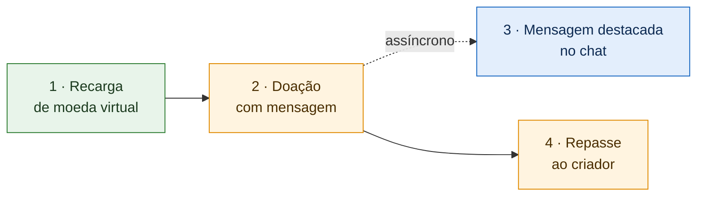

# 1.1.2. SubEquipe_02 — GoFs Estruturais + IA Generativa

> **Estado**: 🟡 Em andamento — padrões e frentes definidos ([Ata S2_02](/Projeto/Atas/Atas_Sg2/ata-S2-02-2026-10-10.md)); modelagem e implementação em produção.
> **Prazo interno**: 18/10/2026 · **Prazo oficial**: 19/10/2026.
> **Planejamento**: [Organização da Entrega 3](/Projeto/Atas/Atas_Sg2/organizacao-entrega-03.md).

Este relatório reúne a aplicação de padrões de projeto GoF estruturais pela SubEquipe_02. Em vez de um padrão isolado, a subequipe codifica **uma história de uso da plataforma** — da recarga de moeda virtual ao repasse ao criador — e aplica cada padrão no ponto da história em que surge um problema concreto de projeto.

## Integrantes

| Matrícula | Integrante | GitHub | Frente |
| --- | --- | --- | --- |
| 24/1011018 | Davi Severiano Freitas | [@Davi-UnB](https://github.com/Davi-UnB) | 🟩 F1 · Recarga de moeda virtual |
| 24/1025505 | Daniel de Oliveira Lira | [@Daniellira540](https://github.com/Daniellira540) | 🟧 F2 · Doação com mensagem e Repasse |
| 24/1011466 | Mateus Rodrigues Barreto | [@Mateus0xC](https://github.com/Mateus0xC) | 🟦 F3 · Mensagem destacada no chat |
| 23/1026545 | Pedro Henrique Freire Rodrigues | [@Pedro-Henrique3](https://github.com/Pedro-Henrique3) | 🟧 F2 · Doação com mensagem e Repasse |

Composição mantida conforme a [introdução da Entrega 02](https://unbarqdsw2026-2-turma01.github.io/2026.2-T01-_G6_ProjetoStreamingVideo_Entrega_02/#/Introducao).

## Foco do relatório

**GoFs Estruturais + IA Generativa.** A entrega mínima deste foco inclui um padrão estrutural, modelo UML, código e vídeo demonstrando sua execução, além dos pontos de vista individuais.

A SubEquipe_02 aplica **quatro padrões estruturais** — Adapter, Proxy, Decorator e Facade —, distribuídos em três frentes que compõem uma única história executável.

## Participantes no foco — lições aprendidas e IA Generativa

| Integrante | Frente | Lições aprendidas | Uso da IA Generativa (senso crítico) |
| --- | --- | --- | --- |
| Davi Severiano Freitas | F1 | A preencher pelo integrante | A preencher pelo integrante |
| Daniel de Oliveira Lira | F2 | A preencher pelo integrante | A preencher pelo integrante |
| Mateus Rodrigues Barreto | F3 | A preencher pelo integrante | A preencher pelo integrante |
| Pedro Henrique Freire Rodrigues | F2 | A preencher pelo integrante | A preencher pelo integrante |

Cada integrante deverá explicar o que aprendeu, como colaborou e, caso tenha usado IA, qual ferramenta utilizou, o apoio recebido, como validou os resultados e quais limitações encontrou. Informar também quando não houver uso de IA.

## Metodologia

**Organização do trabalho.** A subequipe manteve a especialização por domínio adotada na Entrega 02, agora organizada em **frentes de trabalho**, cada uma responsável por uma etapa da história. A divisão não é estanque: todas as frentes trabalham no mesmo repositório de código e podem colaborar entre si.

**Reuniões.**

| Reunião | Data | Resultado | Registro |
| --- | --- | --- | --- |
| S2_01 | 06/10/2026 | Linguagem (TypeScript), manutenção da divisão por módulos, prazo interno e regras de anonimização | [Ata S2_01](/Projeto/Atas/Atas_Sg2/ata-S2-01-2026-10-06.md) |
| S2_02 | 10/10/2026 | História da demonstração, padrões adotados, padrões descartados e divisão em três frentes | [Ata S2_02](/Projeto/Atas/Atas_Sg2/ata-S2-02-2026-10-10.md) |

**Estudo.** Cada integrante estudou os padrões da própria frente, com apoio de material de referência sobre padrões estruturais. A discussão em reunião comparou os sete padrões estruturais do GoF quanto à aplicabilidade na história (ver [Ata S2_02, §4](/Projeto/Atas/Atas_Sg2/ata-S2-02-2026-10-10.md)).

**Uso de IA Generativa no planejamento.** Um documento de apoio elaborado com auxílio de IA serviu de ponto de partida, mas foi tratado como sugestão e submetido à análise crítica da subequipe. Inconsistências geradas pela IA foram identificadas e removidas, e o resultado final da discussão divergiu da proposta original.

**Ferramentas.** TypeScript (implementação), Jest (testes), PlantUML e Miro (modelagem), GitHub (versionamento e revisão).

**Revisão.** Cada frente revisa o artefato de outra antes da consolidação final.

## GoF Estrutural

### Visão geral: a história da demonstração

A doação aciona dois efeitos paralelos: o repasse ao criador e a exibição da mensagem destacada. A exibição é assíncrona — uma falha no chat não invalida a doação nem o repasse —, conforme o modelo da Entrega 02.

### Contexto (problema)

| Frente | Etapa | Problema concreto da plataforma | Modelos anteriores relevantes |
| --- | --- | --- | --- |
| 🟩 F1 | Recarga | Os meios de pagamento externos têm interfaces distintas; a confirmação pode chegar duplicada ou falsificada; o preço do pacote combina desconto, taxas e conversão de moeda | BPMN de compra (Entrega 01) · Diagrama de sequência da Recarga e interface `GatewayPagamento` (Entrega 02) |
| 🟧 F2 | Doação e Repasse | Uma operação simples de doação precisa coordenar carteira, chat e repasse; a mesma doação não pode ser repassada duas vezes | Diagrama de sequência da Doação (Entrega 02) |
| 🟦 F3 | Mensagem destacada | A mensagem recebe camadas visuais combinadas conforme o valor doado | Achados SC01 e SC02 da Engenharia Reversa (Entrega 02) |

### Escolha e justificativa

| Padrão | Frente | Por que foi escolhido |
| --- | --- | --- |
| **Adapter** | F1 | Permite que o sistema trate meios de pagamento com interfaces incompatíveis de forma uniforme, e troque de um para outro sem alterar o restante do código |
| **Proxy** | F1 · F2 | Intercepta a operação antes do objeto real, barrando confirmações duplicadas ou falsificadas e repasses repetidos |
| **Decorator** | F1 · F3 | Acrescenta responsabilidades em camadas sem alterar a classe original: desconto e taxas sobre o preço (F1) e camadas visuais sobre a mensagem (F3) |
| **Facade** | F2 | Oferece uma única operação de doação que esconde a coordenação entre carteira, chat e repasse |

**Alternativas consideradas e descartadas**

| Padrão | Motivo do descarte |
| --- | --- |
| Flyweight | Caso teórico no compartilhamento de emotes do chat, sem necessidade real na história e com custo alto para o prazo |
| Bridge | Sem caso de uso consensual na história |
| Composite | Baixa utilidade para a história |

**Limites de aplicação.** *A preencher ao final da implementação.*

### Modelagem (notação UML)

| Frente | Diagrama | Arquivo-fonte | Status |
| --- | --- | --- | --- |
| 🟩 F1 | Pendente | Pendente | 🔴 Pendente |
| 🟧 F2 | Pendente | Pendente | 🔴 Pendente |
| 🟦 F3 | Pendente | Pendente | 🔴 Pendente |

Cada diagrama deve destacar os papéis do padrão (por exemplo, *Target*, *Adapter* e *Adaptee*) e indicar a correspondência com as classes do modelo da Entrega 02.

### Implementação (código)

**Linguagem**: TypeScript · **Testes**: Jest · **Repositório**: *link a inserir*.

| Frente | Padrão | Código | Teste | Status |
| --- | --- | --- | --- | --- |
| 🟩 F1 | Adapter | Pendente | Pendente | 🔴 Pendente |
| 🟩 F1 | Proxy | Pendente | Pendente | 🔴 Pendente |
| 🟩 F1 | Decorator | Pendente | Pendente | 🔴 Pendente |
| 🟧 F2 | Facade | Pendente | Pendente | 🔴 Pendente |
| 🟧 F2 | Proxy *(se aplicável)* | Pendente | Pendente | 🔴 Pendente |
| 🟦 F3 | Decorator | Pendente | Pendente | 🔴 Pendente |

### Execução e vídeo do padrão em funcionamento

**Pré-requisitos e comandos**: *a preencher.*

| Vídeo | Cenário demonstrado | Responsável(is) | Link |
| --- | --- | --- | --- |
| F1 · Recarga | Pendente | Davi Severiano Freitas | Pendente |
| F2 · Doação e Repasse | Pendente | Daniel de Oliveira Lira e Pedro Henrique Freire Rodrigues | Pendente |
| F3 · Mensagem destacada | Pendente | Mateus Rodrigues Barreto | Pendente |
| Geral · História completa | Pendente | Todos | Pendente |

## Rastreabilidade & Elos com Outros Artefatos

A [modelagem da SubEquipe_02 na Entrega 02](https://unbarqdsw2026-2-turma01.github.io/2026.2-T01-_G6_ProjetoStreamingVideo_Entrega_02/#/Base/Relatórios/1.1.2.SubEquipe_02/README) é o ponto de partida. A tabela abaixo indica quais artefatos sustentam cada decisão.

| Problema ou requisito | Artefato de origem (link) | Elemento do modelo | Trecho de código (link) | Evidência de execução (link) |
| --- | --- | --- | --- | --- |
| Meios de pagamento com interfaces distintas; troca automática em caso de falha (O07) | [NFR Framework — Entrega 01](https://unbarqdsw2026-2-turma01.github.io/2026.2-T01-_G6_ProjetoStreamingVideo_Entrega_01/#/Base/Relatorios/1.1.2.SubEquipe_02/2.NFRFramework) | Interface `GatewayPagamento` | Pendente | Pendente |
| Confirmação de pagamento idempotente e autêntica (O11, O14) | [NFR Framework — Entrega 01](https://unbarqdsw2026-2-turma01.github.io/2026.2-T01-_G6_ProjetoStreamingVideo_Entrega_01/#/Base/Relatorios/1.1.2.SubEquipe_02/2.NFRFramework) | `validarWebhook` · fluxo de confirmação da Recarga | Pendente | Pendente |
| Preço com desconto promocional e imposto (RN01) | [Engenharia Reversa — Entrega 01](https://unbarqdsw2026-2-turma01.github.io/2026.2-T01-_G6_ProjetoStreamingVideo_Entrega_01/#/Base/Relatorios/1.1.2.SubEquipe_02/3.EngenhariaReversa) | `Recarga.calcularValorTotal` | Pendente | Pendente |
| Doação coordenando carteira, chat e repasse | [Modelagem Dinâmica — Entrega 02](https://unbarqdsw2026-2-turma01.github.io/2026.2-T01-_G6_ProjetoStreamingVideo_Entrega_02/#/Base/Relatórios/1.1.2.SubEquipe_02/1.1.2.2.Foco02.ModelagemDinamica) | `ServicoDoacao` | Pendente | Pendente |
| Camadas visuais da mensagem destacada (SC01, SC02) | [Engenharia Reversa complementar — Entrega 02](https://unbarqdsw2026-2-turma01.github.io/2026.2-T01-_G6_ProjetoStreamingVideo_Entrega_02/#/Base/Relatórios/1.1.2.SubEquipe_02/1.1.2.4.Extra.EngenhariaReversa) | `FaixaDestaque` · `Chat.destacar` | Pendente | Pendente |

## Senso Crítico

**A preencher.** Avaliar benefícios, custos e limitações de cada padrão, coerência entre UML e implementação e decisões revistas ao longo do trabalho — incluindo a justificativa dos padrões não adotados e a revisão crítica das sugestões geradas por IA no planejamento. Relacionar a avaliação às evidências e à literatura consultada.

## Referências

**A preencher com fontes efetivamente consultadas.** Identificar autor, título, edição ou versão, ano e link quando disponível; relacionar as referências às decisões e artefatos que fundamentam.

<!--
Candidatas — incluir somente após consulta efetiva:
- GAMMA, Erich; HELM, Richard; JOHNSON, Ralph; VLISSIDES, John. Padrões de Projeto: soluções reutilizáveis de software orientado a objetos. Porto Alegre: Bookman, 2000.
- REFACTORING GURU. Padrões de projeto estruturais. Disponível em: https://refactoring.guru/pt-br/design-patterns/structural-patterns.
-->

## Versionamentos & Participações

Registrar apenas alterações efetivamente realizadas, incluindo autoria, revisão e links para commits ou pull requests.

| Versão | Data | Integrante | Contribuição | Revisor | Comprobatório (commit/PR) |
| --- | --- | --- | --- | --- | --- |
| 1.0 | 11/10/2026 | Davi Severiano Freitas | Estruturação do relatório com as decisões das reuniões S2_01 e S2_02: frentes, padrões adotados e descartados, metodologia, contexto, justificativas e rastreabilidade inicial | — | *a inserir* |
