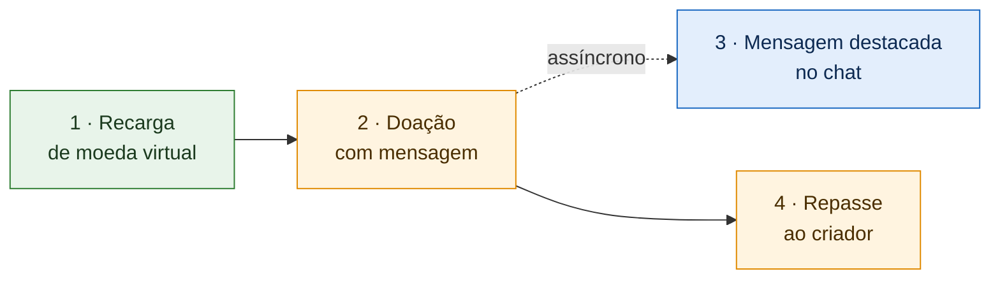

# 1.1.2. SubEquipe_02 — GoFs Estruturais + IA Generativa

> **Estado**: 🟢 Concluída: modelagem, código das três frentes integrado na `main`, front-end, vídeos de todas as frentes e vídeo geral.
> **Prazo interno**: 18/10/2026 · **Prazo oficial**: 19/10/2026.
> **Planejamento**: [Organização da Entrega 3](/Projeto/Atas/Atas_Sg2/organizacao-entrega-03.md).
> **Código**: [2026.2-T01-_G6_ProjetoStreamingVideo_SubEquipe02_Codigo](https://github.com/UnBArqDsw2026-2-Turma01/2026.2-T01-_G6_ProjetoStreamingVideo_SubEquipe02_Codigo/tree/main).

Este relatório reúne a aplicação de padrões de projeto GoF estruturais pela SubEquipe_02. Em vez de um padrão isolado, a subequipe codifica **uma história de uso da plataforma** — da recarga de moeda virtual ao repasse ao criador — e aplica cada padrão no ponto da história em que surge um problema concreto de projeto. A história completa roda em uma página web integrada, mostrada no [vídeo geral](https://youtu.be/f_0iYes1srw) (ver a seção "Vídeos").

## Integrantes

| Matrícula | Integrante | GitHub | Frente |
| --- | --- | --- | --- |
| 24/1011018 | Davi Severiano Freitas | [@Davi-UnB](https://github.com/Davi-UnB) | 🟩 F1 · Recarga de moeda virtual |
| 24/1025505 | Daniel de Oliveira Lira | [@Daniellira540](https://github.com/Daniellira540) | 🟧 F2 · Doação com mensagem e Repasse |
| 24/1011466 | Mateus Rodrigues Barreto | [@Mateus0xC](https://github.com/Mateus0xC) | 🟦 F3 · Mensagem destacada no chat |
| 23/1026545 | Pedro Henrique Freire Rodrigues | [@Pedro-Henrique3](https://github.com/Pedro-Henrique3) | 🟧 F2 · Doação com mensagem e Repasse |

## Foco do relatório

**GoFs Estruturais + IA Generativa.** A entrega mínima deste foco inclui um padrão estrutural, modelo UML, código e vídeo demonstrando sua execução, além dos pontos de vista individuais.

A SubEquipe_02 aplica **quatro padrões estruturais** — Adapter, Proxy, Decorator e Facade — e, como extra, um **padrão comportamental**, o Mediator, distribuídos em três frentes que compõem uma única história executável. O detalhe por frente está em [F1](/Base/Relatórios/1.1.2.SubEquipe_02/1.1.2.1.F1.Recarga.md), [F2](/Base/Relatórios/1.1.2.SubEquipe_02/1.1.2.2.F2.DoacaoRepasse.md) e [F3](/Base/Relatórios/1.1.2.SubEquipe_02/1.1.2.3.F3.MensagemDestacada.md).

## Participantes no foco — lições aprendidas e IA Generativa

Os relatos individuais — lições aprendidas, uso crítico da IA, um acerto e um erro concretos, com comprobatórios — estão em [1.1.2.4. IA Generativa](/Base/Relatórios/1.1.2.SubEquipe_02/1.1.2.4.IAGenerativa.md), que também traz o relato coletivo do uso de IA no planejamento.

| Integrante | Frente | Relato individual |
| --- | --- | --- |
| Davi Severiano Freitas | F1 | [Ver relato](/Base/Relatórios/1.1.2.SubEquipe_02/1.1.2.4.IAGenerativa.md) |
| Daniel de Oliveira Lira | F2 | [Ver relato](/Base/Relatórios/1.1.2.SubEquipe_02/1.1.2.4.IAGenerativa.md) |
| Mateus Rodrigues Barreto | F3 | [Ver relato](/Base/Relatórios/1.1.2.SubEquipe_02/1.1.2.4.IAGenerativa.md) |
| Pedro Henrique Freire Rodrigues | F2 | [Ver relato](/Base/Relatórios/1.1.2.SubEquipe_02/1.1.2.4.IAGenerativa.md) |

## Metodologia

**Organização do trabalho.** A subequipe manteve a especialização por domínio adotada na Entrega 02, agora organizada em **frentes de trabalho**, cada uma responsável por uma etapa da história. A divisão não é estanque: todas as frentes trabalham no mesmo repositório de código e integram o trabalho na `main` por pull request.

**Reuniões.**

| Reunião | Data | Resultado | Registro |
| --- | --- | --- | --- |
| S2_01 | 06/10/2026 | Linguagem (TypeScript), manutenção da divisão por módulos, prazo interno e regras de anonimização | [Ata S2_01](/Projeto/Atas/Atas_Sg2/ata-S2-01-2026-10-06.md) |
| S2_02 | 10/10/2026 | História da demonstração, padrões adotados, padrões descartados e divisão em três frentes | [Ata S2_02](/Projeto/Atas/Atas_Sg2/ata-S2-02-2026-10-10.md) |
| S2_03 | 13/10/2026 | Acompanhamento das entregas, esclarecimento sobre diagramas UML e ajuste de prazos | [Ata S2_03](/Projeto/Atas/Atas_Sg2/ata-S2-03-2026-10-13.md) |
| S2_04 | 16/10/2026 | Apresentação do código, definição da Facade com Mediator na F2 e preparação da integração | [Ata S2_04](/Projeto/Atas/Atas_Sg2/ata-S2-04-2026-10-16.md) |
| S2_05 | 18/10/2026 | Demonstração do front-end integrado, alinhamento dos diagramas ao código, padrão de documentação e organização dos vídeos | [Ata S2_05](/Projeto/Atas/Atas_Sg2/ata-S2-05-2026-10-18.md) |

**Estudo.** Cada integrante estudou os padrões da própria frente, com o livro do GoF, os slides e vídeos da disciplina e material complementar. A discussão em reunião comparou os sete padrões estruturais do GoF quanto à aplicabilidade na história (ver [Ata S2_02, §4](/Projeto/Atas/Atas_Sg2/ata-S2-02-2026-10-10.md)).

**Uso de IA Generativa no planejamento.** Um documento de apoio elaborado com auxílio de IA serviu de ponto de partida, mas foi tratado como sugestão e submetido à análise crítica da subequipe. Inconsistências geradas pela IA foram identificadas e removidas, e o resultado final da discussão divergiu da proposta original.

**Ferramentas.** TypeScript e Node.js (implementação e página web), Jest (testes), PlantUML e Miro (modelagem), Mercado Pago e Stripe em modo de teste (pagamentos reais na F1), GitHub (versionamento e revisão por pull request).

**Revisão.** Os artefatos foram revisados entre as frentes antes da consolidação: os diagramas da F1, por exemplo, foram revisados por um integrante da F2 ([página da F1, §2](/Base/Relatórios/1.1.2.SubEquipe_02/1.1.2.1.F1.Recarga.md)), e os pull requests de cada frente foram integrados por integrantes de outra frente.

## GoF Estrutural

### Visão geral: a história da demonstração



A doação aciona dois efeitos paralelos: o repasse ao criador e a exibição da mensagem destacada. A exibição é assíncrona — uma falha no chat não invalida a doação nem o repasse —, conforme o modelo da Entrega 02 e a implementação em `MediatorDoacaoComMensagem`.

### Contexto (problema)

| Frente | Etapa | Problema concreto da plataforma | Modelos anteriores relevantes |
| --- | --- | --- | --- |
| 🟩 F1 | Recarga | O preço do pacote combina desconto progressivo e imposto; os processadores de pagamento externos têm interfaces distintas e podem ficar indisponíveis; a confirmação do pagamento pode chegar duplicada ou falsificada | BPMN de compra (Entrega 01) · interface `GatewayPagamento` e diagrama de sequência da Recarga (Entrega 02) |
| 🟧 F2 | Doação e Repasse | Uma operação simples de doação precisa orquestrar validação de perfil, transferência financeira e, opcionalmente, notificação ao chat, sem acoplar esses colaboradores entre si | Diagrama de sequência da Doação (Entrega 02) |
| 🟦 F3 | Mensagem destacada | A mensagem recebe camadas visuais — cor, fixação e limite de caracteres — combinadas conforme o valor doado | Achados SC01 e SC02 da Engenharia Reversa (Entrega 02) |

### Escolha e justificativa

| Padrão | Categoria | Frente | Por que foi escolhido |
| --- | --- | --- | --- |
| **Decorator** | Estrutural | F1 · F3 | Acrescenta responsabilidades em camadas sem alterar a classe original: desconto e imposto sobre o preço (F1) e camadas visuais sobre a mensagem (F3) |
| **Adapter** | Estrutural | F1 | Permite tratar processadores de pagamento com interfaces incompatíveis (Mercado Pago, Stripe e simulado) por uma única interface, deixar o espectador escolher o meio e oferecer alternativas quando um deles está indisponível (O07) |
| **Proxy** | Estrutural | F1 | Fica diante do serviço de confirmação e barra avisos de pagamento com assinatura inválida ou já creditados (O14, O11) |
| **Facade** | Estrutural | F2 | Oferece `doar` e `doarComMensagem` ao controller, escondendo a coordenação interna da doação |
| **Mediator** | Comportamental (extra) | F2 | Centraliza a orquestração entre `ServicoFinanceiro` e `NotificadorChat`, evitando que esses colaboradores se conheçam ([Ata S2_04, D01](/Projeto/Atas/Atas_Sg2/ata-S2-04-2026-10-16.md)) |

**Alternativas consideradas e descartadas**

| Padrão | Motivo do descarte |
| --- | --- |
| Flyweight | Caso teórico no compartilhamento de emotes do chat, sem necessidade real na história e com custo alto para o prazo |
| Bridge | Sem caso de uso consensual na história |
| Composite | Baixa utilidade para a história |
| **Proxy na F2 (repasse)** | Planejado na [Ata S2_02](/Projeto/Atas/Atas_Sg2/ata-S2-02-2026-10-10.md) para evitar repasse duplicado; descartado após orientação da professora, porque a forma planejada usava a interface do objeto protegido sem implementá-la. A F2 adotou a Facade com o Mediator e a transferência atômica no `ServicoFinanceiro`; o Proxy permanece apenas na confirmação da F1 |

**Limites de aplicação.**

- O **Proxy** cobre só a confirmação de pagamento da recarga (`ProxyConfirmacaoSegura`); não há Proxy de repasse na F2.
- A notificação ao chat é best-effort: falha no `NotificadorChat` não estorna a doação.
- O aviso de pagamento (webhook) que passa pelo Proxy é simulado, com assinatura própria; com os processadores reais, a aprovação é detectada por consulta ao processador, e só então o aviso é gerado.

### Modelagem (notação UML)

O diagrama integrado dá a visão do projeto inteiro; o detalhe de cada padrão está nos diagramas de cada frente ([Ata S2_05, D03](/Projeto/Atas/Atas_Sg2/ata-S2-05-2026-10-18.md)).

[](assets/visao-geral-integrada.svg ':ignore')

*Figura 1 — Visão geral integrada: domínio, recarga, doação e chat (clique para ampliar). Arquivo-fonte: [`assets/visao-geral-integrada.puml`](assets/visao-geral-integrada.puml ':ignore').*

| Frente | Diagrama | Imagem | Arquivo-fonte |
| --- | --- | --- | --- |
| 🟩 F1 | Visão geral (Decorator, Adapter e Proxy) | [SVG](assets/f1-visao-geral.svg ':ignore') | [`f1-visao-geral.puml`](assets/f1-visao-geral.puml ':ignore') |
| 🟩 F1 | Decorator — preço do pacote | [SVG](assets/f1-decorator.svg ':ignore') | [`f1-decorator.puml`](assets/f1-decorator.puml ':ignore') |
| 🟩 F1 | Adapter — processadores de pagamento | [SVG](assets/f1-adapter.svg ':ignore') | [`f1-adapter.puml`](assets/f1-adapter.puml ':ignore') |
| 🟩 F1 | Proxy — confirmação do pagamento | [SVG](assets/f1-proxy.svg ':ignore') | [`f1-proxy.puml`](assets/f1-proxy.puml ':ignore') |
| 🟧 F2 | Facade e Mediator — doação e repasse | [SVG](assets/doacao-visao-geral.svg ':ignore') | [`doacao-visao-geral.puml`](assets/doacao-visao-geral.puml ':ignore') |
| 🟦 F3 | Decorator — mensagem destacada | [SVG](assets/f3-decorator.svg ':ignore') | [`f3-decorator.puml`](assets/f3-decorator.puml ':ignore') |
| Integrado | Domínio, recarga, doação e chat | [SVG](assets/visao-geral-integrada.svg ':ignore') | [`visao-geral-integrada.puml`](assets/visao-geral-integrada.puml ':ignore') |

**Correspondência resumida (papel GoF → classe).**

| Padrão | Papéis → classes |
| --- | --- |
| Decorator (preço, F1) | Component `Preco` · ConcreteComponent `PrecoPacote` · Decorator `PrecoDecorator` · ConcreteDecorators `ComDesconto`, `ComTaxaFixa`, `ComImposto` · Client `ServicoRecarga` |
| Adapter (F1) | Target `GatewayPagamento` · Adapters `AdaptadorMercadoPago`, `AdaptadorStripe`, `AdaptadorProcessadorSimulado` · Adaptees `Preference` e `Payment` (Mercado Pago), `Checkout::Sessions` (Stripe), `ProcessadorSimulado` · Client `ServicoRecarga` |
| Proxy (F1) | Subject `ConfirmadorPagamento` · Proxy `ProxyConfirmacaoSegura` · RealSubject `ServicoConfirmacao` · Client `RecargaController` |
| Facade (F2) | Facade `ServicoDoacao` · Client `DoacaoController` |
| Mediator (F2, extra) | Mediators `MediatorDoacao`, `MediatorDoacaoComMensagem` · Colleagues `ServicoFinanceiro`, `NotificadorChat` |
| Decorator (chat, F3) | Component `MensagemDestacada` · ConcreteComponent `MensagemBase` · Decorator `MensagemDecorator` · ConcreteDecorators `ComFaixaCor`, `ComFixacao`, `ComLimiteCaracteres` · Client `Chat` |

### Implementação (código)

**Linguagem**: TypeScript · **Testes**: Jest (172 testes) · **Repositório**: [SubEquipe02_Codigo (`main`)](https://github.com/UnBArqDsw2026-2-Turma01/2026.2-T01-_G6_ProjetoStreamingVideo_SubEquipe02_Codigo/tree/main).

| Frente | Padrão | Código | Teste |
| --- | --- | --- | --- |
| 🟩 F1 | Decorator | [`src/f1-recarga/preco/`](https://github.com/UnBArqDsw2026-2-Turma01/2026.2-T01-_G6_ProjetoStreamingVideo_SubEquipe02_Codigo/tree/main/src/f1-recarga/preco) | [`preco.test.ts`](https://github.com/UnBArqDsw2026-2-Turma01/2026.2-T01-_G6_ProjetoStreamingVideo_SubEquipe02_Codigo/blob/main/tests/f1-recarga/preco.test.ts) · [`catalogo.test.ts`](https://github.com/UnBArqDsw2026-2-Turma01/2026.2-T01-_G6_ProjetoStreamingVideo_SubEquipe02_Codigo/blob/main/tests/f1-recarga/catalogo.test.ts) |
| 🟩 F1 | Adapter | [`src/f1-recarga/pagamento/`](https://github.com/UnBArqDsw2026-2-Turma01/2026.2-T01-_G6_ProjetoStreamingVideo_SubEquipe02_Codigo/tree/main/src/f1-recarga/pagamento) | [`tests/f1-recarga/pagamento/`](https://github.com/UnBArqDsw2026-2-Turma01/2026.2-T01-_G6_ProjetoStreamingVideo_SubEquipe02_Codigo/tree/main/tests/f1-recarga/pagamento) |
| 🟩 F1 | Proxy | [`src/f1-recarga/confirmacao/`](https://github.com/UnBArqDsw2026-2-Turma01/2026.2-T01-_G6_ProjetoStreamingVideo_SubEquipe02_Codigo/tree/main/src/f1-recarga/confirmacao) | [`confirmacao.test.ts`](https://github.com/UnBArqDsw2026-2-Turma01/2026.2-T01-_G6_ProjetoStreamingVideo_SubEquipe02_Codigo/blob/main/tests/f1-recarga/confirmacao.test.ts) |
| 🟧 F2 | Facade | [`ServicoDoacao.ts`](https://github.com/UnBArqDsw2026-2-Turma01/2026.2-T01-_G6_ProjetoStreamingVideo_SubEquipe02_Codigo/blob/main/src/f2-doacao/ServicoDoacao.ts) · [`DoacaoController.ts`](https://github.com/UnBArqDsw2026-2-Turma01/2026.2-T01-_G6_ProjetoStreamingVideo_SubEquipe02_Codigo/blob/main/src/f2-doacao/DoacaoController.ts) | [`tests/f2-doacao/`](https://github.com/UnBArqDsw2026-2-Turma01/2026.2-T01-_G6_ProjetoStreamingVideo_SubEquipe02_Codigo/tree/main/tests/f2-doacao) |
| 🟧 F2 | Mediator | [`MediatorDoacao.ts`](https://github.com/UnBArqDsw2026-2-Turma01/2026.2-T01-_G6_ProjetoStreamingVideo_SubEquipe02_Codigo/blob/main/src/f2-doacao/MediatorDoacao.ts) · [`MediatorDoacaoComMensagem.ts`](https://github.com/UnBArqDsw2026-2-Turma01/2026.2-T01-_G6_ProjetoStreamingVideo_SubEquipe02_Codigo/blob/main/src/f2-doacao/MediatorDoacaoComMensagem.ts) | [`tests/f2-doacao/`](https://github.com/UnBArqDsw2026-2-Turma01/2026.2-T01-_G6_ProjetoStreamingVideo_SubEquipe02_Codigo/tree/main/tests/f2-doacao) |
| 🟦 F3 | Decorator | [`src/f3-chat/`](https://github.com/UnBArqDsw2026-2-Turma01/2026.2-T01-_G6_ProjetoStreamingVideo_SubEquipe02_Codigo/tree/main/src/f3-chat) | [`tests/f3-chat/`](https://github.com/UnBArqDsw2026-2-Turma01/2026.2-T01-_G6_ProjetoStreamingVideo_SubEquipe02_Codigo/tree/main/tests/f3-chat) |

Composição: [`montarRecarga.ts`](https://github.com/UnBArqDsw2026-2-Turma01/2026.2-T01-_G6_ProjetoStreamingVideo_SubEquipe02_Codigo/blob/main/src/f1-recarga/montarRecarga.ts) · [`montarDoacao.ts`](https://github.com/UnBArqDsw2026-2-Turma01/2026.2-T01-_G6_ProjetoStreamingVideo_SubEquipe02_Codigo/blob/main/src/f2-doacao/montarDoacao.ts) · página integrada em [`src/web/`](https://github.com/UnBArqDsw2026-2-Turma01/2026.2-T01-_G6_ProjetoStreamingVideo_SubEquipe02_Codigo/tree/main/src/web).

### Execução

**Pré-requisitos**: Node.js 20 ou superior e npm. Para os pagamentos reais da F1, credenciais **de teste** do Mercado Pago e do Stripe em um arquivo `.env`; sem elas, tudo roda com os processadores simulados. Detalhes no [README do repositório de código](https://github.com/UnBArqDsw2026-2-Turma01/2026.2-T01-_G6_ProjetoStreamingVideo_SubEquipe02_Codigo/tree/main#readme).

```bash
npm install
npm test                 # 172 testes de todas as frentes
npm run web              # página integrada em http://localhost:3000 (recarga, doação e chat)
npm run demo             # história completa no terminal
npm run demo:interativo  # F1 · recarga no terminal
npm run demo:f2          # F2 · Facade + Mediator
npm run demo:f3          # F3 · Decorator do chat
```

### Vídeos

**Vídeo geral — a história completa no front-end.** Apresenta a página integrada em execução: da recarga de moeda virtual à doação com mensagem, passando pela mensagem destacada no chat e pelo repasse ao criador.

[](https://youtu.be/f_0iYes1srw)

*Vídeo geral — Subequipe 02 - Front-end integrado: execução da história completa na página web, da recarga de moeda virtual à doação, com a mensagem destacada no chat e o repasse ao criador. Autor: Mateus Rodrigues Barreto, 19/10/2026. [Assistir no YouTube](https://youtu.be/f_0iYes1srw).*

**Catálogo dos vídeos**

| # | Vídeo | Frente | Conteúdo | Autor(es) | Link |
| --- | --- | --- | --- | --- | --- |
| 1 | Geral · Front-end integrado | Todas | Execução da história completa na página web: recarga, doação, mensagem destacada e repasse | Mateus Rodrigues Barreto | [Assistir](https://youtu.be/f_0iYes1srw) |
| 2 | F1 · Decorator | 🟩 F1 | Conceito do padrão, diagrama, código e execução no front-end (preço do pacote) | Davi Severiano Freitas | [Assistir](https://youtu.be/bKWOLcni8D4) |
| 3 | F1 · Adapter | 🟩 F1 | Conceito do padrão, diagrama, código e execução no front-end (processadores de pagamento) | Davi Severiano Freitas | [Assistir](https://youtu.be/TQr0n8cG8DA) |
| 4 | F1 · Proxy | 🟩 F1 | Conceito do padrão, diagrama e código (confirmação do pagamento) | Davi Severiano Freitas | [Assistir](https://youtu.be/lYXL4zcAL70) |
| 5 | F2 · Facade e Mediator | 🟧 F2 | Conceito dos padrões, diagrama, código e execução (doação e repasse) | Daniel de Oliveira Lira e Pedro Henrique Freire Rodrigues | [Assistir](https://youtu.be/DNuCZrmBd_c) |
| 6 | F3 · Decorator | 🟦 F3 | Conceito do padrão, diagrama, código e execução (mensagem destacada) | Mateus Rodrigues Barreto | [Assistir](https://youtu.be/QTQMqaQhtQs) |

Cada vídeo de frente também está incorporado à página da sua frente ([Ata S2_05, D05](/Projeto/Atas/Atas_Sg2/ata-S2-05-2026-10-18.md)).

## Rastreabilidade & Elos com Outros Artefatos

A [modelagem da SubEquipe_02 na Entrega 02](https://unbarqdsw2026-2-turma01.github.io/2026.2-T01-_G6_ProjetoStreamingVideo_Entrega_02/#/Base/Relatórios/1.1.2.SubEquipe_02/README) é o ponto de partida. A tabela abaixo indica quais artefatos sustentam cada decisão; a rastreabilidade detalhada está na página de cada frente.

| Problema ou requisito | Artefato de origem (link) | Elemento do modelo | Trecho de código (link) | Evidência de execução |
| --- | --- | --- | --- | --- |
| Preço em reais com imposto incluso e desconto promocional (RN01) | [Engenharia Reversa — Entrega 01](https://unbarqdsw2026-2-turma01.github.io/2026.2-T01-_G6_ProjetoStreamingVideo_Entrega_01/#/Base/Relatorios/1.1.2.SubEquipe_02/3.EngenhariaReversa) | Decorator de `Preco` | [`preco/`](https://github.com/UnBArqDsw2026-2-Turma01/2026.2-T01-_G6_ProjetoStreamingVideo_SubEquipe02_Codigo/tree/main/src/f1-recarga/preco) | [Vídeo F1 · Decorator](https://youtu.be/bKWOLcni8D4) |
| Escolha da forma de pagamento (B9) e alternativas se indisponível (O07) | [BPMN](https://unbarqdsw2026-2-turma01.github.io/2026.2-T01-_G6_ProjetoStreamingVideo_Entrega_01/#/Base/Relatorios/1.1.2.SubEquipe_02/4.BPMN) e [NFR Framework](https://unbarqdsw2026-2-turma01.github.io/2026.2-T01-_G6_ProjetoStreamingVideo_Entrega_01/#/Base/Relatorios/1.1.2.SubEquipe_02/2.NFRFramework) — Entrega 01 | `GatewayPagamento` e adaptadores | [`pagamento/`](https://github.com/UnBArqDsw2026-2-Turma01/2026.2-T01-_G6_ProjetoStreamingVideo_SubEquipe02_Codigo/tree/main/src/f1-recarga/pagamento) | [Vídeo F1 · Adapter](https://youtu.be/TQr0n8cG8DA) |
| Confirmação autêntica e sem crédito duplicado (O14, O11) | [NFR Framework — Entrega 01](https://unbarqdsw2026-2-turma01.github.io/2026.2-T01-_G6_ProjetoStreamingVideo_Entrega_01/#/Base/Relatorios/1.1.2.SubEquipe_02/2.NFRFramework) | `ProxyConfirmacaoSegura` · `ServicoConfirmacao` | [`confirmacao/`](https://github.com/UnBArqDsw2026-2-Turma01/2026.2-T01-_G6_ProjetoStreamingVideo_SubEquipe02_Codigo/tree/main/src/f1-recarga/confirmacao) | [Vídeo F1 · Proxy](https://youtu.be/lYXL4zcAL70) |
| Doação coordenando financeiro e chat | [Modelagem Dinâmica — Entrega 02](https://unbarqdsw2026-2-turma01.github.io/2026.2-T01-_G6_ProjetoStreamingVideo_Entrega_02/#/Base/Relatórios/1.1.2.SubEquipe_02/1.1.2.2.Foco02.ModelagemDinamica) | Facade e Mediator | [`src/f2-doacao/`](https://github.com/UnBArqDsw2026-2-Turma01/2026.2-T01-_G6_ProjetoStreamingVideo_SubEquipe02_Codigo/tree/main/src/f2-doacao) | [Vídeo F2](https://youtu.be/DNuCZrmBd_c) |
| Camadas visuais da mensagem (SC01, SC02) | [Engenharia Reversa complementar — Entrega 02](https://unbarqdsw2026-2-turma01.github.io/2026.2-T01-_G6_ProjetoStreamingVideo_Entrega_02/#/Base/Relatórios/1.1.2.SubEquipe_02/1.1.2.4.Extra.EngenhariaReversa) | Decorator da mensagem · `FaixaDestaque` | [`src/f3-chat/`](https://github.com/UnBArqDsw2026-2-Turma01/2026.2-T01-_G6_ProjetoStreamingVideo_SubEquipe02_Codigo/tree/main/src/f3-chat) | [Vídeo F3](https://youtu.be/QTQMqaQhtQs) |
| História completa integrada | [Atas S2_04 e S2_05](/Projeto/Atas/Atas_Sg2/ata-S2-05-2026-10-18.md) | Diagrama integrado | [`src/web/`](https://github.com/UnBArqDsw2026-2-Turma01/2026.2-T01-_G6_ProjetoStreamingVideo_SubEquipe02_Codigo/tree/main/src/web) · [`historia-completa.ts`](https://github.com/UnBArqDsw2026-2-Turma01/2026.2-T01-_G6_ProjetoStreamingVideo_SubEquipe02_Codigo/blob/main/src/demo/historia-completa.ts) | [Vídeo geral](https://youtu.be/f_0iYes1srw) |

## Senso Crítico

Avaliação a partir dos artefatos versionados; os relatos pessoais estão na página de [IA Generativa](/Base/Relatórios/1.1.2.SubEquipe_02/1.1.2.4.IAGenerativa.md) e o senso crítico detalhado, na página de cada frente.

- **Benefícios observados.** O Adapter permitiu integrar processadores de pagamento reais (Mercado Pago e Stripe, em modo de teste) depois que o sistema já funcionava com o simulado, sem alterar o serviço de recarga. O Decorator permitiu trocar o desconto único pelo progressivo sem nenhuma classe nova (F1) e combinar as camadas visuais da mensagem conforme o valor doado (F3). O Proxy concentra as verificações de O11 e O14 sem poluir a regra de crédito. A Facade reduz a superfície da F2 para o controller, e o Mediator evita o acoplamento direto entre o financeiro e o chat.
- **Mesmo padrão, problemas distintos.** O Decorator aparece na F1 (preço) e na F3 (mensagem), o que mostra que o padrão se define pela intenção — acrescentar responsabilidades em camadas —, e não pelo domínio.
- **Custos e complexidade.** Cinco padrões na mesma história aumentam a curva de aprendizado e o número de arquivos. O diagrama integrado precisou resumir associações longas em notas para permanecer legível.
- **Coerência UML ↔ código.** Os diagramas em `assets/` foram revisados para refletir o código da `main`, inclusive após a revisão cruzada da F1, que corrigiu a notação UML e a direção da referência do Proxy.
- **Decisões revistas.** A F2 saiu de Facade com Proxy para Facade com Mediator, após orientação da professora; como o Mediator é comportamental, ele é registrado como extra. Na F1, a conversão de moeda foi removida e a troca automática de processador deu lugar à escolha do meio pelo espectador, com alternativas quando ele está indisponível.
- **Limitações.** Os dados ficam em memória; o webhook dos processadores é simulado; e o repasse por moeda da F2 é lido diretamente do catálogo da F1, um acoplamento entre frentes fora de `src/contratos`.

## Referências

Fontes efetivamente usadas no planejamento, na modelagem PlantUML e na implementação TypeScript:

1. GAMMA, Erich; HELM, Richard; JOHNSON, Ralph; VLISSIDES, John. *Padrões de Projeto: soluções reutilizáveis de software orientado a objetos*. Porto Alegre: Bookman, 2000. — intenção e participantes de Adapter, Proxy, Decorator, Facade e Mediator.
2. Material complementar da disciplina (UnB ArqDsw 2026.2) — slides e videoaulas sobre os padrões GoF.
3. REFACTORING GURU. *Padrões de projeto estruturais*. Disponível em: <https://refactoring.guru/pt-br/design-patterns/structural-patterns>. Acesso em: out. 2026. — consulta de estrutura dos padrões durante o estudo das frentes.
4. Atas S2_01 a S2_05 deste repositório — decisões de frentes, história da demonstração, descarte de padrões, integração e vídeos.

Catálogo completo, com as documentações dos processadores de pagamento e os vídeos complementares: [1.1.2.5. Referências](/Base/Relatórios/1.1.2.SubEquipe_02/1.1.2.5.Referencias.md).

## Versionamentos & Participações

Registrar apenas alterações efetivamente realizadas, incluindo autoria, revisão e links para commits ou pull requests.

| Versão | Data | Integrante | Contribuição | Revisor | Comprobatório (commit/PR) |
| --- | --- | --- | --- | --- | --- |
| 1.0 | 11/10/2026 | Davi Severiano Freitas | Estruturação do relatório com as decisões das reuniões S2_01 e S2_02: frentes, padrões adotados e descartados, metodologia, contexto, justificativas e rastreabilidade inicial | — | [`ba10906`](https://github.com/UnBArqDsw2026-2-Turma01/2026.2-T01-_G6_ProjetoStreamingVideo_Entrega_03/commit/ba10906) |
| 1.1 | 17/10/2026 | Pedro Henrique Freire Rodrigues | Preenchimento de modelagem, implementação, execução e rastreabilidade com base no código/diagramas; alinhamento F2 para Facade+Mediator | — | [`de4f335`](https://github.com/UnBArqDsw2026-2-Turma01/2026.2-T01-_G6_ProjetoStreamingVideo_Entrega_03/commit/de4f335) · [`7399f11`](https://github.com/UnBArqDsw2026-2-Turma01/2026.2-T01-_G6_ProjetoStreamingVideo_Entrega_03/commit/7399f11) |
| 1.2 | 19/10/2026 | Mateus Rodrigues Barreto | Registro do vídeo da F3 | — | [`d27102c`](https://github.com/UnBArqDsw2026-2-Turma01/2026.2-T01-_G6_ProjetoStreamingVideo_Entrega_03/commit/d27102c) |
| 1.3 | 19/10/2026 | Daniel de Oliveira Lira | Registro do vídeo da F2 e atualização da rastreabilidade | — | [`f885d81`](https://github.com/UnBArqDsw2026-2-Turma01/2026.2-T01-_G6_ProjetoStreamingVideo_Entrega_03/commit/f885d81) |
| 1.4 | 19/10/2026 | Davi Severiano Freitas | Versão final: estado concluído; Mediator registrado como extra comportamental; Reunião S2_05; diagramas de `assets/` com o integrado como Figura 1; links do código para a `main`; comandos da página web; vídeo geral do front-end e catálogo dos vídeos de todas as frentes; rastreabilidade com os vídeos; senso crítico atualizado | — | [`4734f40`](https://github.com/UnBArqDsw2026-2-Turma01/2026.2-T01-_G6_ProjetoStreamingVideo_Entrega_03/commit/4734f40) |

