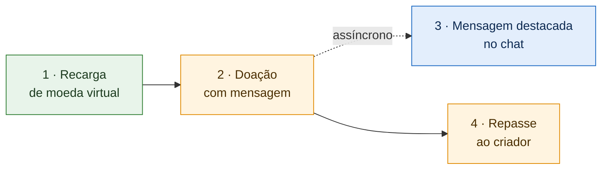

# 1.1.2. SubEquipe_02 — GoFs Estruturais + IA Generativa

> **Estado**: 🟢 Implementação e modelagem disponíveis no repositório de código (`feature/f3-chat`); vídeos e relatos individuais ainda pendentes.
> **Prazo interno**: 18/10/2026 · **Prazo oficial**: 19/10/2026.
> **Planejamento**: [Organização da Entrega 3](/Projeto/Atas/Atas_Sg2/organizacao-entrega-03.md).
> **Código**: [2026.2-T01-_G6_ProjetoStreamingVideo_SubEquipe02_Codigo](https://github.com/UnBArqDsw2026-2-Turma01/2026.2-T01-_G6_ProjetoStreamingVideo_SubEquipe02_Codigo/tree/feature/f3-chat).

Este relatório reúne a aplicação de padrões de projeto GoF estruturais pela SubEquipe_02. Em vez de um padrão isolado, a subequipe codifica **uma história de uso da plataforma** — da recarga de moeda virtual ao repasse ao criador — e aplica cada padrão no ponto da história em que surge um problema concreto de projeto.

## Integrantes

| Matrícula | Integrante | GitHub | Frente |
| --- | --- | --- | --- |
| 24/1011018 | Davi Severiano Freitas | [@Davi-UnB](https://github.com/Davi-UnB) | 🟩 F1 · Recarga de moeda virtual |
| 24/1025505 | Daniel de Oliveira Lira | [@Daniellira540](https://github.com/Daniellira540) | 🟧 F2 · Doação com mensagem e Repasse |
| 24/1011466 | Mateus Rodrigues Barreto | [@Mateus0xC](https://github.com/Mateus0xC) | 🟦 F3 · Mensagem destacada no chat |
| 23/1026545 | Pedro Henrique Freire Rodrigues | [@Pedro-Henrique3](https://github.com/Pedro-Henrique3) | 🟧 F2 · Doação com mensagem e Repasse |

Composição mantida conforme a [introdução da Entrega 02](https://unbarqdsw2026-2-turma01.github.io/2026.2-T01-_G6_ProjetoStreamingVideo_Entrega_02/#/Introducao).

## Foco do relatório

**GoFs Estruturais + IA Generativa.** A entrega mínima deste foco inclui um padrão estrutural, modelo UML, código e vídeo demonstrando sua execução, além dos pontos de vista individuais.

A SubEquipe_02 aplica **cinco padrões estruturais** — Adapter, Proxy, Decorator, Facade e Mediator —, distribuídos em três frentes que compõem uma única história executável. O detalhe por frente está em [F1](/Base/Relatórios/1.1.2.SubEquipe_02/1.1.2.1.F1.Recarga.md), [F2](/Base/Relatórios/1.1.2.SubEquipe_02/1.1.2.2.F2.DoacaoRepasse.md) e [F3](/Base/Relatórios/1.1.2.SubEquipe_02/1.1.2.3.F3.MensagemDestacada.md).

## Participantes no foco — lições aprendidas e IA Generativa

| Integrante | Frente | Lições aprendidas | Uso da IA Generativa (senso crítico) |
| --- | --- | --- | --- |
| Davi Severiano Freitas | F1 | A preencher pelo integrante | A preencher pelo integrante |
| Daniel de Oliveira Lira | F2 | A preencher pelo integrante | A preencher pelo integrante |
| Mateus Rodrigues Barreto | F3 | A preencher pelo integrante | A preencher pelo integrante |
| Pedro Henrique Freire Rodrigues | F2 | A preencher pelo integrante | A preencher pelo integrante |

Cada integrante deverá explicar o que aprendeu, como colaborou e, caso tenha usado IA, qual ferramenta utilizou, o apoio recebido, como validou os resultados e quais limitações encontrou. Informar também quando não houver uso de IA. Relato coletivo de IA no planejamento: [1.1.2.4. IA Generativa](/Base/Relatórios/1.1.2.SubEquipe_02/1.1.2.4.IAGenerativa.md).

## Metodologia

**Organização do trabalho.** A subequipe manteve a especialização por domínio adotada na Entrega 02, agora organizada em **frentes de trabalho**, cada uma responsável por uma etapa da história. A divisão não é estanque: todas as frentes trabalham no mesmo repositório de código e podem colaborar entre si.

**Reuniões.**

| Reunião | Data | Resultado | Registro |
| --- | --- | --- | --- |
| S2_01 | 06/10/2026 | Linguagem (TypeScript), manutenção da divisão por módulos, prazo interno e regras de anonimização | [Ata S2_01](/Projeto/Atas/Atas_Sg2/ata-S2-01-2026-10-06.md) |
| S2_02 | 10/10/2026 | História da demonstração, padrões adotados, padrões descartados e divisão em três frentes | [Ata S2_02](/Projeto/Atas/Atas_Sg2/ata-S2-02-2026-10-10.md) |
| S2_03 | 13/10/2026 | Acompanhamento das entregas, esclarecimento sobre diagramas UML e ajuste de prazos | [Ata S2_03](/Projeto/Atas/Atas_Sg2/ata-S2-03-2026-10-13.md) |
| S2_04 | 16/10/2026 | Apresentação do código, definição da Facade com Mediator na F2 e preparação da integração | [Ata S2_04](/Projeto/Atas/Atas_Sg2/ata-S2-04-2026-10-16.md) |

**Estudo.** Cada integrante estudou os padrões da própria frente, com apoio de material de referência sobre padrões estruturais. A discussão em reunião comparou os sete padrões estruturais do GoF quanto à aplicabilidade na história (ver [Ata S2_02, §4](/Projeto/Atas/Atas_Sg2/ata-S2-02-2026-10-10.md)).

**Uso de IA Generativa no planejamento.** Um documento de apoio elaborado com auxílio de IA serviu de ponto de partida, mas foi tratado como sugestão e submetido à análise crítica da subequipe. Inconsistências geradas pela IA foram identificadas e removidas, e o resultado final da discussão divergiu da proposta original.

**Ferramentas.** TypeScript (implementação), Jest (testes), PlantUML e Miro (modelagem), GitHub (versionamento e revisão).

**Revisão.** Cada frente revisa o artefato de outra antes da consolidação final.

## GoF Estrutural

### Visão geral: a história da demonstração



A doação aciona dois efeitos paralelos: o repasse ao criador e a exibição da mensagem destacada. A exibição é assíncrona — uma falha no chat não invalida a doação nem o repasse —, conforme o modelo da Entrega 02 e a implementação em `MediatorDoacaoComMensagem` / `demo:f2`.

### Contexto (problema)

| Frente | Etapa | Problema concreto da plataforma | Modelos anteriores relevantes |
| --- | --- | --- | --- |
| 🟩 F1 | Recarga | Os meios de pagamento externos têm interfaces distintas; a confirmação pode chegar duplicada ou falsificada; o preço do pacote combina desconto, taxas e conversão de moeda | BPMN de compra (Entrega 01) · Diagrama de sequência da Recarga e interface `GatewayPagamento` (Entrega 02) |
| 🟧 F2 | Doação e Repasse | Uma operação simples de doação precisa orquestrar validação de perfil, transferência financeira e (opcionalmente) notificação ao chat, sem acoplar esses colegas entre si | Diagrama de sequência da Doação (Entrega 02) |
| 🟦 F3 | Mensagem destacada | A mensagem recebe camadas visuais combinadas conforme o valor doado | Achados SC01 e SC02 da Engenharia Reversa (Entrega 02) |

### Escolha e justificativa

| Padrão | Frente | Por que foi escolhido |
| --- | --- | --- |
| **Adapter** | F1 | Permite que o sistema trate meios de pagamento com interfaces incompatíveis de forma uniforme, e troque de um para outro sem alterar o restante do código |
| **Proxy** | F1 | Intercepta a confirmação antes do serviço real, barrando avisos com assinatura inválida ou já creditados (O11, O14) |
| **Decorator** | F1 · F3 | Acrescenta responsabilidades em camadas sem alterar a classe original: desconto e taxas sobre o preço (F1) e camadas visuais sobre a mensagem (F3) |
| **Facade** | F2 | Oferece `doar` / `doarComMensagem` ao controller, encaminhando aos mediators sem regra própria |
| **Mediator** | F2 | Centraliza a orquestração entre `ServicoFinanceiro` e `NotificadorChat`, evitando que esses colegas se conheçam |

**Alternativas consideradas e descartadas**

| Padrão | Motivo do descarte |
| --- | --- |
| Flyweight | Caso teórico no compartilhamento de emotes do chat, sem necessidade real na história e com custo alto para o prazo |
| Bridge | Sem caso de uso consensual na história |
| Composite | Baixa utilidade para a história |
| **Proxy na F2 (repasse)** | Planejado na [Ata S2_02](/Projeto/Atas/Atas_Sg2/ata-S2-02-2026-10-10.md) para idempotência de repasse; na implementação a F2 adotou **Mediator** + transferência atômica em `ServicoFinanceiro`. O Proxy permanece apenas na confirmação da F1 |

**Limites de aplicação (conforme código atual).**

- O **Proxy** cobre só o webhook/confirmação da recarga (`ProxyConfirmacaoSegura`); não há Proxy de repasse na F2.
- A notificação ao chat é best-effort: falha no `NotificadorChat` não estorna a doação (D05).
- O demo `historia-completa` ainda usa stubs provisórios em trechos da F2/F3; a integração real dos padrões está nos demos isolados `demo:f2` e `demo:f3`.
- Não há endpoint HTTP recebendo webhook real dos processadores nos demos de pagamento (limitação documentada no README do código).

### Modelagem (notação UML)

| Frente | Diagrama | Arquivo-fonte | Status |
| --- | --- | --- | --- |
| 🟩 F1 | Visão geral Adapter · Proxy · Decorator | [`docs/f1-visao-geral.puml`](https://github.com/UnBArqDsw2026-2-Turma01/2026.2-T01-_G6_ProjetoStreamingVideo_SubEquipe02_Codigo/blob/feature/f3-chat/docs/f1-visao-geral.puml) | 🟢 Disponível |
| 🟧 F2 | Facade · Mediator | [`docs/doacao-visao-geral.puml`](https://github.com/UnBArqDsw2026-2-Turma01/2026.2-T01-_G6_ProjetoStreamingVideo_SubEquipe02_Codigo/blob/feature/f3-chat/docs/doacao-visao-geral.puml) · [PNG](https://github.com/UnBArqDsw2026-2-Turma01/2026.2-T01-_G6_ProjetoStreamingVideo_SubEquipe02_Codigo/blob/feature/f3-chat/docs/doacao-visao-geral.png) | 🟢 Disponível |
| 🟦 F3 | Decorator da mensagem | [`docs/f3-visao-geral.puml`](https://github.com/UnBArqDsw2026-2-Turma01/2026.2-T01-_G6_ProjetoStreamingVideo_SubEquipe02_Codigo/blob/feature/f3-chat/docs/f3-visao-geral.puml) | 🟢 Disponível |
| Mapa | Domínio + F1 + F2 integrados | [`docs/visao-geral-integrada.puml`](https://github.com/UnBArqDsw2026-2-Turma01/2026.2-T01-_G6_ProjetoStreamingVideo_SubEquipe02_Codigo/blob/feature/f3-chat/docs/visao-geral-integrada.puml) · [PNG](https://github.com/UnBArqDsw2026-2-Turma01/2026.2-T01-_G6_ProjetoStreamingVideo_SubEquipe02_Codigo/blob/feature/f3-chat/docs/visao-geral-integrada.png) | 🟢 Disponível |

**Correspondência resumida (papel GoF → classe).**

| Padrão | Papéis → classes |
| --- | --- |
| Adapter | Target `GatewayPagamento` · Adapters `AdaptadorMercadoPago`, `AdaptadorStripe`, `AdaptadorProcessadorSimulado` |
| Proxy | Subject `ConfirmadorPagamento` · Proxy `ProxyConfirmacaoSegura` · RealSubject `ServicoConfirmacao` |
| Decorator (preço) | Component `Preco` · Decorator `PrecoDecorator` · concretos `ComDesconto`, `ComTaxaFixa`, `ComImposto` |
| Facade | Facade `ServicoDoacao` · Client `DoacaoController` |
| Mediator | Mediator `MediatorDoacao`, `MediatorDoacaoComMensagem` · Colleagues `ServicoFinanceiro`, `NotificadorChat` |
| Decorator (chat) | Component `MensagemDestacada` · Decorator `MensagemDecorator` · concretos `ComFaixaCor`, `ComFixacao`, `ComLimiteCaracteres` · Client `Chat` |

### Implementação (código)

**Linguagem**: TypeScript · **Testes**: Jest · **Repositório**: [SubEquipe02_Codigo (`feature/f3-chat`)](https://github.com/UnBArqDsw2026-2-Turma01/2026.2-T01-_G6_ProjetoStreamingVideo_SubEquipe02_Codigo/tree/feature/f3-chat).

| Frente | Padrão | Código | Teste | Status |
| --- | --- | --- | --- | --- |
| 🟩 F1 | Adapter | [`src/f1-recarga/pagamento/`](https://github.com/UnBArqDsw2026-2-Turma01/2026.2-T01-_G6_ProjetoStreamingVideo_SubEquipe02_Codigo/tree/feature/f3-chat/src/f1-recarga/pagamento) | testes sob `tests/` (suíte Jest do módulo F1) | 🟢 |
| 🟩 F1 | Proxy | [`src/f1-recarga/confirmacao/`](https://github.com/UnBArqDsw2026-2-Turma01/2026.2-T01-_G6_ProjetoStreamingVideo_SubEquipe02_Codigo/tree/feature/f3-chat/src/f1-recarga/confirmacao) | idem | 🟢 |
| 🟩 F1 | Decorator | [`src/f1-recarga/preco/`](https://github.com/UnBArqDsw2026-2-Turma01/2026.2-T01-_G6_ProjetoStreamingVideo_SubEquipe02_Codigo/tree/feature/f3-chat/src/f1-recarga/preco) | idem | 🟢 |
| 🟧 F2 | Facade | [`ServicoDoacao.ts`](https://github.com/UnBArqDsw2026-2-Turma01/2026.2-T01-_G6_ProjetoStreamingVideo_SubEquipe02_Codigo/blob/feature/f3-chat/src/f2-doacao/ServicoDoacao.ts) · [`DoacaoController.ts`](https://github.com/UnBArqDsw2026-2-Turma01/2026.2-T01-_G6_ProjetoStreamingVideo_SubEquipe02_Codigo/blob/feature/f3-chat/src/f2-doacao/DoacaoController.ts) | [`tests/f2-doacao/`](https://github.com/UnBArqDsw2026-2-Turma01/2026.2-T01-_G6_ProjetoStreamingVideo_SubEquipe02_Codigo/tree/feature/f3-chat/tests/f2-doacao) | 🟢 |
| 🟧 F2 | Mediator | [`MediatorDoacao.ts`](https://github.com/UnBArqDsw2026-2-Turma01/2026.2-T01-_G6_ProjetoStreamingVideo_SubEquipe02_Codigo/blob/feature/f3-chat/src/f2-doacao/MediatorDoacao.ts) · [`MediatorDoacaoComMensagem.ts`](https://github.com/UnBArqDsw2026-2-Turma01/2026.2-T01-_G6_ProjetoStreamingVideo_SubEquipe02_Codigo/blob/feature/f3-chat/src/f2-doacao/MediatorDoacaoComMensagem.ts) | idem | 🟢 |
| 🟦 F3 | Decorator | [`src/f3-chat/`](https://github.com/UnBArqDsw2026-2-Turma01/2026.2-T01-_G6_ProjetoStreamingVideo_SubEquipe02_Codigo/tree/feature/f3-chat/src/f3-chat) | [`tests/f3-chat/`](https://github.com/UnBArqDsw2026-2-Turma01/2026.2-T01-_G6_ProjetoStreamingVideo_SubEquipe02_Codigo/tree/feature/f3-chat/tests/f3-chat) | 🟢 |

Composição: [`montarRecarga.ts`](https://github.com/UnBArqDsw2026-2-Turma01/2026.2-T01-_G6_ProjetoStreamingVideo_SubEquipe02_Codigo/blob/feature/f3-chat/src/f1-recarga/montarRecarga.ts) · [`montarDoacao.ts`](https://github.com/UnBArqDsw2026-2-Turma01/2026.2-T01-_G6_ProjetoStreamingVideo_SubEquipe02_Codigo/blob/feature/f3-chat/src/f2-doacao/montarDoacao.ts).

### Execução e vídeo do padrão em funcionamento

**Pré-requisitos**: Node.js com npm; clonar o repositório de código; `npm install` na raiz.

**Comandos** (a partir do README do código):

```bash
npm test                 # suíte Jest (inclui f2-doacao e f3-chat)
npm run demo:interativo  # F1 · recarga (Adapter, Proxy, Decorator)
npm run demo:f2          # F2 · Facade + Mediator
npm run demo:f3          # F3 · Decorator do chat
npm run demo             # história completa (ainda com stubs em trechos F2/F3)
```

| Vídeo | Cenário demonstrado | Responsável(is) | Link |
| --- | --- | --- | --- |
| F1 · Recarga | Demo interativo / pagamento | Davi Severiano Freitas | Pendente |
| F2 · Doação e Repasse | `npm run demo:f2` | Daniel de Oliveira Lira e Pedro Henrique Freire Rodrigues | Pendente |
| F3 · Mensagem destacada | `npm run demo:f3` | Mateus Rodrigues Barreto | [Assistir](https://youtu.be/QTQMqaQhtQs) |
| Geral · História completa | `npm run demo` | Todos | Pendente |

## Rastreabilidade & Elos com Outros Artefatos

A [modelagem da SubEquipe_02 na Entrega 02](https://unbarqdsw2026-2-turma01.github.io/2026.2-T01-_G6_ProjetoStreamingVideo_Entrega_02/#/Base/Relatórios/1.1.2.SubEquipe_02/README) é o ponto de partida. A tabela abaixo indica quais artefatos sustentam cada decisão.

| Problema ou requisito | Artefato de origem (link) | Elemento do modelo | Trecho de código (link) | Evidência de execução |
| --- | --- | --- | --- | --- |
| Meios de pagamento com interfaces distintas; alternativas se indisponível (O07) | [NFR Framework — Entrega 01](https://unbarqdsw2026-2-turma01.github.io/2026.2-T01-_G6_ProjetoStreamingVideo_Entrega_01/#/Base/Relatorios/1.1.2.SubEquipe_02/2.NFRFramework) | `GatewayPagamento` · adapters | [`pagamento/`](https://github.com/UnBArqDsw2026-2-Turma01/2026.2-T01-_G6_ProjetoStreamingVideo_SubEquipe02_Codigo/tree/feature/f3-chat/src/f1-recarga/pagamento) | `npm run demo:interativo` |
| Confirmação idempotente e autêntica (O11, O14) | [NFR Framework — Entrega 01](https://unbarqdsw2026-2-turma01.github.io/2026.2-T01-_G6_ProjetoStreamingVideo_Entrega_01/#/Base/Relatorios/1.1.2.SubEquipe_02/2.NFRFramework) | `ProxyConfirmacaoSegura` · `ServicoConfirmacao` | [`confirmacao/`](https://github.com/UnBArqDsw2026-2-Turma01/2026.2-T01-_G6_ProjetoStreamingVideo_SubEquipe02_Codigo/tree/feature/f3-chat/src/f1-recarga/confirmacao) | `npm run demo:interativo` |
| Preço com desconto e imposto (RN01) | [Engenharia Reversa — Entrega 01](https://unbarqdsw2026-2-turma01.github.io/2026.2-T01-_G6_ProjetoStreamingVideo_Entrega_01/#/Base/Relatorios/1.1.2.SubEquipe_02/3.EngenhariaReversa) | Decorator de `Preco` | [`preco/`](https://github.com/UnBArqDsw2026-2-Turma01/2026.2-T01-_G6_ProjetoStreamingVideo_SubEquipe02_Codigo/tree/feature/f3-chat/src/f1-recarga/preco) | `npm run demo:interativo` |
| Doação coordenando financeiro e chat | [Modelagem Dinâmica — Entrega 02](https://unbarqdsw2026-2-turma01.github.io/2026.2-T01-_G6_ProjetoStreamingVideo_Entrega_02/#/Base/Relatórios/1.1.2.SubEquipe_02/1.1.2.2.Foco02.ModelagemDinamica) | Facade + Mediator | [`src/f2-doacao/`](https://github.com/UnBArqDsw2026-2-Turma01/2026.2-T01-_G6_ProjetoStreamingVideo_SubEquipe02_Codigo/tree/feature/f3-chat/src/f2-doacao) | `npm run demo:f2` · vídeo Pendente |
| Camadas visuais da mensagem (SC01, SC02) | [Engenharia Reversa complementar — Entrega 02](https://unbarqdsw2026-2-turma01.github.io/2026.2-T01-_G6_ProjetoStreamingVideo_Entrega_02/#/Base/Relatórios/1.1.2.SubEquipe_02/1.1.2.4.Extra.EngenhariaReversa) | Decorator F3 · `FaixaDestaque` | [`src/f3-chat/`](https://github.com/UnBArqDsw2026-2-Turma01/2026.2-T01-_G6_ProjetoStreamingVideo_SubEquipe02_Codigo/tree/feature/f3-chat/src/f3-chat) | `npm run demo:f3` · [vídeo](https://youtu.be/QTQMqaQhtQs) |

## Senso Crítico

Avaliação objetiva a partir dos artefatos versionados (sem relatos pessoais dos integrantes):

- **Benefícios observados.** Adapter isola APIs de pagamento; Proxy concentra regras O11/O14 sem poluir o crédito; Decorator permite recompor preço e destaque visual; Facade reduz a superfície da F2 para o controller; Mediator evita acoplamento direto entre financeiro e chat.
- **Custos / complexidade.** Cinco padrões na mesma história aumentam a curva de aprendizado e o número de arquivos. O mapa integrado (`visao-geral-integrada.puml`) precisou resumir associações longas entre pacotes em notas para permanecer legível.
- **Coerência UML ↔ código.** Os PUMLs em `docs/` batem com as pastas `src/f1-recarga`, `src/f2-doacao` e `src/f3-chat` na branch `feature/f3-chat`. Há um desvio em relação ao plano inicial da Ata S2_02: a F2 saiu de Facade+Proxy para **Facade+Mediator**.
- **Decisão revista.** Proxy de repasse não foi implementado; a orquestração e a atomicidade do débito/crédito ficaram no Mediator + `ServicoFinanceiro.transferirDoacao`.
- **Pendências.** Vídeos e seções individuais de lições/IA ainda não estão neste relatório.

## Referências

Fontes efetivamente usadas no planejamento, na modelagem PlantUML e na implementação TypeScript:

1. GAMMA, Erich; HELM, Richard; JOHNSON, Ralph; VLISSIDES, John. *Padrões de Projeto: soluções reutilizáveis de software orientado a objetos*. Porto Alegre: Bookman, 2000. — intenção e participantes de Adapter, Proxy, Decorator, Facade e Mediator.
2. Material complementar da disciplina (UnB ArqDsw 2026.2) — modelagem GoF de Proxy e Mediator (tópico estruturais).
3. REFACTORING GURU. *Padrões de projeto estruturais*. Disponível em: <https://refactoring.guru/pt-br/design-patterns/structural-patterns>. Acesso em out. 2026. — consulta de estrutura dos padrões durante o estudo das frentes.
4. Atas S2_01, S2_02 e S2_03 deste repositório — decisões de frentes, história da demo e descarte de padrões.

Catálogo ampliado: [1.1.2.5. Referências](/Base/Relatórios/1.1.2.SubEquipe_02/1.1.2.5.Referencias.md).

## Versionamentos & Participações

Registrar apenas alterações efetivamente realizadas, incluindo autoria, revisão e links para commits ou pull requests.

| Versão | Data | Integrante | Contribuição | Revisor | Comprobatório (commit/PR) |
| --- | --- | --- | --- | --- | --- |
| 1.0 | 11/10/2026 | Davi Severiano Freitas | Estruturação do relatório com as decisões das reuniões S2_01 e S2_02: frentes, padrões adotados e descartados, metodologia, contexto, justificativas e rastreabilidade inicial | — | `ba10906` (branch `docs/subequipe-02`) |
| 1.1 | 17/10/2026 | Pedro Henrique Freire Rodrigues | Preenchimento de modelagem, implementação, execução e rastreabilidade com base no código/diagramas; alinhamento F2 para Facade+Mediator | — | [`de4f335`](https://github.com/UnBArqDsw2026-2-Turma01/2026.2-T01-_G6_ProjetoStreamingVideo_Entrega_03/commit/de4f335) · [`7399f11`](https://github.com/UnBArqDsw2026-2-Turma01/2026.2-T01-_G6_ProjetoStreamingVideo_Entrega_03/commit/7399f11) |

Atualizar também o [quadro consolidado de participações](/Base/1.2.ParticipacoesPadroesDeProjeto.md).
