# 1.1.3.1. Modelagem — GoF Observer para `StreamChannel`

**Autor:** Eduardo Lôbo Moreira · **Data:** 16/10/2026 · **Escopo:** Diagrama de classes dos padrões GoF Observer e Strategy aplicados ao canal de streaming e pipeline reativo de moderação, mapeamento dos participantes GoF, diagrama de componentes arquiteturais e diagrama de casos de uso da plataforma UGC. Demais padrões comportamentais da SubEquipe 03 com outros focos serão desenvolvidos pelos integrantes Hugo Freitas Silva e Philipe Amâncio Reis Caetano.  
**Decisão Arquitetural Formal:** [ADR-003 — Observer Concorrente para Notificações](/Base/Relatórios/1.1.3.SubEquipe_03/ADR/ADR-003-observer-concorrente-notificacoes-twitch.md)

---

## 1. Contexto e Relação com a Entrega 02

Na Entrega 02, o subsistema de live streaming possuía entidades centrais de canal e sessão de transmissão, mas o tratamento de eventos pós-abertura de live e a fiscalização de conteúdo ocorriam de maneira acoplada ou indefinida.

Nesta modelagem da Entrega 03, é introduzida uma arquitetura orientada a eventos reativos baseada no **GoF Observer** e **GoF Strategy**:
1. O canal de streaming (`StreamChannel`) atua como `Subject` concreto (Observer) e `Context` (Strategy).
2. O ciclo de vida da live (`STREAM_STARTED`, `STREAM_METADATA_UPDATED`, `STREAM_ENDED`) e os incidentes de segurança (`CHAT_MESSAGE_SENT`, `CONTENT_SAFETY_VIOLATION`, `COPYRIGHT_DMCA_DETECTED`, `MODERATOR_ACTION_TAKEN`) são despachados para observadores especializados desacoplados.
3. A política de iteração sobre a lista de observadores é delegada para o padrão **GoF Strategy** (`INotificationDispatchStrategy`), permitindo alternar dinamicamente entre um laço síncrono clássico e um despacho assíncrono paralelo com Worker Pool (**Iniciativa Extra**).

---

## 2. Diagrama de Classes UML (GoF Observer + Strategy)

O diagrama abaixo especifica os contratos `ISubject`, `IObserver` e `INotificationDispatchStrategy`, a implementação concreta do canal e a hierarquia de observadores reativos de moderação e sinalização externa.

*Figura 1 — Diagrama de Classes UML: Padrões Comportamentais GoF Observer e Strategy aplicados ao Streaming UGC. Autoria: Eduardo Lôbo Moreira, 2026. Exportações: <a href="Base/Relatórios/1.1.3.SubEquipe_03/assets/diagramas/diagrama_classes_gof.svg" target="_blank" rel="noopener">Vetor SVG</a> · <a href="Base/Relatórios/1.1.3.SubEquipe_03/assets/diagramas/diagrama_classes_gof.png" target="_blank" rel="noopener">Imagem PNG</a>.*

### Modelo Estrutural em Notação Mermaid

```mermaid
classDiagram
    direction TB

    class ISubject {
        <<interface>>
        +attach(observer: IObserver) void
        +detach(observerId: string) boolean
        +getState() SubjectState
        +notify(event: StreamEvent) Promise~NotificationReport~
    }

    class IObserver {
        <<interface>>
        +id: string
        +name: string
        +targetSystem: string
        +update(event: StreamEvent) Promise~void~ | void
    }

    class INotificationDispatchStrategy {
        <<interface>>
        +strategyName: string
        +dispatch(observers: IObserver[], event: StreamEvent) Promise~NotificationReport~
    }

    class StreamChannel {
        -channelId: string
        -streamerName: string
        -platform: StreamingPlatform
        -status: StreamStatus
        -currentMetadata: StreamMetadata
        -observers: Map~string, IObserver~
        -dispatchStrategy: INotificationDispatchStrategy
        +getState() SubjectState
        +getStatus() StreamStatus
        +getMetadata() Readonly~StreamMetadata~
        +getObserversCount() number
        +setDispatchStrategy(strategy: INotificationDispatchStrategy) void
        +attach(observer: IObserver) void
        +detach(observerId: string) boolean
        +goLive(title, category, tags, viewerCount) Promise~NotificationReport~
        +updateMetadata(category, title) Promise~NotificationReport~
        +processChatMessage(sender, message) Promise~NotificationReport~
        +flagContentSafetyViolation(flagType, confidence, frameDetail, severity) Promise~NotificationReport~
        +flagCopyrightDMCA(songOrVideoTitle, confidence) Promise~NotificationReport~
        +executeModeratorAction(moderatorId, actionDescription) Promise~NotificationReport~
        +endLive() Promise~NotificationReport~
        +notify(event) Promise~NotificationReport~
    }

    class AutoModObserver {
        +targetSystem: "AutoMod AI Engine"
        +update(event: StreamEvent) void
        +getFilteredCount() number
    }

    class SafetyVisionModerationObserver {
        +targetSystem: "Computer Vision Safety (Gore/Nudity)"
        +update(event: StreamEvent) Promise~void~
        +getIncidentCount() number
    }

    class CopyrightDMCAAudioObserver {
        +targetSystem: "Audio Fingerprint DMCA Engine"
        +update(event: StreamEvent) Promise~void~
        +getStrikesCount() number
    }

    class HumanModeratorDashboardObserver {
        +targetSystem: "Live Moderator Dashboard (ModView)"
        +update(event: StreamEvent) void
        +getActionsHistory() string[]
    }

    class ChatRaidShieldObserver {
        +targetSystem: "Chat Raid Velocity & Bot Defense"
        +update(event: StreamEvent) void
    }

    class PiracyVideoRestreamObserver {
        +targetSystem: "Perceptual dHash Piracy Detector"
        +update(event: StreamEvent) void
    }

    class SynchronousBlockingDispatchStrategy {
        +dispatch(observers, event) Promise~NotificationReport~
    }

    class AsynchronousConcurrentDispatchStrategy {
        -concurrencyLimit: number
        +dispatch(observers, event) Promise~NotificationReport~
    }

    ISubject <|.. StreamChannel : implements (ConcreteSubject)
    StreamChannel "1" o-- "1" INotificationDispatchStrategy : delegates dispatch (Context)
    StreamChannel "1" o-- "*" IObserver : notifies (Subject)

    INotificationDispatchStrategy <|.. SynchronousBlockingDispatchStrategy : implements (Naive)
    INotificationDispatchStrategy <|.. AsynchronousConcurrentDispatchStrategy : implements (Iniciativa Extra)

    IObserver <|.. AutoModObserver : implements
    IObserver <|.. SafetyVisionModerationObserver : implements
    IObserver <|.. CopyrightDMCAAudioObserver : implements
    IObserver <|.. HumanModeratorDashboardObserver : implements
    IObserver <|.. ChatRaidShieldObserver : implements
    IObserver <|.. PiracyVideoRestreamObserver : implements
```

---

## 3. Mapeamento dos Participantes GoF no Domínio

| Participante GoF | Elemento da Arquitetura | Responsabilidade no Sistema |
| :--- | :--- | :--- |
| **Subject (Interface)** | `ISubject` | Define os métodos de inscrição (`attach`), cancelamento (`detach`), consulta de estado (`getState`) e notificação (`notify`). |
| **ConcreteSubject** | `StreamChannel` | Mantém o estado da live, a lista de observadores registrados e notifica os dependentes sobre alterações de estado e incidentes. |
| **Observer (Interface)** | `IObserver` | Define o contrato de recebimento de notificações com o método polimórfico `update(event)`. |
| **ConcreteObserver (Segurança Chat)** | `AutoModObserver` | Filtra mensagens de chat em tempo real calculando a Entropia de Shannon e detectando links maliciosos e toxicidade. |
| **ConcreteObserver (Visão Computacional)** | `SafetyVisionModerationObserver` | Processa quadros de vídeo em formato PPM/RGB analisando densidade cromática de sangue (Gore) e tons de pele YCbCr (Nudez/NSFW). |
| **ConcreteObserver (Direitos Autorais)** | `CopyrightDMCAAudioObserver` | Compara assinaturas de espectro acústico (Acoustic Fingerprint) contra base fonográfica protegida e aciona Audio Muting. |
| **ConcreteObserver (Moderação Humana)** | `HumanModeratorDashboardObserver` | Alimenta a interface ModView em tempo real para auditoria de moderadores e aplicação de punições (Timeout/Ban). |
| **ConcreteObserver (Defesa Anti-Raid)** | `ChatRaidShieldObserver` | Monitora velocidade de fluxo de mensagens (msg/s) e distância de Levenshtein para acionar o Shield Mode. |
| **ConcreteObserver (Anti-Pirataria)** | `PiracyVideoRestreamObserver` | Calcula hashes perceptuais 64-bit (dHash) para identificar retransmissões não autorizadas de transmissões Pay-Per-View. |
| **Strategy (Interface)** | `INotificationDispatchStrategy` | Encapsula o algoritmo de entrega de notificações aos observadores registrados. |
| **ConcreteStrategy (Síncrona)** | `SynchronousBlockingDispatchStrategy` | Implementa o laço linear sequencial clássico (Slide 53 naive) para validação conceitual. |
| **ConcreteStrategy (Assíncrona)** | `AsynchronousConcurrentDispatchStrategy` | Executa entrega concorrente com Worker Pool e `Promise.allSettled`, garantindo alta vazão e resiliência a falhas (**Iniciativa Extra**). |

---

## 4. Diagrama de Componentes e Pacotes da Arquitetura

O diagrama abaixo ilustra o desacoplamento arquitetural em camadas, separando clientes web/mobile, serviços HTTP/WebSocket, núcleo comportamental GoF e os módulos de algoritmos analíticos.

*Figura 2 — Diagrama de Componentes e Pacotes UML. Autoria: Eduardo Lôbo Moreira, 2026. Exportações: <a href="Base/Relatórios/1.1.3.SubEquipe_03/assets/diagramas/diagrama_componentes_arquitetura.svg" target="_blank" rel="noopener">Vetor SVG</a> · <a href="Base/Relatórios/1.1.3.SubEquipe_03/assets/diagramas/diagrama_componentes_arquitetura.png" target="_blank" rel="noopener">Imagem PNG</a>.*

---

## 5. Diagrama de Casos de Uso da Plataforma UGC

Modela os atores primários (Streamer, Espectador/Spammer, Moderador Humano e Sistemas de IA) e as 14 funcionalidades essenciais de transmissão, notificação e moderação reativa.

*Figura 3 — Diagrama de Casos de Uso UML da Plataforma UGC. Autoria: Eduardo Lôbo Moreira, 2026. Exportações: <a href="Base/Relatórios/1.1.3.SubEquipe_03/assets/diagramas/diagrama_casos_de_uso.svg" target="_blank" rel="noopener">Vetor SVG</a> · <a href="Base/Relatórios/1.1.3.SubEquipe_03/assets/diagramas/diagrama_casos_de_uso.png" target="_blank" rel="noopener">Imagem PNG</a>.*

---

## Histórico de Versões

| Versão | Data | Integrante | Descrição | Revisor |
| :---: | :---: | :--- | :--- | :--- |
| 1.0 | 16/10/2026 | Eduardo Lôbo Moreira | Elaboração dos diagramas de classes GoF, componentes e casos de uso | A preencher |
