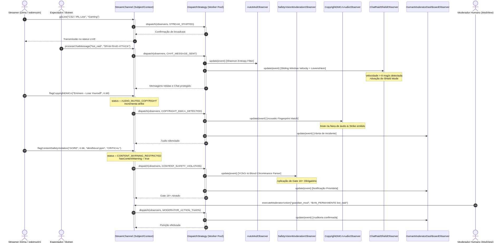
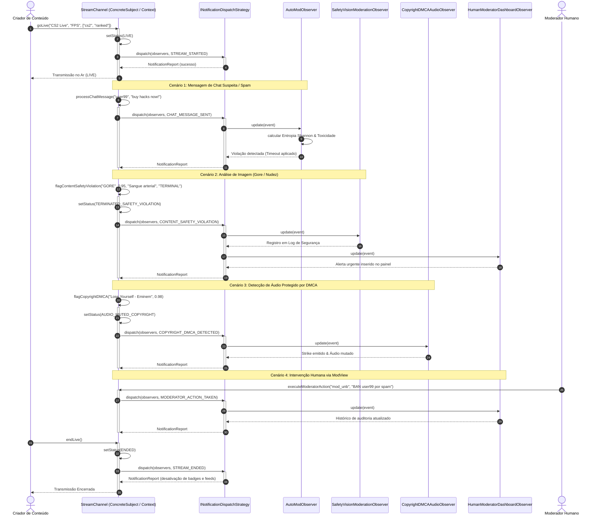
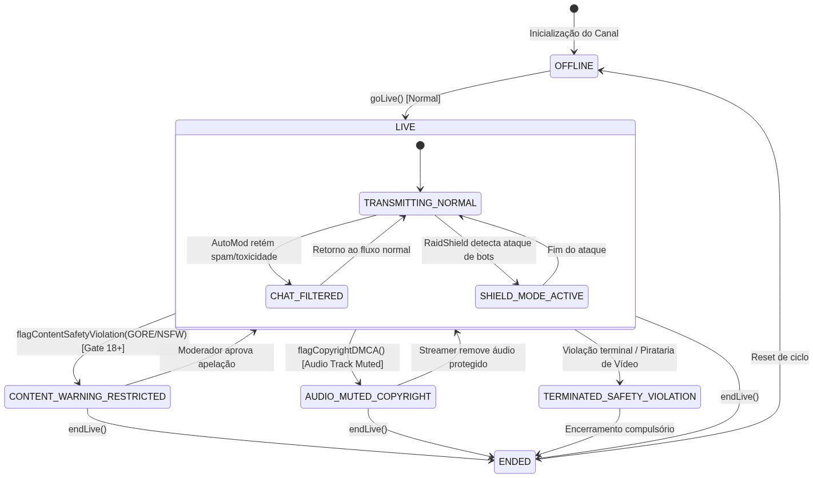
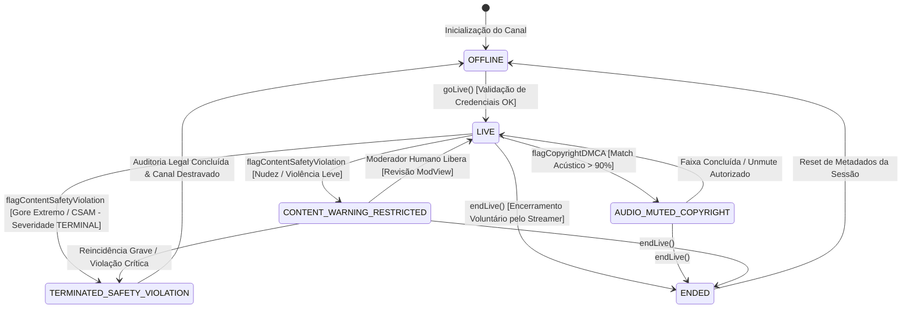
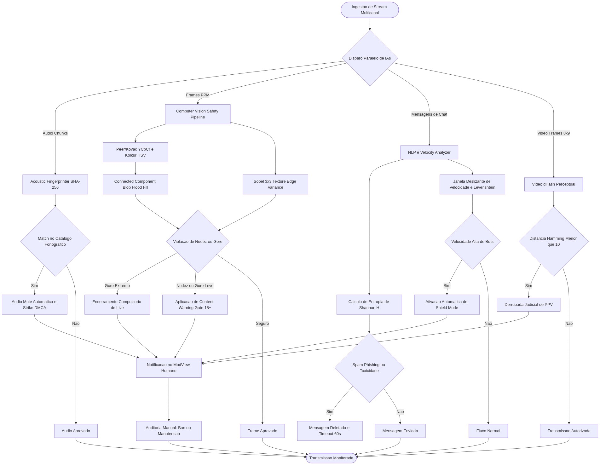

# 1.1.3.2. Sequência e Estados — GoF Observer para `StreamChannel`

**Autor:** Eduardo Lôbo Moreira · **Data:** 16/10/2026 · **Escopo:** Diagrama de Sequência do pipeline reativo de moderação, Diagrama de Máquina de Estados do ciclo de vida do canal e Diagrama de Atividades do processamento paralelo de inteligências artificiais. Demais padrões comportamentais da SubEquipe 03 com outros focos serão desenvolvidos pelos integrantes Hugo Freitas Silva e Philipe Amâncio Reis Caetano.  
**Decisão Arquitetural Formal:** [ADR-003 — Observer Concorrente para Notificações](/Base/Relatórios/1.1.3.SubEquipe_03/ADR/ADR-003-observer-concorrente-notificacoes-twitch.md)

---

## 1. Visão Geral da Dinâmica Temporal

Diferente de sistemas síncronos lineares onde a ocorrência de uma violação bloqueia a ingestão de vídeo ou derruba a conexão dos clientes, a arquitetura da SubEquipe 03 emprega o **GoF Observer** para orquestrar reações imediatas a eventos no canal.

O fluxo temporal compreende:
1. **Abertura e Sinalização:** O streamer aciona `goLive()`; o `StreamChannel` atualiza seu estado e despacha `STREAM_STARTED` para ativadores de interface, bots do Discord e notificações móveis.
2. **Ingestão Contínua e Incidentes:** Mensagens de chat, amostras de áudio e quadros de vídeo são submetidos a algoritmos especializados que notificam o canal sobre violações.
3. **Reações em Tempo Real:** Conforme a severidade da violação, o canal transiciona automaticamente de estado:
   - Nudez / Conteúdo Sensível: Ativação instantânea de aviso de conteúdo 18+ (`CONTENT_WARNING_RESTRICTED`).
   - Sangue Excessivo (Gore): Encerramento compulsório da live (`TERMINATED_SAFETY_VIOLATION`).
   - Violação de DMCA Fonográfico: Silenciamento imediato da faixa sonora (`AUDIO_MUTED_COPYRIGHT`).
   - Incidentes Críticos: Auditoria imediata na interface humana ModView.

---

## 2. Diagrama de Sequência UML: Pipeline Reativo de Moderação

Modela as interações temporais entre o Streamer, o Canal (`StreamChannel`), a Estratégia de Despacho (`INotificationDispatchStrategy`) e os Observadores Concretos.

*Figura 1 — Diagrama de Sequência UML do Pipeline Reativo de Moderação. Autoria: Eduardo Lôbo Moreira, 2026. Exportações: <a href="Base/Relatórios/1.1.3.SubEquipe_03/assets/diagramas/diagrama_sequencia_gof.svg" target="_blank" rel="noopener">Vetor SVG</a> · <a href="Base/Relatórios/1.1.3.SubEquipe_03/assets/diagramas/diagrama_sequencia_gof.png" target="_blank" rel="noopener">Imagem PNG</a>.*

### Especificação Mermaid do Fluxo de Mensagens

---

## 3. Diagrama de Máquina de Estados UML (`StreamChannel`)

O diagrama de máquina de estados formaliza as transições de ciclo de vida e salvaguardas de conformidade legal pelas quais o canal transita durante uma sessão.

*Figura 2 — Diagrama de Máquina de Estados UML do StreamChannel. Autoria: Eduardo Lôbo Moreira, 2026. Exportações: <a href="Base/Relatórios/1.1.3.SubEquipe_03/assets/diagramas/diagrama_estados_gof.svg" target="_blank" rel="noopener">Vetor SVG</a> · <a href="Base/Relatórios/1.1.3.SubEquipe_03/assets/diagramas/diagrama_estados_gof.png" target="_blank" rel="noopener">Imagem PNG</a>.*

---

## 4. Diagrama de Atividades UML: Pipeline Paralelo de Moderação

Modela o fluxo concorrente de ingestão de stream e avaliação de regras das inteligências artificiais simultaneamente.

*Figura 3 — Diagrama de Atividades UML: Avaliação Paralela de Regras pelas IAs. Autoria: Eduardo Lôbo Moreira, 2026. Exportações: <a href="Base/Relatórios/1.1.3.SubEquipe_03/assets/diagramas/diagrama_atividades_pipeline.svg" target="_blank" rel="noopener">Vetor SVG</a> · <a href="Base/Relatórios/1.1.3.SubEquipe_03/assets/diagramas/diagrama_atividades_pipeline.png" target="_blank" rel="noopener">Imagem PNG</a>.*

---

## 5. Rastreabilidade Mensagem a Mensagem no Código

| Mensagem UML | Método em `StreamChannel.ts` | Observador Reagente | Ação Executada |
| :--- | :--- | :--- | :--- |
| `goLive()` | `goLive(...)` (L93) | `Push`, `Discord`, `Badge` | Despacho de alertas móveis e ativação do badge vermelho na interface |
| `processChatMessage()` | `processChatMessage(...)` (L125) | `AutoModObserver` | Cálculo de Shannon Entropy; detecção de phishing e toxicidade; mute de 5 min |
| `flagContentSafetyViolation()` | `flagContentSafetyViolation(...)` (L145) | `SafetyVisionModerationObserver` | Leitura de buffers PPM/RGB; gate 18+ ou encerramento imediato do canal |
| `flagCopyrightDMCA()` | `flagCopyrightDMCA(...)` (L176) | `CopyrightDMCAAudioObserver` | Casamento de espectro de áudio; silenciamento de faixa e emissão de strike |
| `executeModeratorAction()` | `executeModeratorAction(...)` (L199) | `HumanModeratorDashboardObserver` | Registro em log de auditoria permanente no ModView |
| `endLive()` | `endLive()` (L219) | Todos os observadores | Desativação de badges, arquivamento de estatísticas e encerramento |

---

## Histórico de Versões

| Versão | Data | Integrante | Descrição | Revisor |
| :---: | :---: | :--- | :--- | :--- |
| 1.0 | 16/10/2026 | Eduardo Lôbo Moreira | Elaboração do diagrama de sequência, atividades e máquina de estados | A preencher |
