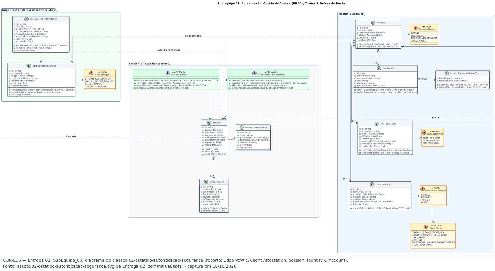
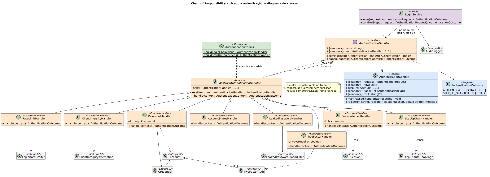

# 1.1.3.3. Modelagem — Chain of Responsibility para a autenticação

**Autor:** Hugo Freitas Silva · **Data:** 18/10/2026 · **Escopo:** diagrama de classes do Chain of Responsibility, correspondência com o diagrama de autenticação da Entrega 02, regras e evidências. A sequência está em [1.1.3.4. Sequência — Chain of Responsibility](/Base/Relatórios/1.1.3.SubEquipe_03/1.1.3.4.SequenciaChainOfResponsibility.md); o código, em <a href="https://github.com/UnBArqDsw2026-2-Turma01/2026.2-T01-_G6_ProjetoStreamingVideo_Entrega_03/tree/main/docs/Base/Relat%C3%B3rios/1.1.3.SubEquipe_03/codigo-autenticacao" target="_blank" rel="noopener"><code>codigo-autenticacao/</code></a>.

Decisão e raciocínio completos: [ADR-004](/Base/Relatórios/1.1.3.SubEquipe_03/ADR/ADR-004-chain-of-responsibility-autenticacao.md).

## Fundamento na aula

*Figura 1 — Modelagem do Chain of Responsibility na aula de GoFs comportamentais da Profa. Milene Serrano, slide 61 (referência completa no [relatório](/Base/Relatórios/1.1.3.SubEquipe_03/README.md?id=referências)): o `Handler` agrega a si mesmo como `nextHandler`; cada derivada trata o pedido ou chama `super.handle()`. Captura: Hugo Freitas Silva, 2026.*

O slide 9 da mesma aula (<a href="Base/Relatórios/1.1.3.SubEquipe_03/assets/chain-of-responsibility/evidencias/cor-e01-slide09-visao-geral-comportamentais.png" target="_blank" rel="noopener">COR-E01</a>) resume a intenção: evitar a dependência entre o objeto que solicita e o que recebe; a base mantém um ponteiro para o "próximo", e cada classe derivada contribui com sua parte no tratamento do pedido. O modelo abaixo segue essa estrutura.

## Antes — recorte da Entrega 02

*Figura 2 — Diagrama de classes de autenticação da Entrega 02, recorte (COR-E06). Autoria original: Eduardo Lôbo Moreira, 2026.*

O modelo da Entrega 02 já tem as peças da autenticação — `ClientIntegrityAttestation`, `Account` e `AccountStatus`, `Credential`, `LeakedPasswordBloomFilter`, `TwoFactorAuth`, `Session`, `StepUpAuthChallenge` e `IAuditLogger` —, mas nenhuma classe que diga **em que ordem** elas são consultadas nem **quem** responde ao pedido de login. É essa coordenação que o padrão acrescenta.

## Depois — Chain of Responsibility aplicado

*Figura 3 — Diagrama de classes do Chain of Responsibility, v1. Autoria: Hugo Freitas Silva, 2026. Fonte editável: <a href="Base/Relatórios/1.1.3.SubEquipe_03/assets/chain-of-responsibility/chain-of-responsibility-classes-v1.puml" target="_blank" rel="noopener"><code>chain-of-responsibility-classes-v1.puml</code></a> (PlantUML) · <a href="Base/Relatórios/1.1.3.SubEquipe_03/assets/chain-of-responsibility/chain-of-responsibility-classes-v1.svg" target="_blank" rel="noopener">SVG</a>.*

O diagrama foi conferido contra o código: nomes de classes, métodos e visibilidades são os de `codigo-autenticacao/src/`. Cores: laranja para os participantes Handler e ConcreteHandler, lilás para o Client, azul para a requisição e o resultado, verde para a montagem das cadeias e cinza (`«Entrega 02»`) para as classes de domínio vindas do diagrama anterior, mostradas sem membros para não repetir aquele modelo. A agregação de `AbstractAuthenticationHandler` para `AuthenticationHandler` (papel `next`, multiplicidade `0..1`) é o ponteiro para o sucessor do slide 61.

### Participantes GoF → classes

| Participante | Classe | Papel no domínio |
| --- | --- | --- |
| Handler | `AuthenticationHandler` («interface») e `AbstractAuthenticationHandler` | Define `handle` e `setNext`; a base guarda o sucessor, repassa o pedido e, no fim da cadeia, recusa (A8) |
| ConcreteHandler | `RateLimitHandler`, `ClientIntegrityHandler`, `PasswordHandler`, `AccountStatusHandler`, `LeakedPasswordHandler`, `TwoFactorHandler` | Cada um verifica uma regra (A1–A7) e recusa, responde com desafio ou repassa |
| ConcreteHandler terminal | `SessionIssuerHandler` (login) e `StepUpGrantHandler` (step-up) | Tratam de fato o pedido: criam a sessão ou concluem o desafio de step-up; não repassam |
| Client | `LoginService` | Entrega o pedido ao primeiro elo sem saber qual vai respondê-lo; registra o resultado na auditoria |
| Request | `AuthenticationContext` (com `AuthenticationRequest`) | O pedido que percorre a cadeia, com o que os elos já descobriram (conta, marcas, trilha) |

### Correspondência com a Entrega 02

| Elemento da Entrega 02 | Usado por | Como |
| --- | --- | --- |
| `ClientIntegrityAttestation` (DE01) | `ClientIntegrityHandler` | Verifica prova de trabalho, idade e `hasWebDriverFlag` |
| `Account`, `AccountStatus` | `PasswordHandler`, `AccountStatusHandler` | Conta localizada pelo e-mail; estados bloqueados recusam |
| `Credential` | `PasswordHandler` | `verifyPassword` em tempo constante; credencial fictícia para e-mail inexistente |
| `LeakedPasswordBloomFilter` (DE02) | `LeakedPasswordHandler` | `mightContain`; marca `PASSWORD_CHANGE_REQUIRED` |
| `TwoFactorAuth` (`TOTP_RFC_6238`) | `TwoFactorHandler` | `verifyToken` com janela de ±1 passo e bloqueio de reuso |
| `Session`, `ITokenService`, `AccessTokenPayload` | `SessionIssuerHandler` | Cria a sessão e emite um JWT HS256 |
| `StepUpAuthChallenge`, `StepUpTrigger` | `StepUpGrantHandler` | Conclui o desafio da própria conta, se ainda válido |
| `IAuditLogger`, `SecurityEventType` | `LoginService` | `LOGIN_SUCCESS`, `LOGIN_FAILURE`, `STEP_UP_CHALLENGE_SUCCESS/FAILED` |

### O que muda no modelo da Entrega 02

| Item | Entrega 02 | Com o padrão | Situação |
| --- | --- | --- | --- |
| Ordem das verificações do login | não modelada | definida pela montagem da cadeia (D3 do ADR-004) | Acréscimo |
| Quem responde ao login | não modelado | o elo que trata; o `LoginService` só conhece o primeiro | Acréscimo |
| `Credential.algorithm` | Argon2id (O06 da Entrega 01) | scrypt nos parâmetros do OWASP | Revisão declarada (D9) |
| `Account` × papéis (RBAC) | `RoleAssignment`, `Role`, `Permission` | só `role: VIEWER \| CREATOR`, o que C03 precisa | Recorte, não revisão |
| `StepUpAuthChallenge` | atributos e `completeWith…` | concluído pela cadeia de step-up | Comportamento atribuído (D7) |
| Limite de tentativas | só em O07 (Entrega 01) | `LoginRateLimiter` + `RateLimitHandler` | Classe nova |

### Regras (verificadas no código e nos testes)

| Id | Regra | Elo | Teste |
| --- | --- | --- | --- |
| A1 | 5 falhas de credencial por e-mail ou IP em 15 min bloqueiam | `RateLimitHandler` | `cinco falhas bloqueiam a sexta tentativa…` |
| A2 | Atestação inválida barrada antes do hash | `ClientIntegrityHandler` | `recusa atestação …` (5 casos) |
| A3 | E-mail inexistente e senha errada: mesma recusa | `PasswordHandler` | `e-mail inexistente e senha errada têm a mesma recusa` |
| A4 | Estado da conta só depois da senha | `AccountStatusHandler` | `conta suspensa só é revelada a quem prova a senha` |
| A5 | Senha vazada marca troca e segue | `LeakedPasswordHandler` | `marca a troca obrigatória e segue mesmo assim` |
| A6 | Segundo fator de criadores e de contas com 2FA | `TwoFactorHandler` | `criador sem segundo fator cadastrado é recusado (C03)` |
| A7 | TOTP ±1 passo, sem reuso | `TwoFactorAuth` | vetores da RFC 6238 e `recusa o reuso…` |
| A8 | Fim da cadeia recusa | `AbstractAuthenticationHandler` | `sem sucessor, recusa com UNHANDLED (falha fechada)` |

## Evidências

Capturas feitas em 18/10/2026; cada imagem traz fonte e data no rodapé.

| Id | Arquivo | O que comprova |
| --- | --- | --- |
| COR-E01 | <a href="Base/Relatórios/1.1.3.SubEquipe_03/assets/chain-of-responsibility/evidencias/cor-e01-slide09-visao-geral-comportamentais.png" target="_blank" rel="noopener"><code>cor-e01-slide09-visao-geral-comportamentais.png</code></a> | Definição do padrão na aula da disciplina |
| COR-E02 | <a href="Base/Relatórios/1.1.3.SubEquipe_03/assets/chain-of-responsibility/evidencias/cor-e02-slide61-modelagem-chain.png" target="_blank" rel="noopener"><code>cor-e02-slide61-modelagem-chain.png</code></a> | Estrutura `Handler` + `nextHandler` + `super.handle()` (D1) |
| COR-E03 | <a href="Base/Relatórios/1.1.3.SubEquipe_03/assets/chain-of-responsibility/evidencias/cor-e03-e01-escopo-fluxo-login-subequipe03.png" target="_blank" rel="noopener"><code>cor-e03-e01-escopo-fluxo-login-subequipe03.png</code></a> | Login e autenticação como fluxo mínimo da SubEquipe_03 desde a Entrega 01 |
| COR-E04 | <a href="Base/Relatórios/1.1.3.SubEquipe_03/assets/chain-of-responsibility/evidencias/cor-e04-e01-nfr-o05-o06-o07.png" target="_blank" rel="noopener"><code>cor-e04-e01-nfr-o05-o06-o07.png</code></a> | O05 (MFA), O06 (Argon2id) e O07 (rate limiting no login): A1, A6, D9 |
| COR-E05 | <a href="Base/Relatórios/1.1.3.SubEquipe_03/assets/chain-of-responsibility/evidencias/cor-e05-e01-nfr-conflito-c03.png" target="_blank" rel="noopener"><code>cor-e05-e01-nfr-conflito-c03.png</code></a> | C03: MFA só para criadores e transações (A6) |
| COR-E06 | <a href="Base/Relatórios/1.1.3.SubEquipe_03/assets/chain-of-responsibility/evidencias/cor-e06-e02-classes-autenticacao.png" target="_blank" rel="noopener"><code>cor-e06-e02-classes-autenticacao.png</code></a> | Classes de autenticação da Entrega 02 usadas pelos elos |

## Senso crítico

- **O padrão não exigiu revisar o modelo da Entrega 02 para se justificar**: as peças existiam, faltava a coordenação. A única revisão é D9 (scrypt no lugar de Argon2id), imposta pela plataforma de execução, não pelo padrão.
- **A ordem é um contrato que o diagrama de classes não mostra.** O diagrama mostra que todo elo tem um sucessor, mas não qual. A ordem está na montagem (`AuthenticationChains`), no diagrama de sequência e num teste; quem olhar só as classes não a vê.
- **`RateLimitHandler` age na volta** (D5), o que o diagrama de classes não distingue dos demais elos. É uma variação conhecida (cadeia de filtros), registrada no ADR.
- **Recorte de domínio.** As classes da Entrega 02 aparecem sem membros e foram implementadas só com o que a cadeia usa; OAuth, passkeys e RBAC completo ficaram de fora.

## Histórico de versões

| Versão | Data | Autor | Descrição | Revisor |
| --- | --- | --- | --- | --- |
| 1.0 | 18/10/2026 | [@HugoFreitass](https://github.com/HugoFreitass) | Diagrama de classes do Chain of Responsibility, correspondência com a Entrega 02, regras A1–A8 e evidências COR-E01 a COR-E06 | [@EduLoboM](https://github.com/EduLoboM) e [@Phill-Chill](https://github.com/Phill-Chill): diagrama conferido contra o código e contra o diagrama de autenticação da Entrega 02; evidências COR-E01 a COR-E06 |
| 1.1 | 18/10/2026 | [@HugoFreitass](https://github.com/HugoFreitass) | Legenda da Figura 1 sem citação autor-data, alinhada às referências numeradas do relatório | [@EduLoboM](https://github.com/EduLoboM) e [@Phill-Chill](https://github.com/Phill-Chill): legenda da Figura 1 |
