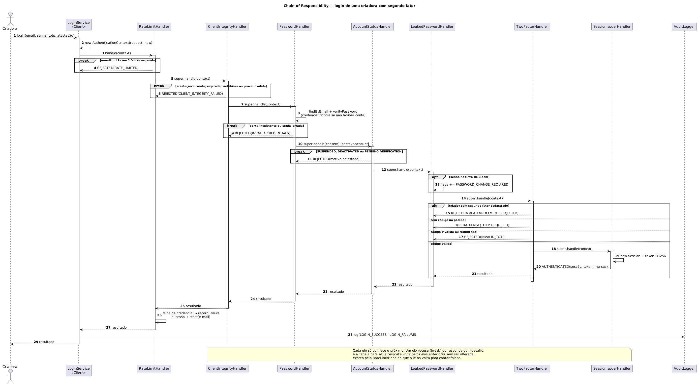

# 1.1.3.4. Sequência — Chain of Responsibility (login com segundo fator)

**Autor:** Hugo Freitas Silva · **Data:** 18/10/2026 · **Escopo:** diagrama de sequência do login de uma criadora com segundo fator, o caso que passa por todos os elos. O diagrama de classes e as regras estão em [1.1.3.3. Modelagem — Chain of Responsibility](/Base/Relatórios/1.1.3.SubEquipe_03/1.1.3.3.ModelagemChainOfResponsibility.md) e no [ADR-004](/Base/Relatórios/1.1.3.SubEquipe_03/ADR/ADR-004-chain-of-responsibility-autenticacao.md).

## Diagrama

*Figura 1 — Diagrama de sequência do Chain of Responsibility, v1: login de uma criadora com segundo fator. Autoria: Hugo Freitas Silva, 2026. Fonte editável: <a href="Base/Relatórios/1.1.3.SubEquipe_03/assets/chain-of-responsibility/chain-of-responsibility-sequencia-v1.puml" target="_blank" rel="noopener"><code>chain-of-responsibility-sequencia-v1.puml</code></a> (PlantUML) · <a href="Base/Relatórios/1.1.3.SubEquipe_03/assets/chain-of-responsibility/chain-of-responsibility-sequencia-v1.svg" target="_blank" rel="noopener">SVG</a>.*

## Como ler

| Mensagens | O que acontece | Elo |
| --- | --- | --- |
| 1–3 | O `LoginService` (Client) cria o contexto e entrega o pedido **só ao primeiro elo**; não sabe qual elo vai responder. | Participante Client |
| 4 | Limite de tentativas: com cinco falhas na janela, o pedido para aqui (`break`). | A1 |
| 5–6 | Atestação do cliente; barra automação antes do hash, a etapa cara. | A2, D3 |
| 7–9 | Senha: conta inexistente e senha errada saem pelo mesmo `break`, com a mesma mensagem e o mesmo custo de hash (credencial fictícia). | A3 |
| 10–11 | Estado da conta, só depois da senha: conta suspensa não é revelada a quem não sabe a senha. | A4, D3 |
| 12–13 | Senha vazada: fragmento `opt`, o elo **não** recusa; deixa a marca e repassa. | A5 |
| 14–21 | Segundo fator: `alt` com quatro saídas. Sem código, o elo **trata** o pedido respondendo com um desafio (16); com código válido, repassa ao elo terminal, que cria a sessão (18–20). | A6, A7, D6 |
| 22–25 | O resultado volta pelos elos sem ser alterado. | — |
| 26–27 | Na volta, o `RateLimitHandler` lê o resultado: falha de credencial conta para o limite; sucesso zera a janela do e-mail. | A1, D5 |
| 28–29 | O Client registra o evento de auditoria e responde. | D8 |

Cada `super.handle(context)` é a chamada que a base `AbstractAuthenticationHandler` transforma em `next.handle(context)`, depois de registrar o elo na trilha (D1). Os fragmentos `break` encerram o fluxo: o elo devolve a recusa ao elo anterior, e nenhum elo seguinte é chamado.

## Correspondência com o código

O diagrama foi desenhado a partir do código já implementado: cada mensagem corresponde a uma chamada real.

| Elemento | Arquivo no repositório de código |
| --- | --- |
| Mensagens 1–3 e 28–29 | `src/autenticacao/login-service.ts` (`login`) |
| `super.handle` → `next.handle` | `src/autenticacao/cadeia/authentication-handler.ts` |
| Mensagens 4 e 26 | `src/autenticacao/cadeia/rate-limit-handler.ts` |
| Mensagens 5–6 | `src/autenticacao/cadeia/client-integrity-handler.ts` |
| Mensagens 7–9 | `src/autenticacao/cadeia/password-handler.ts` |
| Mensagens 10–11 | `src/autenticacao/cadeia/account-status-handler.ts` |
| Mensagens 12–13 | `src/autenticacao/cadeia/leaked-password-handler.ts` |
| Mensagens 14–17 e 21 | `src/autenticacao/cadeia/two-factor-handler.ts` |
| Mensagens 18–20 | `src/autenticacao/cadeia/session-issuer-handler.ts` |
| Ordem dos elos | teste `é montada na ordem decidida no ADR-004` em `test/cadeias.test.ts` |
| Ponto de parada de cada recusa | teste `cada recusa vem do elo responsável e interrompe a cadeia ali`, que confere também a trilha |

A trilha registrada no contexto (`trail`) é a forma de conferir o diagrama em execução: a demonstração imprime, para cada caso, os elos que deixaram o pedido passar.

## Senso crítico

- **Um caso, não todos.** O login da criadora com segundo fator passa por todos os elos e mostra os três tipos de saída (recusa, desafio, sucesso). O step-up usa os mesmos elos com outra montagem e não ganhou diagrama próprio, para não repetir a cadeia.
- **Os `break` simplificam a volta.** No código, a recusa volta elo a elo até o Client, passando pelo `RateLimitHandler`. O diagrama desenha cada recusa voltando só ao elo anterior e mostra a passagem completa apenas no caminho de sucesso (22–27).
- **Síncrono.** As mensagens são chamadas síncronas, como no código. Num serviço real, senha e sessão consultariam armazenamento externo e seriam assíncronas; a estrutura do padrão não muda.

## Histórico de versões

| Versão | Data | Autor | Descrição | Revisor |
| --- | --- | --- | --- | --- |
| 1.0 | 18/10/2026 | [@HugoFreitass](https://github.com/HugoFreitass) | Diagrama de sequência do login com segundo fator, com os caminhos de recusa e desafio | [@EduLoboM](https://github.com/EduLoboM) e [@Phill-Chill](https://github.com/Phill-Chill): ordem das mensagens conferida contra `buildLoginChain` e caminhos de recusa e desafio conferidos contra os testes |
