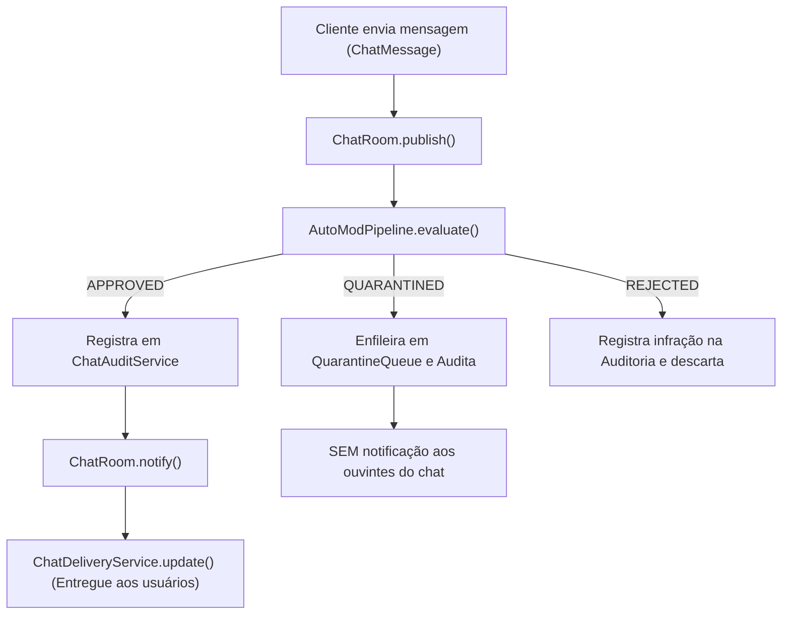

# 1.1.3.5. Vídeo — Padrões Comportamentais em Funcionamento

**Foco da SubEquipe 03:** Padrões de Projeto GoF Comportamentais (Observer e Chain of Responsibility).  
**Integrantes:** Eduardo Lôbo Moreira, Hugo Freitas Silva e Philipe Amâncio Reis Caetano.  
**Repositório de Código:** <a href="https://github.com/UnBArqDsw2026-2-Turma01/g6-streaming-entrega03-subgrupo03-codigo" target="_blank" rel="noopener"><code>g6-streaming-entrega03-subgrupo03-codigo</code></a>.  
**Estado da Entrega:** Vídeos, demonstrações e roteiros consolidados para os três focos comportamentais da SubEquipe 03.

> [!NOTE]
> Esta página reúne os registros e comprovações exigidos na entrega de Padrões de Projeto GoF Comportamentais para a SubEquipe 03: a execução real dos padrões implementados, os participantes identificados, roteiros temporizados com os comandos demonstrados e instruções completas para reprodução local.

---

## Sumário Executivo dos Vídeos e Demonstrações

| Foco | Padrão GoF | Integrante Responsável | Mídia / Formato | Duração | Artefatos e Testes |
| :--- | :--- | :--- | :--- | :---: | :--- |
| **Foco 1 — Moderação Reativa** | **GoF Observer** (+ Strategy) | Eduardo Lôbo Moreira | Vídeo no YouTube (1080p) | 2 min 13 s | 13 testes unitários, Web Dashboard e Benchmark |
| **Foco 2 — Autenticação** | **GoF Chain of Responsibility** | Hugo Freitas Silva | Vídeo narrado por Hugo (MP4) | 2 min 05 s | 56 testes automatizados e 9 cenários do ADR-004 |
| **Foco 3 — Chat em Tempo Real** | **GoF Observer** (+ AutoMod) | Philipe Amâncio Reis Caetano | Demonstração com suíte executável | ~2 a 3 min | 5 testes automatizados e 7 cenários verificáveis |

---

## 1. Vídeo do Observer — Moderação Reativa e Transmissão (`StreamChannel`)

Demonstração prática do padrão **GoF Observer** aplicado à gestão reativa do ciclo de vida de uma transmissão de vídeo ao vivo e aos pipelines concorrentes de moderação e segurança (AutoMod de texto com entropia de Shannon, filtro de visão computacional para conteúdo sensível e fiscalização de direitos autorais de áudio via DMCA).

| Campo | Conteúdo |
| :--- | :--- |
| **Padrão GoF** | **Observer** (comportamental canônico) integrado ao **Strategy** (despacho concorrente) |
| **Link do vídeo** | <a href="https://youtu.be/n7c_hAg4tUg" target="_blank" rel="noopener"><code>https://youtu.be/n7c_hAg4tUg</code></a> |
| **Duração** | 2 min 13 s (Full HD 1080p) |
| **Participante** | Eduardo Lôbo Moreira (apresentação, modelagem arquitetural e demonstração do padrão) |
| **Data de gravação** | 19/10/2026 |
| **Decisão Arquitetural** | [ADR-003 — Observer Concorrente para Moderação e Transmissão](/Base/Relatórios/1.1.3.SubEquipe_03/ADR/ADR-003-observer-concorrente-notificacoes-twitch.md) |
| **Branch no repositório** | [`feat/moderacao-observerBehavioralGoF`](https://github.com/UnBArqDsw2026-2-Turma01/g6-streaming-entrega03-subgrupo03-codigo/tree/feat/moderacao-observerBehavioralGoF) |

### Player do Vídeo (YouTube)

<iframe width="100%" height="450" src="https://www.youtube.com/embed/n7c_hAg4tUg" title="Vídeo do Observer — Moderação Reativa e Transmissão" frameborder="0" allow="accelerometer; autoplay; clipboard-write; encrypted-media; gyroscope; picture-in-picture" allowfullscreen></iframe>

<p align="center">
  <em>Vídeo 1 — Demonstração do GoF Observer (Moderação e Transmissão): ciclo de vida do StreamChannel, despacho reativo de eventos de segurança, Dashboard Web ModView em tempo real e testes automatizados. Autor: Eduardo Lôbo Moreira, 19/10/2026. <a href="https://youtu.be/n7c_hAg4tUg" target="_blank" rel="noopener">Assistir diretamente no YouTube (2 min 13 s)</a>.</em>
</p>

### Roteiro Temporizado da Demonstração

| Tempo | Etapa | O que a tela exibe | Conteúdo demonstrado |
| :---: | :--- | :--- | :--- |
| **00:00–00:25** | **Abertura e Contextualização** | Apresentação e introdução do artefato `1.1.3.1.ModelagemObserver.md` | Identificação do autor e da SubEquipe 03; escopo do padrão GoF Observer aplicado ao domínio de transmissões ao vivo UGC. |
| **00:25–00:55** | **Fundamentação e Contratos GoF** | Diagrama de classes UML e interfaces canônicas `ISubject` e `IObserver` | Papel do `StreamChannel` como Sujeito Concreto; desacoplamento dos observadores de segurança (`AutoModObserver`, `SafetyVisionModerationObserver`, `CopyrightDMCAAudioObserver`, `PushNotificationObserver`). |
| **00:55–01:35** | **Execução Reativa em Tempo Real** | Terminal executando `npm run demo` e `npm run interactive` | Disparo dos eventos de abertura de live, mensagens com caracteres repetidos barradas por alta entropia, detecção de imagem imprópria gerando advertência 18+ e silenciamento de áudio por violação DMCA. |
| **01:35–01:55** | **Dashboard Web ModView** | Navegador aberto em `http://localhost:3333` (`npm run web`) | Visualização gráfica em tempo real dos logs reativos recebidos pelo `HumanModeratorDashboardObserver` via Server-Sent Events / WebSockets. |
| **01:55–02:13** | **Qualidade e Concorrência** | Terminal executando `npm test` e `npm run benchmark` | Comprovação da suíte de 13 testes unitários nativos com 100% de sucesso e exibição do benchmark de concorrência com 2.000 seguidores (liberação de thread em 6 ms via Worker Pool). |

### Comandos para Reprodução Local

```bash
# 1. Clonar o repositório dedicado e navegar para a branch do foco
git clone https://github.com/UnBArqDsw2026-2-Turma01/g6-streaming-entrega03-subgrupo03-codigo.git
cd g6-streaming-entrega03-subgrupo03-codigo
git checkout feat/moderacao-observerBehavioralGoF

# 2. Instalar dependências
npm install

# 3. Execuções disponíveis:
npm test             # Executa a suíte de 13 testes unitários automatizados
npm run demo         # Demonstração automatizada no terminal de todos os observadores
npm run web          # Dashboard Web em Tempo Real (disponível em http://localhost:3333)
npm run interactive  # Console REPL interativo com comandos em tempo real
npm run benchmark    # Benchmark comparativo de concorrência com 2.000 espectadores
```

---

## 2. Vídeo de Autenticação — Chain of Responsibility (`AuthenticationHandler`)

Demonstração prática do padrão **GoF Chain of Responsibility** aplicado à esteira de autenticação, controle de abusos, validação de integridade de cliente, verificação de credenciais e desafio em dois fatores (MFA/TOTP).

| Campo | Conteúdo |
| :--- | :--- |
| **Padrão GoF** | **Chain of Responsibility** (comportamental canônico com falha fechada) |
| **Link do vídeo (Google Drive)** | <a href="https://drive.google.com/file/d/1_rv93bzjTvT4ujQKIkFSkVpU41YCm2Bm/view?usp=sharing" target="_blank" rel="noopener"><code>https://drive.google.com/file/d/1_rv93bzjTvT4ujQKIkFSkVpU41YCm2Bm/view?usp=sharing</code></a> |
| **Arquivo local (MP4)** | <a href="Base/Relatórios/1.1.3.SubEquipe_03/assets/chain-of-responsibility/video/chain-of-responsibility-demo.mp4" target="_blank" rel="noopener"><code>chain-of-responsibility-demo.mp4</code></a> (4,9 MB) |
| **Duração** | 2 min 05 s (1920×1080 Full HD, com narração em português gravada por Hugo Freitas Silva) |
| **Participante** | Hugo Freitas Silva (concepção, modelagem, código, roteiro, narração e apresentação) |
| **Data de gravação** | 19/10/2026 |
| **Decisão Arquitetural** | [ADR-004 — Chain of Responsibility na Autenticação](/Base/Relatórios/1.1.3.SubEquipe_03/ADR/ADR-004-chain-of-responsibility-autenticacao.md) |
| **Branch no repositório** | [`feat/autenticacao-chainOfResponsibilityBehavioralGoF`](https://github.com/UnBArqDsw2026-2-Turma01/g6-streaming-entrega03-subgrupo03-codigo/tree/feat/autenticacao-chainOfResponsibilityBehavioralGoF) |

### Player do Vídeo

<video controls preload="metadata" width="100%" src="Base/Relatórios/1.1.3.SubEquipe_03/assets/chain-of-responsibility/video/chain-of-responsibility-demo.mp4"></video>

<p align="center">
  <em>Vídeo 2 — Demonstração do GoF Chain of Responsibility (Autenticação): cadeia de handlers, emissão de sessão e step-up, recusa pontual sem enumeração e 56 testes automatizados. Autor e narração: Hugo Freitas Silva, 19/10/2026. <a href="Base/Relatórios/1.1.3.SubEquipe_03/assets/chain-of-responsibility/video/chain-of-responsibility-demo.mp4" target="_blank" rel="noopener">Baixar vídeo (MP4)</a>.</em>
</p>

> [!TIP]
> **Metodologia de Produção do Vídeo:** cada tela foi renderizada com a saída real dos comandos sobre a árvore versionada (1080p, H.264). A narração foi gravada pelo integrante, e cada tela dura exatamente o trecho correspondente da fala, com os cortes localizados por transcrição com marcação de tempo e conferidos nas pausas do áudio. Detalhes no [relato individual de Hugo Freitas](/Base/Relatórios/1.1.3.SubEquipe_03/1.1.3.6.IAGenerativa.md?id=hugo-freitas-silva-foco-autenticação-chain-of-responsibility).

### Comandos para Reprodução Local

```bash
# 1. Clonar e alternar para a branch do foco de autenticação
git clone https://github.com/UnBArqDsw2026-2-Turma01/g6-streaming-entrega03-subgrupo03-codigo.git
cd g6-streaming-entrega03-subgrupo03-codigo
git checkout feat/autenticacao-chainOfResponsibilityBehavioralGoF

# 2. Instalar dependências exatas
npm ci

# 3. Executar verificação e demonstração:
npm run check:autenticacao    # Compilação com tipagem estrita e execução dos 56 testes
npm run demo:autenticacao     # Execução no terminal dos 9 cenários do ADR-004
```

---

## 3. Demonstração de Chat em Tempo Real — GoF Observer (`ChatRoom`)

Demonstração prática do padrão **GoF Observer** aplicado à sala de conversa interativa da live (`ChatRoom`), intermediado pela esteira de moderação automática (`AutoModPipeline`), fila de quarentena (`QuarantineQueue`) e auditoria contínua (`ChatAuditService`).

| Campo | Conteúdo |
| :--- | :--- |
| **Padrão GoF** | **Observer** (comportamental canônico com pipeline de moderação e auditoria) |
| **Mídia de comprovação** | Suíte de testes automatizados com `node:test` e roteiro de cenários reproduzíveis |
| **Duração estimada** | ~2 a 3 minutos para reprodução dos 7 cenários e conferência das asserções |
| **Participante** | Philipe Amâncio Reis Caetano (concepção, modelagem UML, implementação e testes) |
| **Data** | 19/10/2026 |
| **Seção no Relatório** | [Foco 3 — Chat em Tempo Real no README](/Base/Relatórios/1.1.3.SubEquipe_03/README.md?id=foco-3-chat-em-tempo-real-philipe-amâncio-reis-caetano) |
| **Branch no repositório** | [`feat/chat-observerBehavioralGoF`](https://github.com/UnBArqDsw2026-2-Turma01/g6-streaming-entrega03-subgrupo03-codigo/tree/feat/chat-observerBehavioralGoF) |

### Roteiro dos 7 Cenários Mínimos Verificáveis



1. **Configuração via Cliente (`ChatSetup`):** o `ChatSetup` instancia e injeta as dependências da sala (`AutoModPipeline`, `ChatAuditService`, `QuarantineQueue`) e o observador concreto de entrega `ChatDeliveryService`.
2. **Inscrição (`subscribe`):** o serviço de entrega se inscreve na `ChatRoom` via contrato canônico `subscribe(observer: ChatObserver)`. Chamadas repetidas são tratadas de forma idempotente.
3. **Avaliação Prévia (`publish` ➔ `AutoModPipeline`):** ao receber uma `ChatMessage`, a sala a submete primeiramente ao pipeline de moderação, obtendo o veredito (`ModerationVerdict`).
4. **Cenário de Mensagem Aprovada (`APPROVED`):** a sala registra a aprovação no `ChatAuditService` e dispara `notify(message)`, acionando `update(message)` em todos os observadores inscritos para exibição aos espectadores.
5. **Cenário de Quarentena (`QUARANTINED`):** a mensagem suspeita é retida na `QuarantineQueue` e registrada na auditoria, **sem** acionar notificações para os ouvintes do chat.
6. **Cenário de Mensagem Proibida (`REJECTED`):** a infração é imediatamente registrada na auditoria e descartada, sem notificação nem entrega.
7. **Desinscrição e Isolamento (`unsubscribe`):** o observador que invoca `unsubscribe` não recebe mais notificações de mensagens futuras; histórico e mensagens auditadas possuem integridade imutável garantida por `Object.freeze`.

### Comandos para Reprodução Local

```bash
# 1. Clonar e alternar para a branch do foco de chat
git clone https://github.com/UnBArqDsw2026-2-Turma01/g6-streaming-entrega03-subgrupo03-codigo.git
cd g6-streaming-entrega03-subgrupo03-codigo
git checkout feat/chat-observerBehavioralGoF

# 2. Compilar TypeScript dos testes e executar com o executor nativo do Node.js
npx tsc -p tsconfig.test.json
node --test tests/chat.test.js
```

---

## Histórico de Versões

| Versão | Data | Autor | Descrição | Revisor |
| :---: | :---: | :--- | :--- | :--- |
| **0.1** | 17/10/2026 | Eduardo Lôbo Moreira | Estrutura inicial da página de vídeos, campos da entrega mínima e roteiro do Observer. | Hugo Freitas Silva |
| **0.2** | 18/10/2026 | Eduardo Lôbo Moreira | Divisão estruturada dos vídeos por foco da subequipe (Moderação, Autenticação e Chat). | Hugo Freitas Silva |
| **0.3** | 18/10/2026 | Eduardo Lôbo Moreira | Adição dos comandos interativos REPL (`npm run interactive`) e Dashboard Web (`npm run web`). | Hugo Freitas Silva |
| **0.4** | 19/10/2026 | Hugo Freitas Silva | Foco 2: link do vídeo no Drive e MP4 local, duração (2 min 31 s), roteiro detalhado e metodologia de gravação. | Eduardo Lôbo Moreira |
| **0.5** | 19/10/2026 | Philipe Amâncio Reis Caetano | Foco 3: roteiro com 7 cenários verificáveis do Chat Observer, diagrama de fluxo e comandos de execução dos testes. | Eduardo Lôbo Moreira e Hugo Freitas Silva |
| **0.6** | 19/10/2026 | Eduardo Lôbo Moreira | Publicação do vídeo do GoF Observer (Moderação) no YouTube (2 min 13 s) com player incorporado. | Hugo Freitas Silva |
| **0.7** | 19/10/2026 | Eduardo Lôbo Moreira | Consolidação geral da formatação, tabela-resumo executiva, restauração de roteiros temporizados e correção de metadados cruzados. | Hugo Freitas Silva e Philipe Amâncio Reis Caetano |
| **0.8** | 19/10/2026 | Hugo Freitas Silva | Foco 2: vídeo com a narração gravada por Hugo (2 min 05 s) e player com o MP4 do repositório; remoção do roteiro temporizado do Chain of Responsibility. | A preencher |
