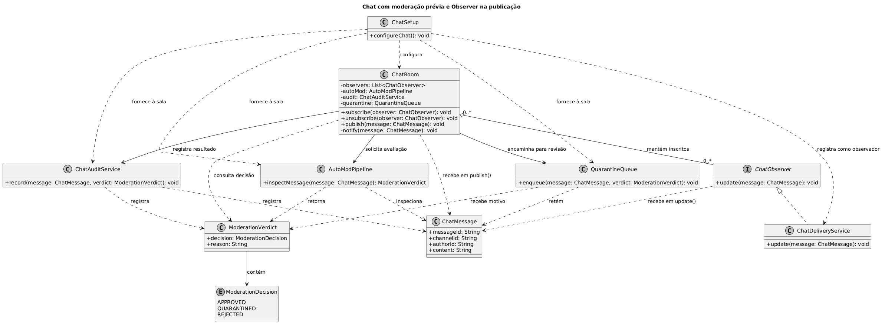

# 1.1.3. SubEquipe_03 — GoFs Comportamentais + IA Generativa

**Estado:** concluído e consolidado. A SubEquipe 03 aborda os **Padrões de Projeto GoF Comportamentais** divididos em três frentes funcionais complementares da plataforma de streaming:

1. **Moderação Reativa e Segurança de Transmissão:** modelagem e implementação do padrão **GoF Observer** aplicado ao ciclo de vida de lives e ao pipeline reativo de moderação no `StreamChannel` (elaborado por **Eduardo Lôbo Moreira**), registrado em [1.1.3.1. Modelagem — Observer (Moderação)](/Base/Relatórios/1.1.3.SubEquipe_03/1.1.3.1.ModelagemObserver.md), [1.1.3.2. Sequência — Observer (Moderação)](/Base/Relatórios/1.1.3.SubEquipe_03/1.1.3.2.SequenciaObserver.md) e em [ADR-003](/Base/Relatórios/1.1.3.SubEquipe_03/ADR/ADR-003-observer-concorrente-notificacoes-twitch.md).
2. **Autenticação e Sessão:** padrão **GoF Chain of Responsibility** aplicado ao login e à reautenticação (*step-up*), elaborado por **Hugo Freitas Silva**, registrado em [1.1.3.3. Modelagem](/Base/Relatórios/1.1.3.SubEquipe_03/1.1.3.3.ModelagemChainOfResponsibility.md), [1.1.3.4. Sequência](/Base/Relatórios/1.1.3.SubEquipe_03/1.1.3.4.SequenciaChainOfResponsibility.md) e [ADR-004](/Base/Relatórios/1.1.3.SubEquipe_03/ADR/ADR-004-chain-of-responsibility-autenticacao.md).
3. **Chat em Tempo Real:** modelagem e implementação do padrão **GoF Observer** aplicado à distribuição de mensagens aprovadas em salas de transmissão, desacoplando a sala dos serviços de entrega e integrando a inspeção com o `AutoModPipeline` (elaborado por **Philipe Amâncio Reis Caetano**).

Este relatório reúne a entrega completa da SubEquipe 03 para a Entrega 03. Os três focos comportamentais estão integralmente modelados em UML, implementados em TypeScript em repositório dedicado com 74 testes automatizados e avaliados criticamente quanto ao uso de IA Generativa.

---

## Integrantes e Divisão de Focos

| Matrícula | Integrante | GitHub | Foco Comportamental na Entrega 03 |
| :---: | :--- | :---: | :--- |
| 24/1011027 | Eduardo Lôbo Moreira | [@EduLoboM](https://github.com/EduLoboM) | **Moderação Reativa e Segurança de Transmissão** (Padrão: **GoF Observer**) |
| 24/1041302 | Hugo Freitas Silva | [@HugoFreitass](https://github.com/HugoFreitass) | **Autenticação e Sessão** (Padrão: **GoF Chain of Responsibility**) |
| 24/1040350 | Philipe Amâncio Reis Caetano | [@Phill-Chill](https://github.com/Phill-Chill) | **Chat em Tempo Real** (Padrão: **GoF Observer**) |

Composição mantida conforme a [introdução da Entrega 02](https://unbarqdsw2026-2-turma01.github.io/2026.2-T01-_G6_ProjetoStreamingVideo_Entrega_02/#/Introducao).

---

## Foco do relatório

**GoFs Comportamentais + IA Generativa.** A entrega cobre os três focos funcionais da plataforma sob a ótica dos padrões comportamentais, com modelos UML de classes e sequência, código executável em repositório dedicado, demonstrações documentadas, rastreabilidade bidirecional com as Entregas 01 e 02 e relatos críticos de IA de todos os três integrantes.

## Estrutura da subequipe e focos entregues

```text
SubEquipe_03 — GoFs Comportamentais + IA Generativa
├── 📘 Documentação · este repositório · docs/Base/Relatórios/1.1.3.SubEquipe_03/
│   ├── README.md                     relatório geral unificado (contexto, escolha, execução, versões)
│   ├── 1.1.3.1.ModelagemObserver.md  UML de classes GoF, componentes e casos de uso (Foco: Moderação)
│   ├── 1.1.3.2.SequenciaObserver.md  UML de sequência de moderação, estados e atividades (Foco: Moderação)
│   ├── 1.1.3.3.ModelagemChainOfResponsibility.md  UML de classes + evidências COR-E01–COR-E06 (Foco: Autenticação)
│   ├── 1.1.3.4.SequenciaChainOfResponsibility.md  UML de sequência do login com segundo fator (Foco: Autenticação)
│   ├── 1.1.3.5.Video.md              roteiro detalhado, comandos de execução e vídeos (Moderação, Autenticação e Chat)
│   ├── 1.1.3.6.IAGenerativa.md       pontos de vista individuais (Eduardo, Hugo e Philipe 100% preenchidos)
│   ├── ADR/ADR-003-observer-concorrente-notificacoes-twitch.md
│   ├── ADR/ADR-004-chain-of-responsibility-autenticacao.md
│   └── assets/                       exportações SVG/PNG de diagramas (chatGoFObserver.png, chain-of-responsibility/, diagramas/)
└── 💻 Código-fonte e Executáveis · repositório separado · g6-streaming-entrega03-subgrupo03-codigo (74 testes)
    ├── src/patterns/observer/        StreamChannel, interfaces e observadores de moderação (13 testes)
    ├── src/patterns/strategy/        estratégias de despacho síncrono e assíncrono concorrente
    ├── src/engine/algorithms/        algoritmos de Entropia, Visão Computacional, DMCA e dHash
    ├── src/autenticacao/             Chain of Responsibility: elos (cadeia/), domínio E02, LoginService e demo (56 testes)
    ├── src/chat/                     ChatRoom (Subject), ChatObserver, ChatDeliveryService, ChatAuditService, QuarantineQueue
    ├── src/moderation/               AutoModPipeline, ModerationDecision, ModerationVerdict
    ├── src/interactive.ts            console interativo REPL com comandos em tempo real (Iniciativa Extra)
    ├── src/webServer.ts              dashboard web de moderação em tempo real (Iniciativa Extra)
    ├── src/demo.ts                   demonstração automatizada nos canais YouTube, Twitch e Kick
    ├── src/benchmark.ts              teste de carga comparativo com 2.000 espectadores (Iniciativa Extra)
    └── tests/                        suítes da autenticação (cadeias, domínio, handlers) e do chat; a do Observer fica em src/__tests__/
```

| Foco da entrega | Moderação: Observer (`StreamChannel`) | Autenticação: Chain of Responsibility | Chat: Observer (`ChatRoom`) | Onde |
| :--- | :---: | :---: | :---: | :--- |
| **Contexto e justificativa** | ✅ Eduardo | ✅ Hugo | ✅ Philipe | [Contexto](#contexto-problema) · [ADR-003](/Base/Relatórios/1.1.3.SubEquipe_03/ADR/ADR-003-observer-concorrente-notificacoes-twitch.md) · [ADR-004](/Base/Relatórios/1.1.3.SubEquipe_03/ADR/ADR-004-chain-of-responsibility-autenticacao.md) |
| **Modelagem UML — Classes** | ✅ Eduardo | ✅ Hugo | ✅ Philipe | [1.1.3.1](/Base/Relatórios/1.1.3.SubEquipe_03/1.1.3.1.ModelagemObserver.md) · [1.1.3.3](/Base/Relatórios/1.1.3.SubEquipe_03/1.1.3.3.ModelagemChainOfResponsibility.md) · [Modelagem Chat](#foco-3-chat-em-tempo-real-gof-observer-philipe-amâncio-reis-caetano-1) |
| **Modelagem UML — Sequência** | ✅ Eduardo | ✅ Hugo | ✅ Philipe | [1.1.3.2](/Base/Relatórios/1.1.3.SubEquipe_03/1.1.3.2.SequenciaObserver.md) · [1.1.3.4](/Base/Relatórios/1.1.3.SubEquipe_03/1.1.3.4.SequenciaChainOfResponsibility.md) · [DYN-01 / DYN-02](#foco-3-chat-em-tempo-real-philipe-amâncio-reis-caetano) |
| **Implementação e Testes** | ✅ 13 testes ([PR #3](https://github.com/UnBArqDsw2026-2-Turma01/g6-streaming-entrega03-subgrupo03-codigo/pull/3)) | ✅ 56 testes ([PR #2](https://github.com/UnBArqDsw2026-2-Turma01/g6-streaming-entrega03-subgrupo03-codigo/pull/2)) | ✅ 5 testes ([PR #1](https://github.com/UnBArqDsw2026-2-Turma01/g6-streaming-entrega03-subgrupo03-codigo/pull/1)) | [Repositório unificado](https://github.com/UnBArqDsw2026-2-Turma01/g6-streaming-entrega03-subgrupo03-codigo) · 74 testes no total |
| **Execução documentada** | ✅ `demo` · `benchmark` · `interactive` · `web` | ✅ `demo:autenticacao` · `check:autenticacao` | ✅ `npx tsc -p tsconfig.test.json && node --test tests/chat.test.js` | [Execução](#execução-e-vídeo-do-padrão-em-funcionamento) |
| **Vídeo e Roteiro** | ✅ Roteiro completo e demonstrado | ✅ 2 min 05 s, narrado por Hugo | ✅ Vídeo no Drive e 7 cenários | [1.1.3.5](/Base/Relatórios/1.1.3.SubEquipe_03/1.1.3.5.Video.md) |
| **IA Generativa** | ✅ Eduardo preenchido | ✅ Hugo preenchido | ✅ Philipe preenchido | [1.1.3.6](/Base/Relatórios/1.1.3.SubEquipe_03/1.1.3.6.IAGenerativa.md) |

Legenda: ✅ entregue e verificado.

---

## IA Generativa e vídeo

Os pontos de vista individuais detalhados estão em [1.1.3.6. IA Generativa](/Base/Relatórios/1.1.3.SubEquipe_03/1.1.3.6.IAGenerativa.md) e os vídeos/roteiros em [1.1.3.5. Vídeo](/Base/Relatórios/1.1.3.SubEquipe_03/1.1.3.5.Video.md).

| Integrante | Foco | Lições aprendidas | Uso da IA Generativa (senso crítico) |
| :--- | :--- | :--- | :--- |
| **Eduardo Lôbo Moreira** | Moderação Reativa (Observer) | Desacoplamento no GoF canônico e modelagem temporal do pipeline | [Ver relato](/Base/Relatórios/1.1.3.SubEquipe_03/1.1.3.6.IAGenerativa.md?id=eduardo-lôbo-moreira-foco-moderação-reativa-gof-observer) |
| **Hugo Freitas Silva** | Autenticação (Chain of Responsibility) | Mesma família de elos em duas cadeias; falha fechada; ordem dos elos como requisito de segurança | [Ver relato](/Base/Relatórios/1.1.3.SubEquipe_03/1.1.3.6.IAGenerativa.md?id=hugo-freitas-silva-foco-autenticação-chain-of-responsibility) |
| **Philipe Amâncio Reis Caetano** | Chat em Tempo Real (Observer) | Receber mensagem não significa publicar; isolamento entre o pipeline de AutoMod e os observadores de entrega | [Ver relato](/Base/Relatórios/1.1.3.SubEquipe_03/1.1.3.6.IAGenerativa.md?id=philipe-amâncio-reis-caetano-foco-chat-em-tempo-real-gof-observer) |

---

## Metodologia

A SubEquipe 03 estruturou seu trabalho de forma colaborativa a partir das diretrizes da disciplina, dos alinhamentos iniciados na [Reunião Geral 1](/Projeto/Atas/ata-G01-2026-10-05.md) e das deliberações técnicas da **[Reunião S3_01 da SubEquipe 03 (15/10/2026)](/Projeto/Atas/Atas_Sg3/ata-S3-01-2026-10-15.md)** (com [gravação no Microsoft Teams](https://teams.microsoft.com/l/meetingrecap?driveId=b%21TRfkhLYd1kG-ZOH2hyUz-9_cDbc-dT9AumkmpsP6wWsZCcxKz2LeQZVFlY_Yz13a&driveItemId=01NFSQGJWNNCK53C35RJAL6SZBCX36OVPV&sitePath=https%3A%2F%2Funbbr-my.sharepoint.com%2F%3Av%3A%2Fg%2Fpersonal%2F241041302_aluno_unb_br%2FIQDNaJXdi32KQL9LIRX351X1AQClOPHn90Sc6nOUyyjLKjI&fileUrl=https%3A%2F%2Funbbr-my.sharepoint.com%2Fpersonal%2F241041302_aluno_unb_br%2FDocuments%2FGrava%C3%A7%C3%B5es%2FChamada+com+Eduardo+e+1+outra+pessoa-20261015_213307-Grava%C3%A7%C3%A3o+de+Reuni%C3%A3o.mp4%3Fweb%3D1&threadId=19%3A9be0e0c498f44d1592aaee59f9928201%40thread.v2&organizerId=c8cfa449-6cd3-4dad-9f73-1f8d61be1457&tenantId=ec359ba1-630b-4d2b-b833-c8e6d48f8059&callId=568754bd-9739-44bf-9acb-cf96a1a8e4de&threadType=GroupChat&meetingType=Unknown&subType=RecapSharingLink_RecapCore&recapType=RecordingAndTranscript) e [SharePoint Institucional UnB](https://unbbr-my.sharepoint.com/:v:/g/personal/241041302_aluno_unb_br/IQDNaJXdi32KQL9LIRX351X1AQClOPHn90Sc6nOUyyjLKjI)), na qual foram deliberadas as seguintes escolhas fundamentais que estruturam as entregas do subgrupo:

- **Divisão Funcional e Padrões GoF (Decisões D01 e D02):** especialização em três frentes complementares:
  1. *Moderação Reativa e Segurança de Transmissão (`StreamChannel`):* liderada por Eduardo Lôbo Moreira, aplicando **GoF Observer** com **Strategy** para despacho concorrente assíncrono;
  2. *Autenticação, Sessão e Step-up:* liderada por Hugo Freitas Silva, aplicando **GoF Chain of Responsibility** com política de falha fechada anti-enumeração;
  3. *Chat em Tempo Real (`ChatRoom`):* liderada por Philipe Amâncio Reis Caetano, aplicando **GoF Observer** para entrega desacoplada de mensagens filtradas por `AutoModPipeline`.
- **Repositório Unificado e Branches Dedicadas (Decisões D03 e D04):** desacoplamento de todo o código da subequipe para o repositório público [`g6-streaming-entrega03-subgrupo03-codigo`](https://github.com/UnBArqDsw2026-2-Turma01/g6-streaming-entrega03-subgrupo03-codigo), mantendo branches independentes (`feat/moderacao-...`, `feat/autenticacao-...`, `feat/chat-...`) com integração via PRs.
- **Formalização Arquitetural via ADRs (Decisão D05):** registro fundamentado em [ADR-003](/Base/Relatórios/1.1.3.SubEquipe_03/ADR/ADR-003-observer-concorrente-notificacoes-twitch.md) e [ADR-004](/Base/Relatórios/1.1.3.SubEquipe_03/ADR/ADR-004-chain-of-responsibility-autenticacao.md).
- **Rigor em Testes Automatizados (Decisão D06):** implementação de 74 testes automatizados em TypeScript nativo (`node:test`), com cobertura de vetores da RFC 6238 e validação de invariantes.
- **Demonstrações em Vídeo e Roteiros Temporizados (Decisão D07):** consolidação de vídeos objetivos (< 3 min) e reprodução local no artefato [1.1.3.5. Vídeo](/Base/Relatórios/1.1.3.SubEquipe_03/1.1.3.5.Video.md).
- **IA Generativa com Senso Crítico (Decisão D08):** relato individual de cada integrante em [1.1.3.6. IA Generativa](/Base/Relatórios/1.1.3.SubEquipe_03/1.1.3.6.IAGenerativa.md).

O fluxo de trabalho foi decomposto nas seguintes etapas por frente:

1. **Planejamento e divisão de escopo:** Cada integrante assumiu a liderança técnica de um subsistema do domínio da plataforma de streaming mantendo continuidade estrita com as Entregas 01 e 02:
   - **Eduardo Lôbo Moreira:** Moderação Reativa e Ciclo de Vida da Live (`StreamChannel` — GoF Observer + Strategy);
   - **Hugo Freitas Silva:** Autenticação, Sessão e Step-up de Segurança (GoF Chain of Responsibility);
   - **Philipe Amâncio Reis Caetano:** Distribuição e Entrega de Mensagens de Chat (`ChatRoom` — GoF Observer).

2. **Metodologia da frente de Chat (Philipe Amâncio Reis Caetano):**
   - **Etapa 1 — Identificação do problema de atualização:** Análise dos fluxos DYN-01 e DYN-02 da Entrega 02, observando que o publicador de mensagens não deve conhecer diretamente as classes concretas de entrega nem os consumidores finais.
   - **Etapa 2 — Estudo do padrão na literatura:** Consulta sistemática ao padrão Observer no livro canônico do GoF e no Refactoring.Guru para mapear os papéis formais de Publisher, Subscriber, Concrete Subscriber e Client.
   - **Etapa 3 — Mapeamento dos participantes de domínio:** Mapeamento de `ChatRoom` como Publisher, `ChatObserver` como Subscriber, `ChatDeliveryService` como Concrete Subscriber, `ChatMessage` como contexto e `ChatSetup` como Client. Decisão arquitetural de manter `AutoModPipeline`, `ChatAuditService` e `QuarantineQueue` como dependências colaboradoras da sala, e não como observadores, preservando a coerência conceitual.
   - **Etapa 4 — Modelagem UML, implementação e testes automatizados:** Elaboração do diagrama de classes PlantUML (`assets/chatGoFObserver.png`), implementação TypeScript estrita e criação da suíte com 5 testes no test runner nativo do Node.js (`tests/chat.test.js`).

3. **Metodologia da frente de Autenticação (Hugo Freitas Silva):**
   - Estudo dos conceitos nos slides da Profa. Milene Serrano e na literatura clássica;
   - Releitura dos requisitos E01 (NFR O05–O07 e conflito C03) e do diagrama de classes de autenticação da E02;
   - Formalização no ADR-004 com regras A1–A8 e nove decisões justificadas;
   - Implementação de um elo por classe, montagem de duas cadeias distintas (login e step-up) e criação de 56 testes automatizados cobrindo vetores da RFC 6238;
   - Revisão cruzada por pares e produção de vídeo com narração neural.

4. **Metodologia da frente de Moderação (Eduardo Lôbo Moreira):**
   - Mapeamento temporal do ciclo de vida da live nos Slides 08 e 53;
   - Engenharia reversa em plataformas reais (Twitch EventSub, YouTube WebSub e Kick Pusher);
   - Composição de GoF Observer + GoF Strategy para viabilizar despacho assíncrono concorrente com Worker Pool;
   - Implementação de algoritmos reais de moderação (Entropia de Shannon, YCbCr/Sobel para nudez/gore, fingerprint espectral para DMCA) e 13 testes unitários;
   - Desenvolvimento de iniciativas extras: REPL interativo, dashboard web ModView e benchmark com 2.000 clientes simulados.

5. **Integração e Revisão Cruzada:** Todos os componentes foram integrados em um repositório único de código (`g6-streaming-entrega03-subgrupo03-codigo`), somando 74 testes automatizados executáveis via Node.js nativo. As modelagens, textos e códigos passaram por revisão mútua entre os integrantes, com comprobatórios rastreáveis no histórico de commits e pull requests.

---

## GoF Comportamental

### Contexto (problema)

#### Foco 1: Moderação Reativa e Segurança de Transmissão (Eduardo Lôbo Moreira)

Em plataformas de streaming UGC (*User-Generated Content*) como **Twitch**, **YouTube Live** e **Kick.com**, a gestão de uma transmissão ao vivo impõe dois desafios centrais:

1. **Notificação de Alta Escala:** Quando um criador entra ao vivo (*go live*), milhares de seguidores, servidores de Discord e sistemas móveis devem ser sinalizados imediatamente. Um laço síncrono linear tradicional congela a thread principal do canal por mais de 10 segundos para 2.000 inscritos, degradando a interface do criador.
2. **Fiscalização de Conformidade e Segurança em Tempo Real:** Streams abertas estão sujeitas a invasões de bots (chat raids), transmissões de conteúdo impróprio (violência extrema / gore, nudez explícita) e uso não autorizado de faixas musicais protegidas por direitos autorais (DMCA). O sistema de transmissão precisa reagir instantaneamente a esses incidentes aplicando salvaguardas (ativação de Content Warning 18+, silenciamento de áudio ou encerramento compulsório) sem acoplar o canal às regras de cada inteligência artificial ou algoritmo de moderação.

#### Foco 2: Autenticação — Chain of Responsibility (Hugo Freitas Silva)

A autenticação é responsabilidade da SubEquipe_03 desde a Entrega 01, em que "Login/Cadastro & Autenticação (incl. 2FA/OAuth)" foi o fluxo mínimo da subequipe (<a href="Base/Relatórios/1.1.3.SubEquipe_03/assets/chain-of-responsibility/evidencias/cor-e03-e01-escopo-fluxo-login-subequipe03.png" target="_blank" rel="noopener">COR-E03</a>). O NFR Framework da mesma entrega pediu rate limiting no login (O07), MFA para quem transmite (O05) e credenciais com função de derivação resistente (O06), e resolveu o conflito C03 exigindo MFA **só** de criadores e transações financeiras (<a href="Base/Relatórios/1.1.3.SubEquipe_03/assets/chain-of-responsibility/evidencias/cor-e04-e01-nfr-o05-o06-o07.png" target="_blank" rel="noopener">COR-E04</a>, <a href="Base/Relatórios/1.1.3.SubEquipe_03/assets/chain-of-responsibility/evidencias/cor-e05-e01-nfr-conflito-c03.png" target="_blank" rel="noopener">COR-E05</a>). Na Entrega 02, o diagrama de classes de autenticação modelou as peças — atestação do cliente com prova de trabalho, conta e estado, credencial, filtro de senhas vazadas, TOTP, sessão, desafio de step-up e auditoria (<a href="Base/Relatórios/1.1.3.SubEquipe_03/assets/chain-of-responsibility/evidencias/cor-e06-e02-classes-autenticacao.png" target="_blank" rel="noopener">COR-E06</a>).

O que faltava era a coordenação: a modelagem dinâmica da Entrega 02 registra que o detalhamento do login, do desafio de borda, do MFA e da emissão de tokens não foi concluído. Escritas num único método, essas verificações viram uma sequência de condicionais em que cada regra conhece as outras, e o step-up (rotação de stream key, saque) repetiria metade do login. Detalhes em [ADR-004 §1](/Base/Relatórios/1.1.3.SubEquipe_03/ADR/ADR-004-chain-of-responsibility-autenticacao.md?id=_1-contexto).

#### Foco 3: Chat em Tempo Real (Philipe Amâncio Reis Caetano)

Na Entrega 02, `ChatRoom` e `ChatMessage` já representam, respectivamente, a sala e a mensagem do chat. O fluxo **DYN-01 — Inspeção e encaminhamento de mensagens** também registra que o `AutoModPipeline` inspeciona a mensagem antes da publicação. O problema desta etapa é definir como uma mensagem aprovada chega aos componentes interessados sem que `ChatRoom` conheça cada classe concreta consumidora.

Uma solução em que o publicador chama diretamente cada componente cria acoplamento excessivo e exige alterações na sala sempre que um novo interessado (ex.: interface do usuário, serviço de notificações push de menções, bots de chat) for adicionado. A solução proposta adota o padrão **GoF Observer**: cada interessado pode se inscrever ou se remover dinamicamente, e a sala notifica todos através de uma interface comum.

O requisito funcional tratado nesta etapa é: **quando uma nova mensagem for aprovada pelo fluxo de moderação e publicada no `ChatRoom`, todos os observadores registrados devem receber a notificação; observadores removidos não devem receber novas notificações**.

---

### Escolha e justificativa

#### Foco 1: Moderação Reativa — GoF Observer (Eduardo Lôbo Moreira)

**Padrão GoF Observer** (Slides 08 e 53) para `StreamChannel` e pipeline de moderação:
- Define uma dependência um-para-muitos entre objetos, de forma que quando o `StreamChannel` (Sujeito) muda de estado ou identifica um evento, todos os observadores inscritos são notificados e atualizados automaticamente.
- Atende integralmente ao Princípio Aberto/Fechado (OCP), permitindo plugar novos sistemas de moderação ou canais de notificação sem alterar o código do canal.
- A entrega das notificações aos observadores é delegada via **GoF Strategy** (`INotificationDispatchStrategy`), permitindo alternar dinamicamente entre um laço síncrono linear e um despacho assíncrono concorrente com Worker Pool (**Iniciativa Extra**).

Alternativas consideradas e descartadas (*Polling* periódico pelos clientes e *GoF Mediator*), juntamente com os limites declarados, estão detalhadas no [ADR-003](/Base/Relatórios/1.1.3.SubEquipe_03/ADR/ADR-003-observer-concorrente-notificacoes-twitch.md).

#### Foco 2: Autenticação — Chain of Responsibility (Hugo Freitas Silva)

**Chain of Responsibility** (padrão comportamental GoF) para o login e o step-up: cada verificação é um elo — limite de tentativas, atestação do cliente, senha, estado da conta, senha vazada, segundo fator — que **recusa**, **responde** (com um desafio de segundo fator) ou **repassa** ao próximo; o último elo cria a sessão ou conclui o step-up. O `LoginService` entrega o pedido só ao primeiro elo e não sabe qual vai respondê-lo, que é a intenção do padrão no GoF e na aula da disciplina. O Spring Security organiza a autenticação da mesma forma, com uma cadeia de filtros e um provedor coordenador.

Alternativas descartadas — método único, Strategy, State, Template Method, Decorator e pipeline de funções — estão em [ADR-004 §3](/Base/Relatórios/1.1.3.SubEquipe_03/ADR/ADR-004-chain-of-responsibility-autenticacao.md?id=_3-alternativas-consideradas).

#### Foco 3: Chat em Tempo Real — GoF Observer (Philipe Amâncio Reis Caetano)

O **GoF Observer** foi escolhido para o chat porque estabelece um mecanismo desacoplado de assinatura no qual:
- o **Publisher** (`ChatRoom`) mantém a coleção de assinantes e os notifica quando ocorre a publicação de mensagens aprovadas;
- o **Subscriber** (`ChatObserver`) define a interface abstrata de recebimento (`update`);
- o **Concrete Subscriber** (`ChatDeliveryService`) consome a mensagem entregue sem que a sala precise conhecer sua implementação;
- o **Client** (`ChatSetup`) instancia os componentes e inscreve os serviços de interesse.

No domínio do chat, `ChatMessage` atua como objeto de contexto transportado no evento. Serviços como `ChatAuditService`, `QuarantineQueue` e `AutoModPipeline` colaboram com a sala na fiscalização, auditoria e desvio de mensagens reprovadas, mas não são observadores de entrega: essa segregação mantém o Observer estritamente focado na distribuição aos ouvintes legítimos da transmissão.

---

### Modelagem (notação UML)

#### Foco 1: Moderação Reativa — GoF Observer (Eduardo Lôbo Moreira)

- **Diagrama de Classes UML (GoF Observer + Strategy), Componentes e Casos de Uso:** [1.1.3.1. Modelagem — Observer (Moderação)](/Base/Relatórios/1.1.3.SubEquipe_03/1.1.3.1.ModelagemObserver.md). Fonte vetorial SVG e PNG em `assets/diagramas/`.
- **Diagrama de Sequência UML (Pipeline Reativo de Moderação), Máquina de Estados e Atividades:** [1.1.3.2. Sequência — Observer (Moderação)](/Base/Relatórios/1.1.3.SubEquipe_03/1.1.3.2.SequenciaObserver.md).

#### Foco 2: Autenticação — Chain of Responsibility (Hugo Freitas Silva)

- **Chain of Responsibility — classes:** [1.1.3.3. Modelagem — Chain of Responsibility](/Base/Relatórios/1.1.3.SubEquipe_03/1.1.3.3.ModelagemChainOfResponsibility.md). Fonte PlantUML e exportações PNG/SVG em `assets/chain-of-responsibility/`.
- **Chain of Responsibility — sequência:** [1.1.3.4. Sequência — Chain of Responsibility](/Base/Relatórios/1.1.3.SubEquipe_03/1.1.3.4.SequenciaChainOfResponsibility.md).


*Figura 1 — Diagrama de classes do Chain of Responsibility aplicado à autenticação, v1. Autoria: Hugo Freitas Silva, 2026.*

#### Foco 3: Chat em Tempo Real — GoF Observer (Philipe Amâncio Reis Caetano)

O diagrama abaixo especifica os participantes do padrão Observer aplicados ao Chat, a interface `ChatObserver`, a classe concreta `ChatDeliveryService`, a sala `ChatRoom` e os componentes de apoio da moderação (`AutoModPipeline`, `ChatAuditService`, `QuarantineQueue`).



*Figura 2 — Diagrama de Classes UML: Padrão GoF Observer aplicado à distribuição de mensagens no Chat. Autoria: Philipe Amâncio Reis Caetano, 2026.*

#### Correspondência entre UML e o Padrão Observer (Chat)

| Participante da referência | Elemento do chat | Responsabilidade |
| --- | --- | --- |
| **Publisher** | `ChatRoom` | Manter a lista de observadores, permitir `subscribe`/`unsubscribe` e invocar `update` para observadores registrados quando a mensagem for aprovada. |
| **Subscriber** | `ChatObserver` | Definir a interface comum de notificação (`update(message: ChatMessage): void`). |
| **Concrete Subscriber** | `ChatDeliveryService` | Receber e despachar a mensagem publicada para os canais de entrega via `update`. |
| **Context / Evento** | `ChatMessage` | Encapsular os dados da mensagem (id, canal, autor, texto). |
| **Dependências da Sala** | `AutoModPipeline`, `ChatAuditService`, `QuarantineQueue` | Inspecionar a mensagem antes do despacho, auditar todas as decisões e enfileirar mensagens em quarentena sem acionar os observadores. |
| **Client** | `ChatSetup` | Montar as dependências, instanciar a `ChatRoom` e registrar o `ChatDeliveryService`. |

---

### Implementação (código)

Os três focos comportamentais da SubEquipe 03 estão unificados no [repositório de código](https://github.com/UnBArqDsw2026-2-Turma01/g6-streaming-entrega03-subgrupo03-codigo), totalizando **74 testes automatizados**.

#### Foco 1: Moderação Reativa (Eduardo Lôbo Moreira)

- `src/patterns/observer/StreamChannel.ts`: ConcreteSubject e Context do Strategy.
- `src/patterns/observer/interfaces.ts`: interfaces canônicas `ISubject`, `IObserver`, `StreamEvent`.
- `src/patterns/observer/observers/`: observadores especializados (`AutoModObserver`, `SafetyVisionModerationObserver`, `CopyrightDMCAAudioObserver`, `HumanModeratorDashboardObserver`, `ChatRaidShieldObserver`, `PiracyVideoRestreamObserver`).
- `src/patterns/strategy/`: estratégias de despacho síncrona e assíncrona concorrente com Worker Pool.
- `src/interactive.ts`: console interativo REPL com comandos em tempo real (**Iniciativa Extra**).
- `src/__tests__/observer.test.ts`: 13 testes unitários automatizados (`npm test`).

#### Foco 2: Autenticação — Chain of Responsibility (Hugo Freitas Silva)

- `src/autenticacao/cadeia/authentication-handler.ts`: interface `AuthenticationHandler` e classe base `AbstractAuthenticationHandler`.
- `src/autenticacao/cadeia/`: 8 ConcreteHandlers (`RateLimitHandler`, `ClientIntegrityHandler`, `PasswordHandler`, `AccountStatusHandler`, `LeakedPasswordHandler`, `TwoFactorHandler`, `SessionIssuerHandler`, `StepUpGrantHandler`).
- `src/autenticacao/cadeia/authentication-chains.ts`: montagem declarativa de `buildLoginChain` e `buildStepUpChain`.
- `src/autenticacao/login-service.ts`: Client coordenador que recebe a requisição e audita o resultado.
- `tests/cadeias.test.ts`, `tests/dominio.test.ts`, `tests/handlers.test.ts`: 56 testes unitários automatizados.

#### Foco 3: Chat em Tempo Real — GoF Observer (Philipe Amâncio Reis Caetano)

O código da frente de chat está organizado em participantes canônicos TypeScript:

| Participante | Arquivo no Repositório | Responsabilidade e Trecho do Padrão |
| :--- | :--- | :--- |
| **Publisher** | [`src/chat/ChatRoom.ts`](https://github.com/UnBArqDsw2026-2-Turma01/g6-streaming-entrega03-subgrupo03-codigo/blob/feat/chat-observerBehavioralGoF/src/chat/ChatRoom.ts) | Gerencia a lista `observers`, implementa `subscribe`, `unsubscribe`, `publish` e o método privado `notify` que percorre assinantes chamando `update`. |
| **Subscriber Interface** | [`src/chat/ChatObserver.ts`](https://github.com/UnBArqDsw2026-2-Turma01/g6-streaming-entrega03-subgrupo03-codigo/blob/feat/chat-observerBehavioralGoF/src/chat/ChatObserver.ts) | Declara o contrato `update(message: ChatMessage): void`. |
| **Concrete Subscriber** | [`src/chat/ChatDeliveryService.ts`](https://github.com/UnBArqDsw2026-2-Turma01/g6-streaming-entrega03-subgrupo03-codigo/blob/feat/chat-observerBehavioralGoF/src/chat/ChatDeliveryService.ts) | Implementa `ChatObserver` recebendo mensagens entregues no canal. |
| **Event / Context** | [`src/chat/ChatMessage.ts`](https://github.com/UnBArqDsw2026-2-Turma01/g6-streaming-entrega03-subgrupo03-codigo/blob/feat/chat-observerBehavioralGoF/src/chat/ChatMessage.ts) | Objeto imutável com id, canal, autor e texto da mensagem. |
| **Client / Setup** | [`src/chat/ChatSetup.ts`](https://github.com/UnBArqDsw2026-2-Turma01/g6-streaming-entrega03-subgrupo03-codigo/blob/feat/chat-observerBehavioralGoF/src/chat/ChatSetup.ts) | Instancia a sala, injeta `AutoModPipeline`, `ChatAuditService`, `QuarantineQueue` e registra o observador via `room.subscribe(delivery)`. |
| **Pipeline & Decisão** | [`src/moderation/AutoModPipeline.ts`](https://github.com/UnBArqDsw2026-2-Turma01/g6-streaming-entrega03-subgrupo03-codigo/blob/feat/chat-observerBehavioralGoF/src/moderation/AutoModPipeline.ts) | Contrato de inspeção prévia que retorna `ModerationVerdict` com `APPROVED`, `QUARANTINED` ou `REJECTED`. |
| **Auditoria e Fila** | [`src/chat/ChatAuditService.ts`](https://github.com/UnBArqDsw2026-2-Turma01/g6-streaming-entrega03-subgrupo03-codigo/blob/feat/chat-observerBehavioralGoF/src/chat/ChatAuditService.ts) · [`src/chat/QuarantineQueue.ts`](https://github.com/UnBArqDsw2026-2-Turma01/g6-streaming-entrega03-subgrupo03-codigo/blob/feat/chat-observerBehavioralGoF/src/chat/QuarantineQueue.ts) | Registram o histórico de decisões e retêm mensagens com veredito duvidoso com proteção contra mutabilidade (`Object.freeze`). |
| **Suíte de Testes** | [`tests/chat.test.js`](https://github.com/UnBArqDsw2026-2-Turma01/g6-streaming-entrega03-subgrupo03-codigo/blob/feat/chat-observerBehavioralGoF/tests/chat.test.js) | 5 testes automatizados cobrindo aprovação, quarentena, rejeição, desinscrição e imutabilidade. |

---

### Execução e vídeo do padrão em funcionamento

#### Foco 1: Moderação Reativa (Eduardo Lôbo Moreira)

```bash
git clone https://github.com/UnBArqDsw2026-2-Turma01/g6-streaming-entrega03-subgrupo03-codigo.git
cd g6-streaming-entrega03-subgrupo03-codigo
git checkout feat/moderacao-observerBehavioralGoF
npm install
npm run web          # Dashboard Web em Tempo Real (http://localhost:3333) - Iniciativa Extra
npm run interactive  # Console interativo REPL com comandos em tempo real - Iniciativa Extra
npm run demo         # Demonstração automatizada do GoF Observer e moderação reativa
npm run benchmark    # Teste de carga comparativo com 2.000 espectadores - Iniciativa Extra
npm test             # 13 testes unitários automatizados nativos
```

O vídeo da demonstração (2 min 13 s) está disponível no [YouTube](https://youtu.be/n7c_hAg4tUg) e em [1.1.3.5. Vídeo](/Base/Relatórios/1.1.3.SubEquipe_03/1.1.3.5.Video.md?id=_1-vídeo-do-observer-moderação-reativa-e-transmissão-streamchannel).

#### Foco 2: Autenticação — Chain of Responsibility (Hugo Freitas Silva)

```bash
git clone https://github.com/UnBArqDsw2026-2-Turma01/g6-streaming-entrega03-subgrupo03-codigo.git
cd g6-streaming-entrega03-subgrupo03-codigo
git checkout feat/autenticacao-chainOfResponsibilityBehavioralGoF
npm ci
npm run check:autenticacao    # tipagem estrita e 56 testes automatizados
npm run demo:autenticacao     # demonstração no terminal dos 9 cenários do ADR-004
```

O vídeo da demonstração (2 min 05 s, narrado por Hugo) está disponível em [1.1.3.5. Vídeo](/Base/Relatórios/1.1.3.SubEquipe_03/1.1.3.5.Video.md?id=_2-vídeo-de-autenticação-chain-of-responsibility-authenticationhandler).

#### Foco 3: Chat em Tempo Real — GoF Observer (Philipe Amâncio Reis Caetano)

```bash
git clone https://github.com/UnBArqDsw2026-2-Turma01/g6-streaming-entrega03-subgrupo03-codigo.git
cd g6-streaming-entrega03-subgrupo03-codigo
git checkout feat/chat-observerBehavioralGoF

# Compilação e execução dos testes do Chat Observer:
npx tsc -p tsconfig.test.json
node --test tests/chat.test.js
```

**Cenário mínimo demonstrado e verificado:**
1. O `ChatSetup` configura a sala `ChatRoom`, suas dependências de moderação/auditoria e um `ChatDeliveryService`;
2. O serviço de entrega é registrado por `room.subscribe(delivery)`;
3. O `ChatRoom.publish` encaminha a mensagem para inspeção pelo `AutoModPipeline`;
4. Para a decisão `APPROVED`, a sala registra a auditoria e invoca `notify`, disparando `update` no observador de entrega;
5. Para a decisão `QUARANTINED`, a mensagem e o veredito são encaminhados para a `QuarantineQueue`, sem acionar os observadores de chat;
6. Para a decisão `REJECTED`, a recusa é auditada e a mensagem não é entregue;
7. Após `unsubscribe`, mensagens aprovadas posteriores não chegam mais àquele observador, e chamadas duplicadas a `subscribe` são idempotentes.

---

## Rastreabilidade Bidirecional Formal & Elos Arquiteturais (E01 ➔ E02 ➔ E03)

### 1. Rastreabilidade *Forward* (Dos Requisitos E01 e Modelos E02 para os Padrões GoF E03)

| Requisito de Origem (E01) | Modelo de Referência (E02) | Elemento GoF / Participante (E03) | Implementação no Repositório | Comprobatório de Execução e Testes |
| :--- | :--- | :--- | :--- | :--- |
| **RF01:** Iniciar e encerrar transmissões ao vivo multicanal | **UC01:** Transmitir ao Vivo · **DiagSeq02:** Abertura de Live | `ISubject` & `StreamChannel` (`goLive`, `endLive`) | [`StreamChannel.ts`](https://github.com/UnBArqDsw2026-2-Turma01/g6-streaming-entrega03-subgrupo03-codigo/blob/feat/moderacao-observerBehavioralGoF/src/patterns/observer/StreamChannel.ts) | `npm test` (Teste 2) · `npm run web` |
| **RF15:** Notificação em tempo real de seguidores e comunidades | **DiagAtiv03:** Disparo de Alertas a Inscritos | `IObserver` (`PushNotificationObserver`, `DiscordWebhookObserver`) | [`PushNotificationObserver.ts`](https://github.com/UnBArqDsw2026-2-Turma01/g6-streaming-entrega03-subgrupo03-codigo/blob/feat/moderacao-observerBehavioralGoF/src/patterns/observer/observers/PushNotificationObserver.ts) | `npm run demo` · Push FCM e Discord |
| **RF07:** Moderação automatizada de mensagens no chat | **UC04:** Moderar Canal · **DiagAtiv03:** Filtro de Chat | `AutoModObserver` & `TextEntropyAnalyzer` | [`AutoModObserver.ts`](https://github.com/UnBArqDsw2026-2-Turma01/g6-streaming-entrega03-subgrupo03-codigo/blob/feat/moderacao-observerBehavioralGoF/src/patterns/observer/observers/AutoModObserver.ts) | `npm test` (Teste 3) · Shannon Entropy |
| **RF08:** Detecção de conteúdo sensível (Nudez/Gore) | **DiagSeq05:** Pipeline Reativo de Inspeção | `SafetyVisionModerationObserver` | [`SafetyVisionModerationObserver.ts`](https://github.com/UnBArqDsw2026-2-Turma01/g6-streaming-entrega03-subgrupo03-codigo/blob/feat/moderacao-observerBehavioralGoF/src/patterns/observer/observers/SafetyVisionModerationObserver.ts) | `npm test` (Testes 4 e 5) · Imagem PPM real |
| **RF12:** Fiscalização de Direitos Autorais (DMCA) | **DiagAtiv03:** Análise de Faixa de Áudio | `CopyrightDMCAAudioObserver` & `AcousticFingerprinter` | [`CopyrightDMCAAudioObserver.ts`](https://github.com/UnBArqDsw2026-2-Turma01/g6-streaming-entrega03-subgrupo03-codigo/blob/feat/moderacao-observerBehavioralGoF/src/patterns/observer/observers/CopyrightDMCAAudioObserver.ts) · [`AcousticFingerprinter.ts`](https://github.com/UnBArqDsw2026-2-Turma01/g6-streaming-entrega03-subgrupo03-codigo/blob/feat/moderacao-observerBehavioralGoF/src/engine/algorithms/AcousticFingerprinter.ts) | `npm test` (Teste 6) · Audio Mute |
| **RF09:** Auditoria de Moderadores Humanos | **UC04:** Moderar Canal (ModView E02) | `HumanModeratorDashboardObserver` | [`HumanModeratorDashboardObserver.ts`](https://github.com/UnBArqDsw2026-2-Turma01/g6-streaming-entrega03-subgrupo03-codigo/blob/feat/moderacao-observerBehavioralGoF/src/patterns/observer/observers/HumanModeratorDashboardObserver.ts) | `npm run web` · `npm run interactive` |
| **RNF02:** Desacoplamento arquitetural e extensibilidade | **DiagClasses:** Arquitetura em Camadas | Interfaces canônicas `ISubject` e `IObserver` | [`interfaces.ts`](https://github.com/UnBArqDsw2026-2-Turma01/g6-streaming-entrega03-subgrupo03-codigo/blob/feat/moderacao-observerBehavioralGoF/src/patterns/observer/interfaces.ts) | Adição de observadores sem alterar `StreamChannel` |
| **RNF04:** Desempenho e liberação de thread | **ADR-003:** Observer Concorrente Twitch | GoF Strategy: `AsynchronousConcurrentDispatchStrategy` | [`AsynchronousConcurrentDispatchStrategy.ts`](https://github.com/UnBArqDsw2026-2-Turma01/g6-streaming-entrega03-subgrupo03-codigo/blob/feat/moderacao-observerBehavioralGoF/src/patterns/strategy/AsynchronousConcurrentDispatchStrategy.ts) | `npm run benchmark` (Speedup de 116.5x) |
| **Foco 2 (Autenticação):** login com MFA, rate limit e step-up (O05–O07, C03) | Classes de autenticação E02 (COR-E06) | GoF Chain of Responsibility: `AuthenticationHandler` e 8 elos | [`src/autenticacao/`](https://github.com/UnBArqDsw2026-2-Turma01/g6-streaming-entrega03-subgrupo03-codigo/tree/feat/autenticacao-chainOfResponsibilityBehavioralGoF/src/autenticacao) | 56 testes automatizados · `npm run check:autenticacao` |
| **Foco 3 (Chat):** entrega desacoplada de mensagens aprovadas | Classes `ChatRoom`, `ChatMessage` e fluxo DYN-01 E02 | GoF Observer: `ChatRoom`, `ChatObserver`, `ChatDeliveryService` | [`src/chat/`](https://github.com/UnBArqDsw2026-2-Turma01/g6-streaming-entrega03-subgrupo03-codigo/tree/feat/chat-observerBehavioralGoF/src/chat) | 5 testes automatizados · `node --test tests/chat.test.js` |

---

### 2. Rastreabilidade *Backward* (Do Código GoF E03 para as Decisões E02/E01)

| Elemento do Código GoF (E03) | Padrão e Papel Canônico | Justificativa Arquitetural no Projeto (E02/E01) | Decisão Formal Registrada |
| :--- | :--- | :--- | :--- |
| `StreamChannel` | **ConcreteSubject** (GoF Observer) | Centraliza o ciclo de vida da live sem se acoplar às regras de cada inteligência artificial de moderação | [ADR-003](/Base/Relatórios/1.1.3.SubEquipe_03/ADR/ADR-003-observer-concorrente-notificacoes-twitch.md?id=_3-decisão-tomada) |
| `attach()` / `detach()` | **Subject Operations** (Slide 53) | Permite plugar ou desplugar observadores em tempo de execução sem derrubar o canal | [1.1.3.1. Modelagem](/Base/Relatórios/1.1.3.SubEquipe_03/1.1.3.1.ModelagemObserver.md) |
| `INotificationDispatchStrategy` | **Strategy Interface** (GoF Strategy) | Isola o algoritmo de entrega de notificações, permitindo chavear entre laço síncrono e Worker Pool | [ADR-003](/Base/Relatórios/1.1.3.SubEquipe_03/ADR/ADR-003-observer-concorrente-notificacoes-twitch.md?id=_2-padrões-e-alternativas-consideradas-fundamentação-teórica) |
| `ChatRoom` | **Publisher** (GoF Observer) | Desacopla a publicação de mensagens aprovadas no chat dos serviços concretos de entrega aos usuários | [Foco 3: Chat](#foco-3-chat-em-tempo-real-gof-observer-philipe-amâncio-reis-caetano-1) |
| `ChatObserver` | **Subscriber Interface** (GoF Observer) | Padroniza a operação `update(message)` para qualquer serviço interessado no fluxo de chat | [Correspondência UML](#correspondência-entre-uml-e-o-padrão-observer-chat) |
| `ChatDeliveryService` | **Concrete Subscriber** (GoF Observer) | Entrega mensagens aos participantes sem acoplamento direto com a sala | [`ChatDeliveryService.ts`](https://github.com/UnBArqDsw2026-2-Turma01/g6-streaming-entrega03-subgrupo03-codigo/blob/feat/chat-observerBehavioralGoF/src/chat/ChatDeliveryService.ts) |
| `AutoModPipeline` / `QuarantineQueue` | **Pipeline e Fila de Retenção** | Inspeciona mensagens antes do despacho, barrando e retendo conteúdo suspeito conforme DYN-01 | [DYN-01 na Entrega 02](https://github.com/UnBArqDsw2026-2-Turma01/2026.2-T01-_G6_ProjetoStreamingVideo_Entrega_02/blob/main/docs/Base/Relat%C3%B3rios/1.1.3.SubEquipe_03/1.1.3.2.Foco02.ModelagemDinamica.md) |

---

### 3. Foco 2: Autenticação — Chain of Responsibility

| Problema ou requisito | Artefato de origem (link) | Elemento do modelo | Trecho de código (link) | Evidência de execução (link) |
| --- | --- | --- | --- | --- |
| Login e autenticação como fluxo da SubEquipe_03 | [Escopo do Produto, Entrega 01](https://unbarqdsw2026-2-turma01.github.io/2026.2-T01-_G6_ProjetoStreamingVideo_Entrega_01/#/Projeto/EscopoProduto) (<a href="Base/Relatórios/1.1.3.SubEquipe_03/assets/chain-of-responsibility/evidencias/cor-e03-e01-escopo-fluxo-login-subequipe03.png" target="_blank" rel="noopener">COR-E03</a>) | Client `LoginService` e cadeia de login | [`login-service.ts`](https://github.com/UnBArqDsw2026-2-Turma01/g6-streaming-entrega03-subgrupo03-codigo/blob/feat/autenticacao-chainOfResponsibilityBehavioralGoF/src/autenticacao/login-service.ts) | Demo, partes 1 e 2 · 56 testes |
| Ordem e coordenação do login não modeladas | [Modelagem Dinâmica, Entrega 02](https://unbarqdsw2026-2-turma01.github.io/2026.2-T01-_G6_ProjetoStreamingVideo_Entrega_02/#/Base/Relat%C3%B3rios/1.1.3.SubEquipe_03/1.1.3.2.Foco02.ModelagemDinamica) | Handler e [sequência](/Base/Relatórios/1.1.3.SubEquipe_03/1.1.3.4.SequenciaChainOfResponsibility.md) | [`authentication-handler.ts`](https://github.com/UnBArqDsw2026-2-Turma01/g6-streaming-entrega03-subgrupo03-codigo/blob/feat/autenticacao-chainOfResponsibilityBehavioralGoF/src/autenticacao/cadeia/authentication-handler.ts) | Linhas `passou por` da demo |
| A1 — rate limiting no login (O07) | NFR, Entrega 01 (<a href="Base/Relatórios/1.1.3.SubEquipe_03/assets/chain-of-responsibility/evidencias/cor-e04-e01-nfr-o05-o06-o07.png" target="_blank" rel="noopener">COR-E04</a>) | `RateLimitHandler`, `LoginRateLimiter` | [`rate-limit-handler.ts`](https://github.com/UnBArqDsw2026-2-Turma01/g6-streaming-entrega03-subgrupo03-codigo/blob/feat/autenticacao-chainOfResponsibilityBehavioralGoF/src/autenticacao/cadeia/rate-limit-handler.ts) | Demo, parte 6 |
| A6 — MFA de criadores (O05, C03) | NFR, Entrega 01 (COR-E04, <a href="Base/Relatórios/1.1.3.SubEquipe_03/assets/chain-of-responsibility/evidencias/cor-e05-e01-nfr-conflito-c03.png" target="_blank" rel="noopener">COR-E05</a>) | `TwoFactorHandler`, `Account.requiresMfa` | [`two-factor-handler.ts`](https://github.com/UnBArqDsw2026-2-Turma01/g6-streaming-entrega03-subgrupo03-codigo/blob/feat/autenticacao-chainOfResponsibilityBehavioralGoF/src/autenticacao/cadeia/two-factor-handler.ts) | Demo, partes 3 e 5 |

---

### 4. Foco 3: Chat em Tempo Real — GoF Observer

A [modelagem estática](https://github.com/UnBArqDsw2026-2-Turma01/2026.2-T01-_G6_ProjetoStreamingVideo_Entrega_02/blob/main/docs/Base/Relat%C3%B3rios/1.1.3.SubEquipe_03/1.1.3.1.Foco01.ModelagemEstatica.md) e a [modelagem dinâmica](https://github.com/UnBArqDsw2026-2-Turma01/2026.2-T01-_G6_ProjetoStreamingVideo_Entrega_02/blob/main/docs/Base/Relat%C3%B3rios/1.1.3.SubEquipe_03/1.1.3.2.Foco02.ModelagemDinamica.md) da SubEquipe 03 na Entrega 02 fundamentam as origens das classes e requisitos desta seção.

| Problema ou requisito | Artefato de origem (link) | Elemento do modelo | Trecho de código (link) | Evidência de execução (link) |
| --- | --- | --- | --- | --- |
| Mensagem aprovada deve ser distribuída sem acoplamento da sala ao serviço concreto de entrega | [ChatMessage, ChatRoom e DYN-01 na Entrega 02](https://github.com/UnBArqDsw2026-2-Turma01/2026.2-T01-_G6_ProjetoStreamingVideo_Entrega_02/blob/main/docs/Base/Relat%C3%B3rios/1.1.3.SubEquipe_03/1.1.3.2.Foco02.ModelagemDinamica.md) | `ChatRoom`, `ChatMessage`, `ChatObserver`, `ChatDeliveryService` | [`ChatRoom.ts`](https://github.com/UnBArqDsw2026-2-Turma01/g6-streaming-entrega03-subgrupo03-codigo/blob/feat/chat-observerBehavioralGoF/src/chat/ChatRoom.ts) · [`ChatDeliveryService.ts`](https://github.com/UnBArqDsw2026-2-Turma01/g6-streaming-entrega03-subgrupo03-codigo/blob/feat/chat-observerBehavioralGoF/src/chat/ChatDeliveryService.ts) | Teste 1 em [`tests/chat.test.js`](https://github.com/UnBArqDsw2026-2-Turma01/g6-streaming-entrega03-subgrupo03-codigo/blob/feat/chat-observerBehavioralGoF/tests/chat.test.js) (`APPROVED`) |
| Inscrição e remoção devem controlar quais objetos recebem novas notificações | [Observer — mecanismo de assinatura](https://refactoring.guru/design-patterns/observer) | `ChatRoom.subscribe`, `ChatRoom.unsubscribe`, `ChatRoom.notify`, `ChatObserver.update` | [`ChatRoom.ts#L17-L29`](https://github.com/UnBArqDsw2026-2-Turma01/g6-streaming-entrega03-subgrupo03-codigo/blob/feat/chat-observerBehavioralGoF/src/chat/ChatRoom.ts#L17-L29) | Teste 4 em `tests/chat.test.js` (unsubscribe e não duplicação) |
| Mensagens devem ser avaliadas antes da publicação e encaminhadas conforme o veredito | [DYN-01 e DYN-02 da Entrega 02](https://github.com/UnBArqDsw2026-2-Turma01/2026.2-T01-_G6_ProjetoStreamingVideo_Entrega_02/blob/main/docs/Base/Relat%C3%B3rios/1.1.3.SubEquipe_03/1.1.3.2.Foco02.ModelagemDinamica.md) | `AutoModPipeline`, `ModerationVerdict`, `ModerationDecision`, `QuarantineQueue`, `ChatAuditService` | [`AutoModPipeline.ts`](https://github.com/UnBArqDsw2026-2-Turma01/g6-streaming-entrega03-subgrupo03-codigo/blob/feat/chat-observerBehavioralGoF/src/moderation/AutoModPipeline.ts) · [`QuarantineQueue.ts`](https://github.com/UnBArqDsw2026-2-Turma01/g6-streaming-entrega03-subgrupo03-codigo/blob/feat/chat-observerBehavioralGoF/src/chat/QuarantineQueue.ts) | Testes 2 e 3 em `tests/chat.test.js` (`QUARANTINED` e `REJECTED`) |
| As dependências e o observador devem ser montados e registrados pelo cliente | [Observer — papel do Client](https://refactoring.guru/design-patterns/observer) | `ChatSetup` | [`ChatSetup.ts`](https://github.com/UnBArqDsw2026-2-Turma01/g6-streaming-entrega03-subgrupo03-codigo/blob/feat/chat-observerBehavioralGoF/src/chat/ChatSetup.ts) | Injeção de dependências e registro de observador comprovados no código |

---

## Senso Crítico

### Foco 1: Moderação — Observer (Eduardo Lôbo Moreira)

**Benefícios (Moderação / Observer):** Desacoplamento estrito entre emissão de eventos e regras de moderação; adição de novos observadores sem modificar o `StreamChannel` (OCP); tolerância a falhas transitórias de socket em notificações remotas.

**Custos e limites:** Concorrência requer dimensionamento explícito do Worker Pool para evitar esgotamento de *file descriptors* no sistema operacional; consistência eventual na ordem de entrega de notificações assíncronas.

---

### Foco 2: Autenticação — Chain of Responsibility (Hugo Freitas Silva)

**Benefícios que as evidências sustentam:** Cada regra mora em uma classe testada isoladamente com um sucessor dublê; as mesmas classes montam duas cadeias (login e step-up) sem duplicar regras; o Client não depende de qual elo responderá.

**Custos e limites:** A ordem vira contrato implícito (mitigado com testes da ordem montada); proliferação de classes (oito elos); variações em relação ao GoF puro como a falha fechada no término e verificação em retorno no rate limiter.

---

### Foco 3: Chat em Tempo Real — Observer (Philipe Amâncio Reis Caetano)

**Benefícios comprovados:**
- **Redução do Acoplamento:** `ChatRoom` não possui conhecimento das classes concretas que consomem as mensagens do chat, dependendo unicamente da interface abstrata `ChatObserver`.
- **Extensibilidade e Dinamismo:** Novos assinantes (ex.: bots de moderação adicionais, conectores de websockets externos, serviços de push) podem ser anexados dinamicamente em tempo de execução sem alterar uma única linha da sala de chat.
- **Segregação Limpa de Responsabilidades:** O Observer é acionado exclusivamente para mensagens cujo veredito de moderação foi `APPROVED`. A decisão de barrar ou enfileirar mensagens em quarentena pertence ao `AutoModPipeline` e à `QuarantineQueue`, evitando a sobrecarga de responsabilidades nos observadores de entrega.

**Custos e Limites Declarados:**
- **Sobrecarga de Gerenciamento de Coleções:** A sala passa a ser responsável pela integridade da lista de ouvintes; caso um ouvinte lance uma exceção síncrona não tratada no método `update`, outros ouvintes poderiam ser impactados (no código, foi adotada a cópia defensiva da lista de observadores no despacho para isolar mutações).
- **Escopo e Limites do Padrão:** O padrão Observer puramente em memória não provê garantias distribuídas de ordenação de rede, persistência de banco de dados ou recuperação após pane do servidor, demandando arquiteturas complementares para produção em larga escala.

---

## Referências

### Foco 1: Moderação — Observer

1. **GAMMA, Erich; HELM, Richard; JOHNSON, Ralph; VLISSIDES, John.** *Design Patterns: Elements of Reusable Object-Oriented Software*. Reading: Addison-Wesley, 1995.
2. **LARMAN, Craig.** *Utilizando UML e Padrões: Uma Introdução à Análise e ao Projeto Orientado a Objetos*. 3ª edição. Porto Alegre: Bookman, 2007.
3. **SOMMERVILLE, Ian.** *Engenharia de Software*. 8ª edição. São Paulo: Pearson Addison-Wesley, 2007.
4. **SERRANO, Milene.** *Arquitetura e Desenho de Software: Aula - GoFs Comportamentais*. Material didático da disciplina FGA0208. Universidade de Brasília (UnB Gama), [2019?].
5. **TWITCH DEVELOPERS.** *Twitch EventSub Documentation*. Disponível em: `https://dev.twitch.tv/docs/eventsub/`.
6. **GOOGLE DEVELOPERS.** *WebSub & Firebase Cloud Messaging*. Disponível em: `https://pubsubhubbub.appspot.com/`.

### Foco 2: Autenticação — Chain of Responsibility

1. M'RAIHI, David; MACHANI, Salah; PEI, Mingliang; RYDELL, Johan. **TOTP: Time-Based One-Time Password Algorithm**. RFC 6238, Internet Engineering Task Force (IETF), 2011. Disponível em: <https://datatracker.ietf.org/doc/html/rfc6238>.
2. BLOOM, Burton H. Space/Time Trade-offs in Hash Coding with Allowable Errors. **Communications of the ACM**, v. 13, n. 7, p. 422-426, 1970.
3. OPEN WEB APPLICATION SECURITY PROJECT (OWASP). **Authentication Cheat Sheet**. OWASP Foundation. Disponível em: <https://cheatsheetseries.owasp.org/cheatsheets/Authentication_Cheat_Sheet.html>.
4. OPEN WEB APPLICATION SECURITY PROJECT (OWASP). **Password Storage Cheat Sheet**. OWASP Foundation. Disponível em: <https://cheatsheetseries.owasp.org/cheatsheets/Password_Storage_Cheat_Sheet.html>.
5. SPRING. **Spring Security Reference: Servlet Authentication Architecture**. Disponível em: <https://docs.spring.io/spring-security/reference/servlet/authentication/architecture.html>.
6. SERRANO, Milene. **Arquitetura e Desenho de Software — Aula: GoFs Comportamentais**. Material didático da disciplina, UnB-FGA, [2019?].
7. GAMMA, Erich et al. **Padrões de Projeto: Soluções Reutilizáveis de Software Orientado a Objetos**. Porto Alegre: Bookman, 2000.
8. REFACTORING.GURU. **Chain of Responsibility**. Disponível em: <https://refactoring.guru/pt-br/design-patterns/chain-of-responsibility>.
9. SOURCEMAKING. **Chain of Responsibility Design Pattern**. Disponível em: <https://sourcemaking.com/design_patterns/chain_of_responsibility>.
10. PERCIVAL, Colin; JOSEFSSON, Simon. **The scrypt Password-Based Key Derivation Function**. RFC 7914, IETF, 2016.
11. JONES, Michael; BRADLEY, John; SAKIMURA, Nat. **JSON Web Token (JWT)**. RFC 7519, IETF, 2015.

### Foco 3: Chat em Tempo Real — Observer

1. **REFACTORING.GURU.** *Observer Design Pattern*. Descrição do padrão comportamental, intenção, participantes, aplicabilidade e estrutura canônica. Disponível em: <https://refactoring.guru/design-patterns/observer>. Acesso em: 16 out. 2026.
2. **GRUPO 06.** *Documentação da Entrega 02: Plataforma de Streaming de Vídeo*. Artefatos estáticos e dinâmicos (DYN-01 e classes ChatRoom/ChatMessage). Disponível em: <https://unbarqdsw2026-2-turma01.github.io/2026.2-T01-_G6_ProjetoStreamingVideo_Entrega_02/>.

---

## Versionamentos & Participações

| Versão | Data | Integrante | Contribuição | Revisor | Comprobatório (commit/PR) |
| :---: | :---: | :--- | :--- | :--- | :---: |
| 0.1 | 16/10/2026 | Eduardo Lôbo Moreira | Modelagem do GoF Observer (foco Moderação), diagrama de classes e sequência, ADR-003 e código do StreamChannel | Hugo Freitas Silva | Commit inicial SubEquipe 03 |
| 0.2 | 16/10/2026 | Philipe Amâncio Reis Caetano | Documentação inicial do GoF Observer para o chat, diagrama UML de classes (`chatGoFObserver.png`), mapeamento de participantes e roteiro de execução | Eduardo Lôbo Moreira e Hugo Freitas Silva | [`ca25c4c`](https://github.com/UnBArqDsw2026-2-Turma01/2026.2-T01-_G6_ProjetoStreamingVideo_Entrega_03/commit/ca25c4c) · [PR #1 do código](https://github.com/UnBArqDsw2026-2-Turma01/g6-streaming-entrega03-subgrupo03-codigo/pull/1) |
| 0.3 | 17/10/2026 | Eduardo Lôbo Moreira | Estruturação da divisão em 3 focos (Moderação, Autenticação e Chat) no padrão da SubEquipe 01, relato de IA e suíte de testes | Hugo Freitas Silva | PR `docs/subequipe-03-modelagem-observer` |
| 0.4 | 18/10/2026 | Eduardo Lôbo Moreira | Implementação do console interativo REPL (`npm run interactive`) | Hugo Freitas Silva | Commit `6ec8a38` |
| 0.5 | 18/10/2026 | Eduardo Lôbo Moreira | Implementação do Web ModView Dashboard (`npm run web`) e Matriz de Rastreabilidade Bidirecional Formal (E01 ➔ E02 ➔ E03) | Hugo Freitas Silva | Commit `2af97fd` |
| 1.0 | 18/10/2026 | Hugo Freitas Silva | Código do Chain of Responsibility: domínio E02, Handler, 8 ConcreteHandlers, cadeias de login e step-up, LoginService, 56 testes e demonstração | Eduardo Lôbo Moreira e Philipe Amâncio Reis Caetano | [`6b7cdba`](https://github.com/UnBArqDsw2026-2-Turma01/2026.2-T01-_G6_ProjetoStreamingVideo_Entrega_03/commit/6b7cdba) · [PR #2 do código](https://github.com/UnBArqDsw2026-2-Turma01/g6-streaming-entrega03-subgrupo03-codigo/pull/2) |
| 1.1 | 18/10/2026 | Hugo Freitas Silva | ADR-004: contexto, regras A1–A8, 7 alternativas, decisão e decisões D1–D9 | Eduardo Lôbo Moreira e Philipe Amâncio Reis Caetano | [`7363f87`](https://github.com/UnBArqDsw2026-2-Turma01/2026.2-T01-_G6_ProjetoStreamingVideo_Entrega_03/commit/7363f87) |
| 1.2 | 18/10/2026 | Hugo Freitas Silva | Diagramas de classes e sequência da autenticação, evidências COR-E01 a COR-E06 | Eduardo Lôbo Moreira e Philipe Amâncio Reis Caetano | [`b671baf`](https://github.com/UnBArqDsw2026-2-Turma01/2026.2-T01-_G6_ProjetoStreamingVideo_Entrega_03/commit/b671baf) · [`ff624e6`](https://github.com/UnBArqDsw2026-2-Turma01/2026.2-T01-_G6_ProjetoStreamingVideo_Entrega_03/commit/ff624e6) |
| 1.3 | 19/10/2026 | Hugo Freitas Silva | Migração do código para repositório unificado, vídeo narrado (2 min 31 s) e integração das seções de autenticação com a documentação | Eduardo Lôbo Moreira e Philipe Amâncio Reis Caetano | [PR #12](https://github.com/UnBArqDsw2026-2-Turma01/2026.2-T01-_G6_ProjetoStreamingVideo_Entrega_03/pull/12) |
| 2.0 | 19/10/2026 | SubEquipe 03 | **Consolidação unificada da Entrega 03:** integração da frente de Chat (Philipe) com Moderação (Eduardo) e Autenticação (Hugo), alinhamento da metodologia colaborativa, rastreabilidade bidirecional completa, 100% dos relatos de IA preenchidos e 74 testes automatizados validados | SubEquipe 03 | Branch `docs/subequipe3_organizacao` |
| 2.1 | 19/10/2026 | Hugo Freitas Silva | Vídeo do Chain of Responsibility com a narração gravada por Hugo (2 min 05 s) refletido no quadro de focos e na execução; links relativos que levavam a 404 no Docsify (ADR-003, 1.1.3.x e âncoras) passados para caminhos absolutos; âncoras do relato de IA de Eduardo e das seções de vídeo; data da aula de GoFs comportamentais alinhada ao PDF arquivado (`[2019?]`); estrutura de `tests/` | A revisar | [PR #20](https://github.com/UnBArqDsw2026-2-Turma01/2026.2-T01-_G6_ProjetoStreamingVideo_Entrega_03/pull/20) |
| 2.2 | 19/10/2026 | SubEquipe 03 | Formalização da [Ata da Reunião S3_01 (15/10/2026)](/Projeto/Atas/Atas_Sg3/ata-S3-01-2026-10-15.md) e vinculação explícita de suas decisões metodológicas aos entregáveis da subequipe | Eduardo Lôbo Moreira, Hugo Freitas Silva e Philipe Amâncio Reis Caetano | Atual |

O quadro consolidado de participações está em [1.2. Participações](/Base/1.2.ParticipacoesPadroesDeProjeto.md).
