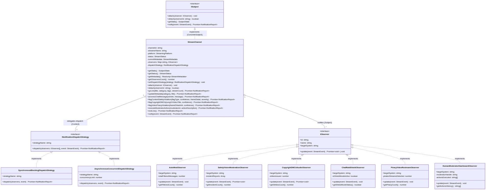
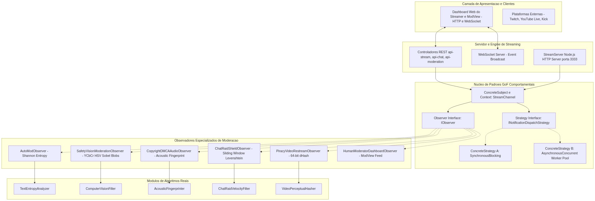
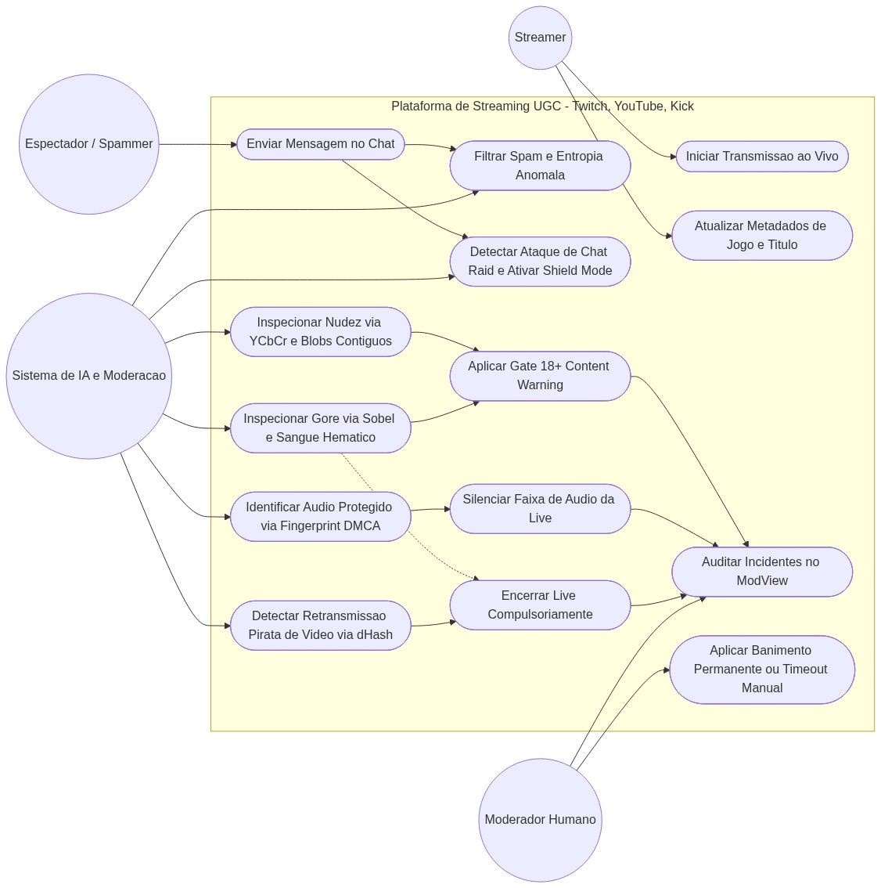

# Catálogo Completo de Diagramas de Arquitetura e Modelagem GoF

> **Disciplina:** Arquitetura e Desenho de Software (UnB Gama)  
> **Docente:** Profa. Dra. Milene Serrano  
> **SubEquipe 03:** Padrões Comportamentais GoF + IA Generativa  
> **Domínio:** Plataforma Multiplataforma de Streaming UGC (Twitch, YouTube Live, Kick) com Pipeline Reativo de Moderação  

Este documento reúne a especificação visual e formal completa de **todos os diagramas de engenharia de software** exigidos e recomendados na **Entrega 3**, disponibilizados em formato **PNG de alta resolução**, **vetorial SVG (resolução infinita)** e **código-fonte Mermaid**.

---

## 📑 Índice dos Diagramas em Arquivo

| # | Diagrama | Tipo UML | Arquivo PNG | Arquivo SVG |
| :-: | :--- | :--- | :--- | :--- |
| **1** | [**Classes GoF (Observer + Strategy)**](#1-diagrama-de-classes-uml-completo-gof-observer--strategy) | Estrutural GoF | [`diagrama_classes_gof.png`](diagrama_classes_gof.png) | [`diagrama_classes_gof.svg`](diagrama_classes_gof.svg) |
| **2** | [**Sequência (Pipeline de Moderação)**](#2-diagrama-de-sequência-uml-pipeline-reativo-de-moderação) | Comportamental | [`diagrama_sequencia_gof.png`](diagrama_sequencia_gof.png) | [`diagrama_sequencia_gof.svg`](diagrama_sequencia_gof.svg) |
| **3** | [**Máquina de Estados (Ciclo da Live)**](#3-diagrama-de-máquina-de-estados-uml-streamchannel) | Comportamental | [`diagrama_estados_gof.png`](diagrama_estados_gof.png) | [`diagrama_estados_gof.svg`](diagrama_estados_gof.svg) |
| **4** | [**Atividades (Pipeline Paralelo de IAs)**](#4-diagrama-de-atividades-uml-pipeline-paralelo-de-moderação) | Atividades / Processos | [`diagrama_atividades_pipeline.png`](diagrama_atividades_pipeline.png) | [`diagrama_atividades_pipeline.svg`](diagrama_atividades_pipeline.svg) |
| **5** | [**Componentes e Pacotes da Arquitetura**](#5-diagrama-de-componentes-e-pacotes-uml-arquitetura-do-sistema) | Arquitetural | [`diagrama_componentes_arquitetura.png`](diagrama_componentes_arquitetura.png) | [`diagrama_componentes_arquitetura.svg`](diagrama_componentes_arquitetura.svg) |
| **6** | [**Casos de Uso da Plataforma UGC**](#6-diagrama-de-casos-de-uso-uml-plataforma-ugc) | Casos de Uso | [`diagrama_casos_de_uso.png`](diagrama_casos_de_uso.png) | [`diagrama_casos_de_uso.svg`](diagrama_casos_de_uso.svg) |

---

## 📐 1. Diagrama de Classes UML Completo (GoF Observer + Strategy)

Modela o canal como `ConcreteSubject` e `Context`, os observadores de moderação com algoritmos reais e as estratégias de despacho síncrono e concorrente:

*Formatos:* [**Vetor SVG**](diagrama_classes_gof.svg) | [**Imagem PNG**](diagrama_classes_gof.png)

---

## 🔄 2. Diagrama de Sequência UML: Pipeline Reativo de Moderação

Modela o fluxo temporal de reações assíncronas a incidentes de Nudez/Gore, DMCA de Áudio e Vídeo, Chat Raids e Ação Humana:

*Formatos:* [**Vetor SVG**](diagrama_sequencia_gof.svg) | [**Imagem PNG**](diagrama_sequencia_gof.png)

---

## 🚦 3. Diagrama de Máquina de Estados UML (`StreamChannel`)

Modela as transições de estado do canal conforme as violações de moderação (`OFFLINE`, `LIVE`, `CONTENT_WARNING_RESTRICTED`, `AUDIO_MUTED_COPYRIGHT`, `TERMINATED_SAFETY_VIOLATION`, `ENDED`):

*Formatos:* [**Vetor SVG**](diagrama_estados_gof.svg) | [**Imagem PNG**](diagrama_estados_gof.png)

---

## ⚙️ 4. Diagrama de Atividades UML: Pipeline Paralelo de Moderação

Modela o fluxo concorrente de ingestão de stream e avaliação de regras das 4 IAs simultaneamente:

*Formatos:* [**Vetor SVG**](diagrama_atividades_pipeline.svg) | [**Imagem PNG**](diagrama_atividades_pipeline.png)

---

## 🧱 5. Diagrama de Componentes e Pacotes UML: Arquitetura do Sistema

Modela o desacoplamento de camadas: Camada Web Client, Servidor HTTP/WebSocket, Núcleo GoF Comportamental, Observadores de Moderação e Módulos de Algoritmos Reais:

*Formatos:* [**Vetor SVG**](diagrama_componentes_arquitetura.svg) | [**Imagem PNG**](diagrama_componentes_arquitetura.png)

---

## 👥 6. Diagrama de Casos de Uso UML: Plataforma UGC

Modela os atores primários (Streamer, Espectador/Spammer, Moderador Humano, Sistema de IA) e as 14 funcionalidades essenciais de transmissão e moderação:

*Formatos:* [**Vetor SVG**](diagrama_casos_de_uso.svg) | [**Imagem PNG**](diagrama_casos_de_uso.png)

