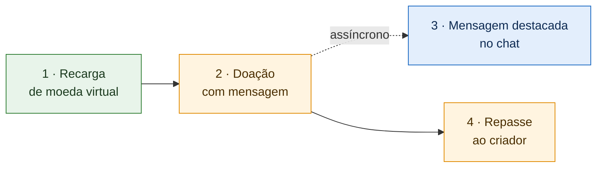

# Organização da Entrega 3 · SubEquipe_02

> **Tema**: Desenho de Software — Padrões de Projeto GoF (Padrões Estruturais) + IA Generativa.
> **Prazo interno**: 18/10/2026 · **Prazo oficial**: 19/10/2026.
> **Decisões vigentes**: [Ata S2_01](./ata-S2-01-2026-10-06.md) e [Ata S2_02](./ata-S2-02-2026-10-10.md).
> **Status**: 🟡 Em andamento

---

## 1. O que é a entrega

Não vamos implementar o sistema inteiro — sem banco de dados, sem servidor, sem interface gráfica completa.

Vamos **codificar uma história comum de uso da plataforma**, em TypeScript, inspirada nos diagramas de sequência da Entrega 2, e aplicar **padrões estruturais nos pontos onde existe um problema real de projeto**. Os diagramas das entregas anteriores continuam valendo como mapa do sistema: os padrões são a forma de organizar o código nesses pontos.

### O que cada frente entrega

| # | Entregável | Descrição | Obrigatório |
| -- | -- | -- | -- |
| 1 | **Diagrama** | Diagrama de classes do recorte da frente, com os papéis de cada padrão destacados | ✅ |
| 2 | **Código** | Implementação funcionando, no repositório único, com link direto | ✅ |
| 3 | **Vídeo** | Vídeo da frente em execução, narrado por quem implementou | ✅ |
| 4 | **Relato de IA** | Relato individual, crítico e fundamentado, sobre o uso de IA generativa (um por membro) | ✅ |
| 5 | **Teste** | Teste automatizado comprovando o comportamento do padrão | ⭐ Agrega à menção |

Além dos vídeos de cada frente, haverá **um vídeo geral** com a história completa em execução.

---

## 2. A história da demonstração

| Passo | O que acontece | Frente |
| -- | -- | -- |
| 1 | Espectador recarrega moeda virtual, pagando por um dos meios de pagamento disponíveis | 🟩 F1 |
| 2 | Espectador doa moeda virtual a um criador, junto com uma mensagem | 🟧 F2 |
| 3 | A mensagem aparece destacada no chat, com camadas visuais conforme o valor doado | 🟦 F3 |
| 4 | A moeda virtual doada é convertida em dinheiro e repassada à carteira do criador | 🟧 F2 |

**Regra do repasse**: o repasse ao criador é acionado pela própria doação, de forma independente da exibição no chat. A mensagem destacada é uma notificação assíncrona: se o chat falhar, a doação e o repasse continuam válidos, conforme o modelo da Entrega 2 e o achado SC04 ([Ata S2_02, D05](./ata-S2-02-2026-10-10.md)). Os passos 3 e 4 são, portanto, consequências paralelas da doação, e não uma sequência dependente.

**Fora do escopo, por ora**: o saque do criador. Ele é independente das demais etapas e, na plataforma de referência, ocorre por repasse periódico automático. Sua inclusão será reavaliada entre 14 e 15/10.

---

## 3. Frentes, padrões e justificativas

| Frente | Etapa | Problema real | Padrão | Responsável(is) | Evidência |
| -- | -- | -- | -- | -- | -- |
| 🟩 **F1** | Recarga | Cada meio de pagamento tem uma interface diferente, mas o sistema precisa tratá-los de forma uniforme | **Adapter** | Davi | O07 (NFR) · SQ11, SQ12 (ER) |
| 🟩 **F1** | Recarga | A confirmação de pagamento pode chegar duplicada ou falsificada e precisa ser barrada antes do crédito | **Proxy** | Davi | O11, O14 (NFR) |
| 🟩 **F1** | Recarga | O preço do pacote recebe desconto promocional, taxas e conversão de moeda, combinados de formas diferentes | **Decorator** | Davi | Descontos e preço com IVA observados na Entrega 1 (RN01) |
| 🟧 **F2** | Doação e Repasse | Uma operação simples de doação precisa, internamente, verificar a carteira, acionar o chat e realizar o repasse | **Facade** | Daniel e Pedro | Integração entre Monetização e Chat ([Ata S2_01](./ata-S2-01-2026-10-06.md)) |
| 🟧 **F2** | Repasse | A mesma doação não pode ser repassada duas vezes ao criador, mesmo que a operação seja reenviada | **Proxy** *(se aplicável)* | Daniel e Pedro | O11 (NFR) |
| 🟦 **F3** | Mensagem destacada | A mensagem destacada recebe camadas visuais — cor da faixa, fixação, emblema — combinadas conforme o valor doado | **Decorator** | Mateus | SC01, SC02 (ER) |

> **Legenda**: *NFR* = operacionalizações do NFR Framework (Entrega 1) · *ER* = achados da Engenharia Reversa (Entregas 1 e 2).

### Cobertura dos padrões estruturais

| Padrão | Situação | Justificativa |
| -- | -- | -- |
| Adapter | ✅ Adotado | F1 |
| Proxy | ✅ Adotado | F1, e F2 se aplicável |
| Decorator | ✅ Adotado | F1 (preço) e F3 (mensagem) — mesmo padrão resolvendo problemas distintos |
| Facade | ✅ Adotado | F2 |
| Flyweight | ❌ Não adotado | Caso teórico nos emotes do chat, mas sem necessidade real na história e com custo alto para o prazo |
| Bridge | ❌ Não adotado | Sem caso de uso consensual na história |
| Composite | ❌ Não adotado | Baixa utilidade para a história |

A justificativa dos padrões não adotados será registrada no senso crítico: reconhecer quando um padrão **não** se aplica também demonstra domínio do conteúdo.

---

## 4. Divisão de responsabilidades

| Membro | Frente | Responsabilidades |
| -- | -- | -- |
| **Davi Severiano Freitas** | 🟩 F1 · Recarga | Adapter, Proxy e Decorator do preço · criação do repositório · coordenação |
| **Daniel de Oliveira Lira** | 🟧 F2 · Doação e Repasse | Facade da doação · Proxy do repasse (se aplicável) · diagrama da frente antes do código |
| **Pedro Henrique Freire Rodrigues** | 🟧 F2 · Doação e Repasse | Facade da doação · Proxy do repasse (se aplicável) · diagrama da frente antes do código |
| **Mateus Rodrigues Barreto** | 🟦 F3 · Mensagem destacada | Decorator da mensagem destacada |
| **Todos** | — | Diagrama, código e vídeo da própria frente · relato individual de IA · revisão cruzada |

A divisão **não é estanque**: todos trabalham no mesmo repositório e podem colaborar com as demais frentes.

---

## 5. Cronograma

| Data | Meta | Responsável |
| -- | -- | -- |
| **11/10** | Repositório único criado e documento de organização atualizado | Davi |
| **13/10** | 🗓️ Reunião às 21h — início do desenho de cada padrão; diagrama da F2 com estrutura e comunicação definidas | Todos |
| **15/10** | 🗓️ Reunião — diagramas prontos e código iniciado · reavaliação do saque | Todos |
| **16/10** | 🗓️ Reunião — código implementado e planejamento dos vídeos | Todos |
| **17/10** | Integração das frentes, gravação dos vídeos de cada frente e do vídeo geral | Todos |
| **18/10** | Relatos de IA finalizados e publicação | Todos |
| **19/10** | Entrega oficial | — |

---

## 6. Estudo

Cada membro estuda os padrões da própria frente na seção de Padrões Estruturais do [Refactoring Guru](https://refactoring.guru/pt-br/design-patterns/structural-patterns).

| Frente | Padrões a estudar |
| -- | -- |
| F1 | Adapter, Proxy e Decorator |
| F2 | Facade e Proxy |
| F3 | Decorator |

Para a fundamentação teórica do relatório, citamos a obra original:

> GAMMA, Erich; HELM, Richard; JOHNSON, Ralph; VLISSIDES, John. **Padrões de Projeto: soluções reutilizáveis de software orientado a objetos**. Porto Alegre: Bookman, 2000.

---

## 7. Regras

| Regra | Detalhe |
| -- | -- |
| **Linguagem** | TypeScript |
| **Repositório** | Único, compartilhado por todas as frentes |
| **Escopo** | Dados em memória; meios de pagamento externos simulados (mocks) |
| **Anonimização** | Nada do nome real da plataforma nem de nomes proprietários de recursos. Usar `<plataforma>`, "moeda virtual" e "mensagem paga destacada" — inclusive em nomes de variáveis, arquivos e mensagens de commit |
| **Rastreabilidade** | Toda classe nova referencia uma classe, um achado ou uma operacionalização já documentada |
| **Escopo da categoria** | Padrões criacionais e comportamentais pertencem às Subequipes 1 e 3; se surgirem naturalmente no código, são citados como colaboração, e não como entregáveis desta subequipe |

---

## 8. Pendências

| # | Pendência | Prazo |
| -- | -- | -- |
| P01 | Reavaliação da inclusão do saque do criador | 15/10 |
| P02 | Confirmação do uso de Proxy na F2 | 13/10 |
| P03 | Horário das reuniões de 15 e 16/10 | A combinar |

---

## Histórico de Versões

| Versão | Data | Descrição | Autor(es) | Revisor(es) |
| -- | -- | -- | -- | -- |
| 1.0 | 10/10/2026 | Criação do documento de organização da Entrega 3, com escopo, integração, divisão de padrões e cronograma | Davi Severiano Freitas | |
| 1.1 | 10/10/2026 | Substituição dos nomes por frentes de trabalho; novo fluxo da demonstração; remoção do bloqueio de mensagens; inclusão do Composite opcional| Davi Severiano Freitas | |
| 1.2 | 10/10/2026 | Atualização com as decisões da Reunião S2_02: história em quatro etapas, repasse independente da exibição no chat, saque fora do escopo, padrões adotados (Adapter, Proxy, Decorator e Facade), divisão em três frentes com responsáveis e novo cronograma de reuniões | Davi Severiano Freitas | |