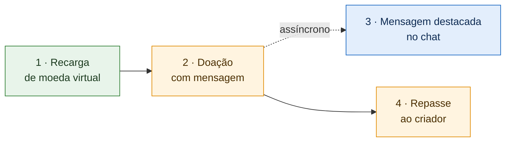

# Organização da Entrega 3 · SubEquipe_02

> **Tema**: Desenho de Software — Padrões de Projeto GoF (Padrões Estruturais) + IA Generativa.
>
> **Prazo interno**: 18/10/2026 · **Prazo oficial**: 19/10/2026.
>
> **Decisões vigentes**: [Ata S2_01](./ata-S2-01-2026-10-06.md), [Ata S2_02](./ata-S2-02-2026-10-10.md), [Ata S2_03](./ata-S2-03-2026-10-13.md), [Ata S2_04](./ata-S2-04-2026-10-16.md) e [Ata S2_05](./ata-S2-05-2026-10-18.md).
>
> **Status**: 🟢 Concluída — código das três frentes e front-end integrados na `main`; vídeos de todas as frentes e vídeo geral publicados; relatos de IA dos quatro integrantes e README final da subequipe concluídos.

---

## 1. O que é a entrega

Não vamos implementar o sistema inteiro — sem banco de dados e sem servidor de produção.

Vamos **codificar uma história comum de uso da plataforma**, em TypeScript, inspirada nos diagramas de sequência da Entrega 2, e aplicar **padrões estruturais nos pontos onde existe um problema real de projeto**. Os diagramas das entregas anteriores continuam valendo como mapa do sistema: os padrões são a forma de organizar o código nesses pontos.

### O que cada frente entrega

| # | Entregável | Descrição | Obrigatório |
| -- | -- | -- | -- |
| 1 | **Diagrama** | Diagrama de classes UML do recorte da frente, com os papéis de cada padrão destacados ([Ata S2_03](./ata-S2-03-2026-10-13.md)) | ✅ |
| 2 | **Código** | Implementação funcionando, no repositório único, com link direto | ✅ |
| 3 | **Vídeo** | Vídeo da frente, narrado por quem implementou, com conceito, diagrama, código e execução, gravado após a integração e incorporado à página da frente ([Ata S2_04, D03](./ata-S2-04-2026-10-16.md); [Ata S2_05, D05](./ata-S2-05-2026-10-18.md)) | ✅ |
| 4 | **Relato de IA** | Relato individual, crítico e fundamentado, sobre o uso de IA generativa (um por membro) | ✅ |
| 5 | **Teste** | Teste automatizado comprovando o comportamento do padrão | ⭐ Pode agregar à menção |

Cada frente tem o seu vídeo; não haverá vídeo geral ([Ata S2_05, D05](./ata-S2-05-2026-10-18.md)). A F1 dividiu o seu em três vídeos, um por padrão, cada um com a execução no front-end.

---

## 2. A história da demonstração

| Passo | O que acontece | Frente |
| -- | -- | -- |
| 1 | Espectador recarrega moeda virtual, escolhendo o meio de pagamento no modal | 🟩 F1 |
| 2 | Espectador doa moeda virtual a um criador, junto com uma mensagem | 🟧 F2 |
| 3 | A mensagem aparece destacada no chat, com camadas visuais conforme o valor doado | 🟦 F3 |
| 4 | A moeda virtual doada é convertida em dinheiro e repassada à carteira do criador | 🟧 F2 |

**Regra do repasse**: o repasse ao criador é acionado pela própria doação, de forma independente da exibição no chat. A mensagem destacada é uma notificação assíncrona: se o chat falhar, a doação e o repasse continuam válidos, conforme o modelo da Entrega 2 e o achado SC04 ([Ata S2_02, D05](./ata-S2-02-2026-10-10.md)). Os passos 3 e 4 são, portanto, consequências paralelas da doação, e não uma sequência dependente.

**Fora do escopo**: o saque do criador. Ele é independente das demais etapas e, na plataforma de referência, ocorre por repasse periódico automático. Sua exclusão definitiva do escopo foi decidida em 17/10.

---

## 3. Frentes, padrões e justificativas

| Frente | Etapa | Problema real | Padrão | Responsável(is) | Evidência |
| -- | -- | -- | -- | -- | -- |
| 🟩 **F1** | Recarga | O preço do pacote recebe desconto promocional, taxa e imposto, combinados de formas diferentes | **Decorator** | Davi | RN01 (ER, Entrega 1) |
| 🟩 **F1** | Recarga | Os processadores de pagamento têm interfaces diferentes, mas o sistema precisa tratá-los de forma uniforme, deixar o espectador escolher o meio e reagir à indisponibilidade | **Adapter** | Davi | O07 (NFR) · B9 (BPMN) · SQ11, SQ12 (ER) |
| 🟩 **F1** | Recarga | A confirmação de pagamento pode chegar duplicada ou falsificada e precisa ser barrada antes do crédito | **Proxy** | Davi | O11, O14 (NFR) |
| 🟧 **F2** | Doação e Repasse | Uma operação simples de doação precisa, internamente, verificar a carteira, acionar o chat e realizar o repasse | **Facade** | Daniel e Pedro | Integração entre Monetização e Chat ([Ata S2_01](./ata-S2-01-2026-10-06.md)) |
| 🟧 **F2** | Doação e Repasse | A orquestração entre o serviço financeiro e o chat não deve acoplar esses dois serviços entre si | **Mediator** *(extra, comportamental)* | Daniel e Pedro | [Ata S2_04, D01](./ata-S2-04-2026-10-16.md) |
| 🟦 **F3** | Mensagem destacada | A mensagem destacada recebe camadas visuais — cor da faixa, fixação, limite de caracteres — combinadas conforme o valor doado | **Decorator** | Mateus | SC01, SC02 (ER) |

> **Legenda**: *NFR* = operacionalizações do NFR Framework (Entrega 1) · *ER* = achados da Engenharia Reversa (Entregas 1 e 2) · *BPMN* = BPMN de compra (Entrega 1).

**Proxy na F2.** Previsto na [Ata S2_02](./ata-S2-02-2026-10-10.md) para evitar repasse duplicado, foi descartado após orientação da professora: a forma planejada usava a interface do objeto protegido, mas não a implementava, e por isso não era um Proxy ([Ata S2_04, D01](./ata-S2-04-2026-10-16.md)).

### Cobertura dos padrões

| Padrão | Categoria | Situação | Onde |
| -- | -- | -- | -- |
| Adapter | Estrutural | ✅ Adotado | F1 |
| Proxy | Estrutural | ✅ Adotado | F1 (descartado na F2) |
| Decorator | Estrutural | ✅ Adotado | F1 (preço) e F3 (mensagem) — mesmo padrão resolvendo problemas distintos |
| Facade | Estrutural | ✅ Adotado | F2 |
| Mediator | **Comportamental** | ⭐ Extra | F2 — registrado como colaboração fora da categoria da subequipe (§7) |
| Flyweight | Estrutural | ❌ Não adotado | Caso teórico nos emotes do chat, sem necessidade real na história e com custo alto para o prazo |
| Bridge | Estrutural | ❌ Não adotado | Sem caso de uso consensual na história |
| Composite | Estrutural | ❌ Não adotado | Baixa utilidade para a história |

A justificativa dos padrões não adotados será registrada no senso crítico: reconhecer quando um padrão **não** se aplica também demonstra domínio do conteúdo.

### Iniciativas extras

A [Ata S2_03](./ata-S2-03-2026-10-13.md) reservou os dias finais para extras. As iniciativas efetivamente realizadas ou em andamento:

| Iniciativa | Frente | Situação |
| -- | -- | -- |
| Integração com processadores de pagamento **reais em modo de teste** (Mercado Pago e Stripe) atrás do mesmo Adapter | F1 | ✅ Concluída |
| Mediator aliado à Facade | F2 | ✅ Concluída |
| Testes automatizados em todas as frentes | Todas | ✅ Concluída |
| Integração da história completa e front-end (página web com recarga, doação e chat) | Integração | ✅ Concluída em 18/10 ([PR #4](https://github.com/UnBArqDsw2026-2-Turma01/2026.2-T01-_G6_ProjetoStreamingVideo_SubEquipe02_Codigo/pull/4)) |

---

## 4. Divisão de responsabilidades

| Membro | Frente | Responsabilidades |
| -- | -- | -- |
| **Davi Severiano Freitas** | 🟩 F1 · Recarga | Decorator, Adapter e Proxy · processadores reais em modo de teste · criação do repositório · coordenação · README final da subequipe ([Ata S2_05, D04](./ata-S2-05-2026-10-18.md)) |
| **Daniel de Oliveira Lira** | 🟧 F2 · Doação e Repasse | Implementação da Facade e do Mediator · revisão dos diagramas da F1 · molde da página de IA Generativa · README da subequipe ([Ata S2_04](./ata-S2-04-2026-10-16.md)) |
| **Pedro Henrique Freire Rodrigues** | 🟧 F2 · Doação e Repasse | Diagrama da Facade e do Mediator · diagrama integrado ([Ata S2_05, D03](./ata-S2-05-2026-10-18.md)) · consulta à professora sobre o Proxy da F2 · página da F2 |
| **Mateus Rodrigues Barreto** | 🟦 F3 · Mensagem destacada | Decorator da mensagem destacada · integração do código e front-end ([Ata S2_04, D02](./ata-S2-04-2026-10-16.md)) |
| **Todos** | — | Diagrama, código, vídeo e página da própria frente · relato individual de IA · revisão cruzada · referências |

A divisão **não é estanque**: todos trabalham no mesmo repositório e podem colaborar com as demais frentes.

---

## 5. Cronograma

| Data | Meta | Responsável | Situação |
| -- | -- | -- | -- |
| **11/10** | Repositório único criado | Davi | ✅ Concluído em 13/10 |
| **13/10** | Reunião S2_03 — acompanhamento e ajuste de prazos | Todos | ✅ Realizada |
| **15/10** | Diagramas **e código** de todas as frentes ([Ata S2_03, D01](./ata-S2-03-2026-10-13.md)) | Cada frente | ✅ F1 em 15/10 · F3 em 16/10 · F2 em 17/10 |
| **16/10** | Reunião S2_04 — apresentação do código e definição da F2 | Todos | ✅ Realizada (adiada de 15/10, 21h) |
| **17/10** | Pull requests da F2 e da F3 · molde da página de IA Generativa | Daniel, Pedro e Mateus | ✅ PRs integrados · ✅ molde de IA concluído |
| **18/10, 12h** | Integração do código e front-end ([Ata S2_04, D02](./ata-S2-04-2026-10-16.md)) | Mateus | ✅ Concluída em 18/10 |
| **18/10** | Reunião S2_05 — revisão do front-end, dos diagramas e organização dos vídeos | Todos | ✅ Realizada |
| **18/10, 20h** | Vídeos (após a integração), páginas das frentes, relatos de IA e referências | Todos | ✅ Vídeos da F1 (18/10) e da F3 (19/10) · ✅ referências · ✅ vídeo da F2 (19/10), relatos de IA e página da F2|
| **19/10** | README final da subequipe ([Ata S2_05, D04](./ata-S2-05-2026-10-18.md)) e entrega oficial | Davi | ✅ Concluída em 19/10 |

---

## 6. Estudo

Cada membro estuda os padrões da própria frente, com apoio do livro do GoF, dos slides e vídeos da disciplina e de material complementar.

| Frente | Padrões a estudar |
| -- | -- |
| F1 | Decorator, Adapter e Proxy |
| F2 | Facade e Mediator |
| F3 | Decorator |

Para a fundamentação teórica do relatório, citamos a obra original:

> GAMMA, Erich; HELM, Richard; JOHNSON, Ralph; VLISSIDES, John. **Padrões de Projeto: soluções reutilizáveis de software orientado a objetos**. Porto Alegre: Bookman, 2000.

---

## 7. Regras

| Regra | Detalhe |
| -- | -- |
| **Linguagem** | TypeScript (Node.js 20.12 ou superior) |
| **Repositório** | Único, compartilhado por todas as frentes; integração na `main` por pull request |
| **Escopo** | Dados em memória; processadores de pagamento simulados nos testes, e reais apenas em modo de teste nos demos |
| **Anonimização** | Nada do nome real da plataforma nem de nomes proprietários de recursos. Usar `<plataforma>`, "moeda virtual" e "mensagem paga destacada" — inclusive em nomes de variáveis, arquivos e mensagens de commit |
| **Rastreabilidade** | Toda classe nova referencia uma classe, um achado ou uma operacionalização já documentada |
| **Escopo da categoria** | Padrões criacionais e comportamentais pertencem às Subequipes 1 e 3; se surgirem no código, como o Mediator da F2, são citados como extra ou colaboração, e não como entregáveis desta subequipe |

---

## 8. Pendências

Não há pendências em aberto.

Pendências resolvidas desde a versão anterior: o vídeo da F2, os relatos de IA Generativa de Daniel, Pedro e Mateus, os links do código na página da F2 e o README final da subequipe, com o vídeo geral e o catálogo dos vídeos (19/10).

---

## Histórico de Versões

| Versão | Data | Descrição | Autor(es) | Revisor(es) |
| -- | -- | -- | -- | -- |
| 1.0 | 10/10/2026 | Criação do documento de organização da Entrega 3, com escopo, integração, divisão de padrões e cronograma | Davi Severiano Freitas | |
| 1.1 | 10/10/2026 | Substituição dos nomes por frentes de trabalho; novo fluxo da demonstração; remoção do bloqueio de mensagens; inclusão do Composite opcional | Davi Severiano Freitas | |
| 1.2 | 10/10/2026 | Atualização com as decisões da Reunião S2_02: história em quatro etapas, repasse independente da exibição no chat, saque fora do escopo, padrões adotados (Adapter, Proxy, Decorator e Facade), divisão em três frentes com responsáveis e novo cronograma de reuniões | Davi Severiano Freitas | |
| 1.3 | 17/10/2026 | Atualização com as decisões das Reuniões S2_03 e S2_04: prazo do código em 15/10, Proxy descartado na F2, Mediator como extra comportamental, exclusão definitiva do saque e validação da mudança no O07 da F1 decididas em 17/10, integração e front-end com Mateus, vídeos após a integração, extras realizados, mudanças da F1 (sem conversão de moeda, escolha do meio e processadores reais) e novas pendências | Davi Severiano Freitas | |
| 1.4 | 19/10/2026 | Atualização com a Reunião S2_05: um vídeo por frente, sem vídeo geral (a F1 com um vídeo por padrão); integração e front-end concluídos; novas responsabilidades (README final e diagrama integrado); cronograma e pendências da reta final | Davi Severiano Freitas | |
| 1.5 | 19/10/2026 | Atualização do status das tarefas do cronograma | Davi Severiano Freitas | |
| 1.6 | 19/10/2026 | Fechamento da entrega: status final e todas as pendências resolvidas (vídeo da F2, relatos de IA, links da página da F2 e README final) | Davi Severiano Freitas | |